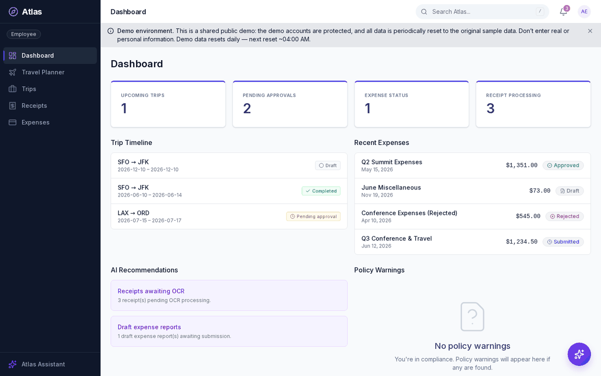
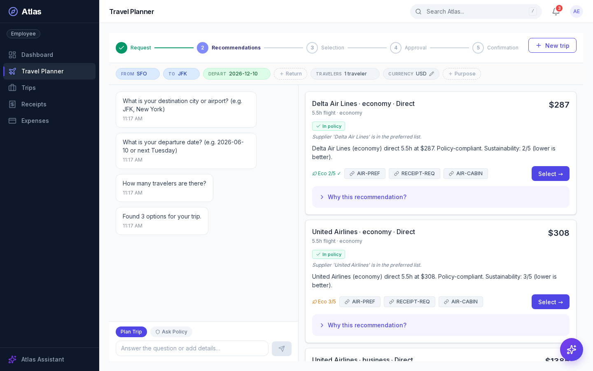
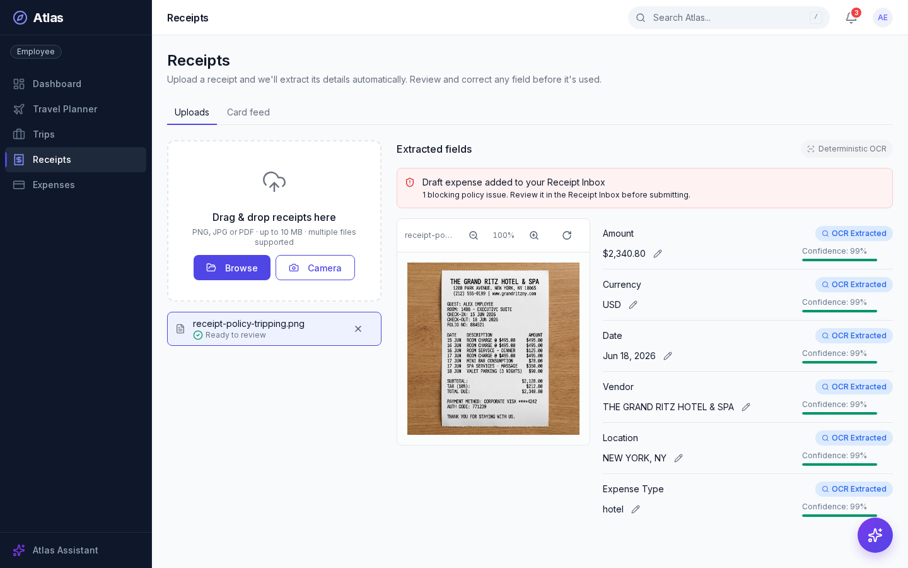
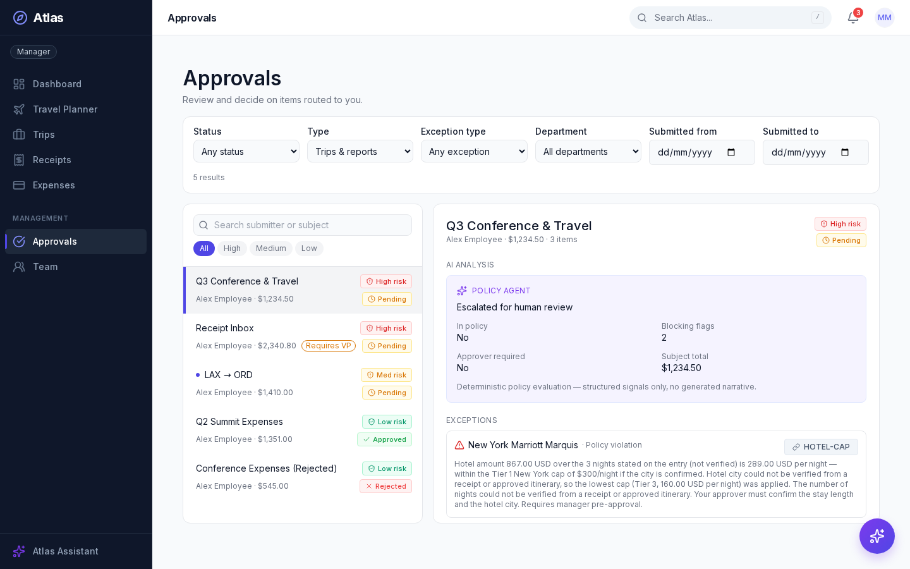
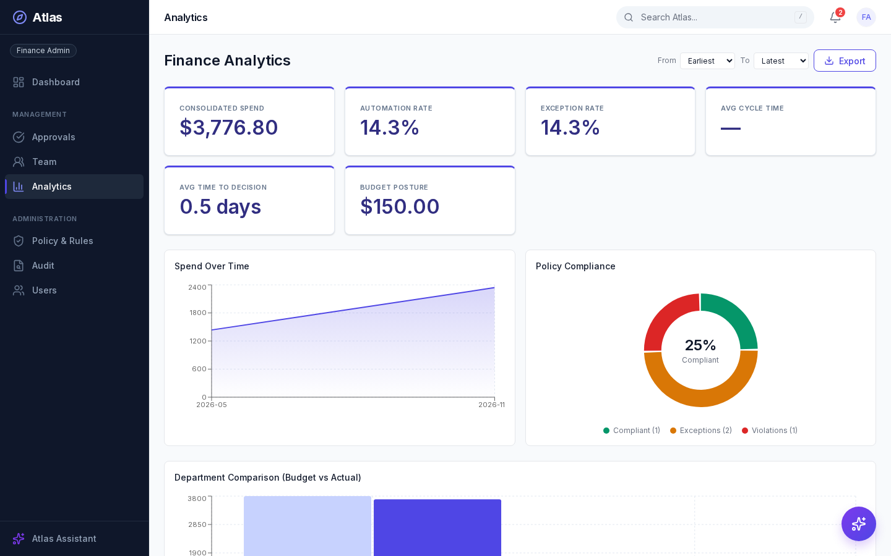
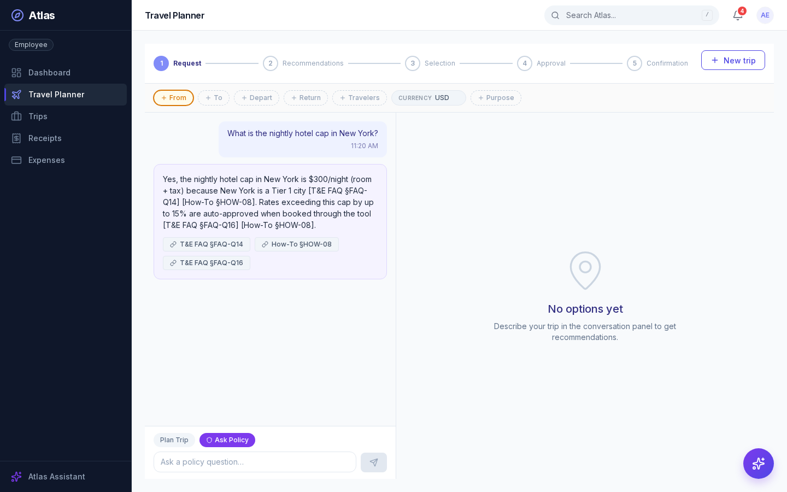
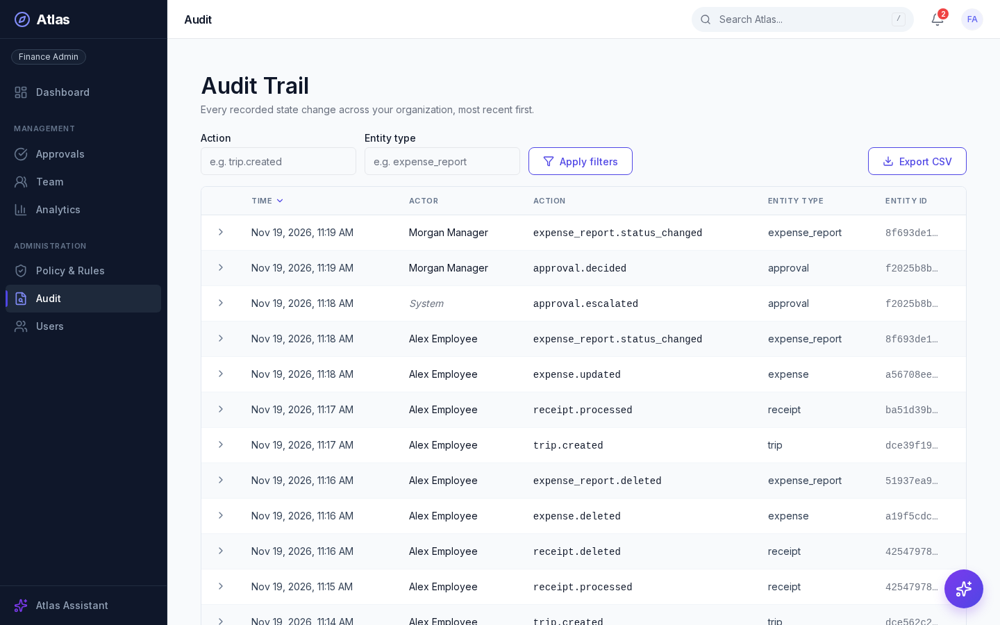
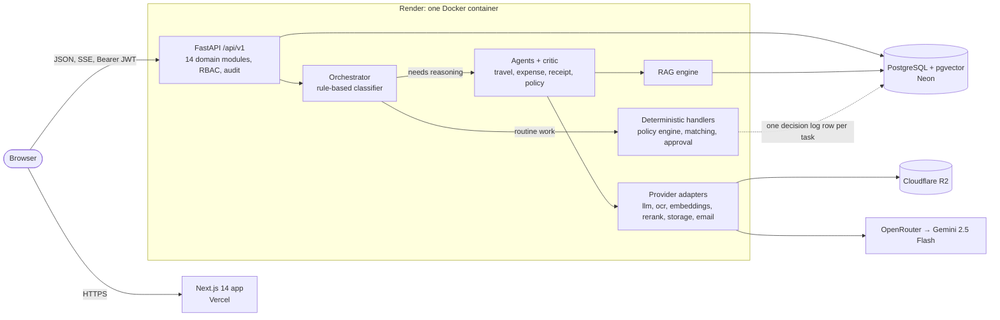
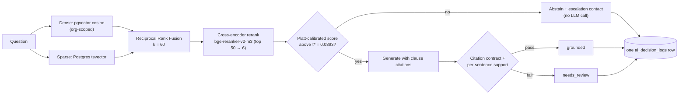
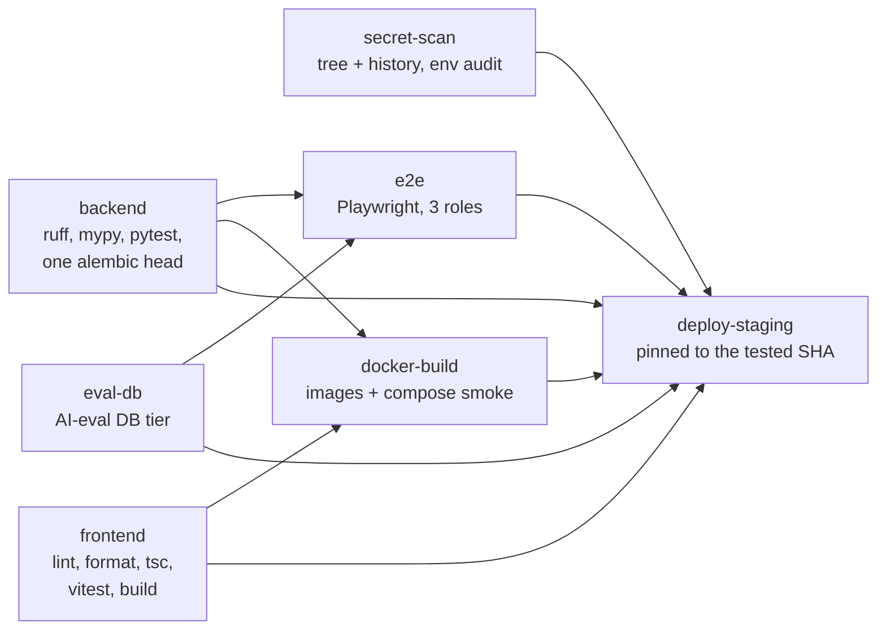

<div align="center">

# Atlas — AI-Powered Travel & Expense Copilot

**A hands-on, end-to-end engineering study of how an enterprise travel-and-expense suite like SAP Concur works: plan a policy-checked itinerary → capture receipts → assemble → approve → reimburse → audit (booking and payment are simulated), with an AI layer where every decision is logged and can be checked.**

[](https://github.com/GarvSingh791/atlas-concur-ai/actions/workflows/ci.yml)
[](https://atlas-concur-ai.vercel.app)
[](LICENSE)


**[Live demo](https://atlas-concur-ai.vercel.app)** · **[Architecture](docs/ARCHITECTURE.md)** · **[RAG engine](docs/RAG/README.md)** · **[Product docs](docs/README.md#product)** · **[Test report](docs/quality/TESTING.md)** · **[Docs hub](docs/README.md)**

<sub>Independent engineering study inspired by SAP Concur — not affiliated with or endorsed by SAP. All data is synthetic. <a href="#disclaimer">Full disclaimer</a></sub>

</div>

## At a glance

| | |
|---|---|
| **Problem** | Travel and expense work is slow and error-prone. Receipts are re-keyed by hand, policy violations surface after the money is spent, and finance sees spend weeks after the trip. Putting AI into a workflow that moves money adds a second problem: every automated decision has to be explainable and auditable. |
| **What I built** | A full-stack T&E app for three roles (employee, manager, finance admin). A FastAPI backend with **14 domain modules** and **80 `/api/v1` endpoints**; a Next.js 14 frontend; PostgreSQL + pgvector with **25 Alembic migrations**; a deterministic policy engine (24 active rules enforcing 29 clauses of a synthetic policy); routed AI agents for travel, expenses, receipts, policy and approvals, checked by a critic; and a hybrid **RAG engine** that answers policy questions with clause citations or abstains. |
| **Results** | RAG recall@10 **0.819** on the deterministic, CI-gated path → **0.959** with a live cross-encoder; **0.981** LLM-judged faithfulness at **74%** grounded coverage (108/145); calibrated abstention roughly halves selective risk on the same queries (AURC **0.088 → 0.047**, cosine vs. reranker signal). **4,225** hermetic + **2,069** database-backed pytest tests, **968** Vitest tests, and a **7-job** CI that deploys only the commit it tested. |
| **My role** | Sole engineer — product spec, architecture, implementation, testing, deployment and operations. Author: **Garv Singh Saini**. |

## See it

<p align="center">
  
</p>

<p align="center"><sub>About 73 seconds: plan a trip, upload a receipt that trips HOTEL-CAP, justify and submit, approve as manager, review as finance, then ask one in-scope and one out-of-scope policy question. <a href="docs/assets/atlas-demo-poster.png">Still frame</a>.</sub></p>

<table>
  <tr>
    <td width="50%"><a href="docs/assets/screenshots/01-planner.png"></a><br><sub><b>Planner.</b> Options carry an in-policy badge and the clauses they were checked against (AIR-PREF, RECEIPT-REQ, AIR-CABIN).</sub></td>
    <td width="50%"><a href="docs/assets/screenshots/02-receipt-ocr.png"></a><br><sub><b>Receipt OCR.</b> Vision OCR of a sample hotel receipt: fields with per-field confidence and provenance; the draft expense lands in the Receipt Inbox with one blocking policy issue.</sub></td>
  </tr>
  <tr>
    <td width="50%"><a href="docs/assets/screenshots/03-manager-approval.png"></a><br><sub><b>Manager approval.</b> A hotel line flagged against HOTEL-CAP and escalated for human review, with the clause and the reason shown.</sub></td>
    <td width="50%"><a href="docs/assets/screenshots/04-finance-analytics.png"></a><br><sub><b>Finance analytics.</b> Spend, automation and exception rates, policy compliance, department budget against actual.</sub></td>
  </tr>
  <tr>
    <td width="50%"><a href="docs/assets/screenshots/05-policy-answer.png"></a><br><sub><b>Policy answer.</b> "What is the nightly hotel cap in New York?" answered from the policy corpus with clause citations (FAQ-Q14, HOW-08, FAQ-Q16).</sub></td>
    <td width="50%"><a href="docs/assets/screenshots/06-audit-trail.png"></a><br><sub><b>Audit trail.</b> Every recorded state change, most recent first, filterable and exportable as CSV.</sub></td>
  </tr>
</table>

Captured from the live staging demo with Gemini (via OpenRouter) on 2026-11-19, signed in as the demo accounts; nothing edited after capture ([how they were captured](docs/assets/README.md)).

## Try it in 2 minutes

### Demo accounts

The password is a **public demo value**, published on purpose; the accounts hold only seeded, synthetic data. On staging, `DEMO_MODE=true` stops visitors editing or deactivating the seeded accounts or archiving the seeded rules.

| Role | Email | Password | Good things to try |
|---|---|---|---|
| Employee | `employee@atlas-demo.internal` | `change-me-seed-password` | Plan a trip, upload a receipt, add mileage, submit a report, withdraw a returned report, ask a policy question |
| Manager | `manager@atlas-demo.internal` | `change-me-seed-password` | Work the approval queue, read exception citations, open the Team view, reverse an auto-approval |
| Finance admin | `finance@atlas-demo.internal` | `change-me-seed-password` | Mark a report reimbursed, filter and export approvals, analytics, policy rules and their history, the audit trail, Users admin |

The optional organisation code on the login page is `atlas-demo-corp`; email and password alone also work. The seed also creates `manager2@` and `employee2@atlas-demo.internal` with the same password.

> [!NOTE]
> The backend runs on Render's free tier and sleeps after about 15 minutes idle, so the first request can take two to three minutes (measured 100–152 s); the sign-in page says when it is waking the server. Visitors share these accounts, so the demo organisation is reset to its seed data daily (about 04:00 UTC).

### The five-step tour

1. **Employee:** open **Travel Planner** and ask for a trip, for example a few days from San Francisco to New York. Compliance ranks above price, and out-of-policy options are labelled, not hidden.
2. **Employee:** open **Receipts** and upload [`receipt-policy-tripping.png`](docs/assets/sample-receipts/receipt-policy-tripping.png) (a New York hotel folio above the $300 nightly cap) and [`receipt-compliant.png`](docs/assets/sample-receipts/receipt-compliant.png). Vision OCR fills the fields, each with a confidence value and a provenance badge. Add both to a report in **Expenses**. The hotel line is a blocking HOTEL-CAP violation, so Submit stays disabled until you click **Add justification** on that line; then submit.
3. **Manager:** open **Approvals**. The report appears with its policy flags and the clause each one cites. Approve, return or reject it with a reason.
4. **Finance admin:** open **Analytics** for the org KPIs, then **Audit** for the append-only trail of what just happened. On an approved report, **Mark reimbursed** (a simulated payment).
5. **Any role:** ask the policy assistant "What is the company stock price today?". It says the policy is silent and names an escalation contact instead of guessing. Ask "What is the nightly hotel cap in New York?" for a grounded answer with a clause citation.

<details>
<summary><b>What each role can do</b></summary>

| Role | Features |
|---|---|
| **Employee** | Conversational planner (editable intent chips, one follow-up question, policy-checked ranked options, advance-booking and lowest-fare notices); trips with completion and withdrawal; receipt capture (PNG, JPEG, WebP or PDF) with OCR, itinerary-grounded gap-fill and per-field provenance; expense reports with smart matching of receipts, card transactions and trip segments, pre-submit policy check and justifications; mileage with a live estimate; foreign-currency conversion at simulated static rates; withdraw and re-file; policy Q&A with citations |
| **Manager** | Approval queue with exception cards and clause citations; approve, reject or request changes (a reason is required to deny); reverse an auto-approval until reimbursement; Team view with spend and drill-down; the employee features for their own travel |
| **Finance admin** | Org-wide approval oversight with filters and CSV export; simulated reimbursement (`REIMB-<date>-<id>`); analytics including cycle time and time to decision; policy rules by clause, rule authoring from plain language (LLM draft → critic → saved as draft → a human activates), per-rule history; audit trail with CSV export; Users admin with invitations and traveller grades |

Every role also gets a role-shaped dashboard, account recovery, a notification bell, global search and the policy assistant. Requirement-by-requirement evidence is in the [traceability matrix](docs/product/requirements-traceability.md).
</details>

## How SAP Concur concepts map to Atlas

I studied SAP Concur's public product material to decide what Atlas should model. Each concept maps to a part of Atlas, with deliberate simplifications:

| Concur concept | Atlas equivalent | What Atlas simplifies |
|---|---|---|
| Concur Travel | Conversational Travel Planner | Mock inventory, no ticketing |
| Concur Request / travel policy | Trip approval + planner policy checks | Approval after selection, not a separate request object |
| Concur Expense | Expense reports with smart match and pre-submit check | One policy, one org per login |
| ExpenseIt / Receipt Analysis Agent | Receipt pipeline with routed gap-fill | Vision OCR through an LLM provider or a local stub |
| Audit rules / pre-submit audit | Deterministic policy engine (24 active rules) | Synthetic policy, no human audit service |
| Approval workflow | LLM-free approval agent + manager/finance queue | Single deciding approver, no delegates |
| Reimbursement | "Mark reimbursed" with a `REIMB-…` reference | No money moves |
| Joule-style assistant and agents | Orchestrator + agents + RAG policy assistant | Web app only, four task routes |

Full map with code paths: [concur-to-atlas-map.md](docs/product/concur-to-atlas-map.md). Background: [domain study of SAP Concur](docs/product/domain-study-sap-concur.md), built from public sources only.

<details>
<summary><b>Policy engine: clauses enforced</b></summary>

The rule engine (`ai_agents/tools/policy_eval.py` plus the `entry_rules`, `process_rules` and `fx_policy` tools) evaluates 24 active structured rules that enforce 29 clauses of the synthetic Helios Dynamics TEP-FY26 policy. The RAG corpus quotes the same figures (`database/seeds/corpus/figures.py`).

| Area | Clauses |
|---|---|
| Air | AIR-CABIN, AIR-PREF, AIR-04 (business class for SVP and above on flights over 6 h), AIR-06 (lowest logical fare), AIR-07 (early boarding and lounge fees) |
| Lodging | HOTEL-CAP / LOD-01 (Tier 1 incl. New York $300, Tier 2 $225, Tier 3 $160), LOD-02, HOTEL-PREF, LOD-05 (standard room only) |
| Meals | MEALS-PD / MEAL-01 ($85 / $75 / $65 per day), MEAL-02, MEAL-04, MEAL-05 |
| Ground, entertainment, other | GROUND-CLASS, GRND-01, GRND-03, GRND-05, ENT-02, ENT-04, NR-01 |
| Mileage and process | MIL-01..03, RECEIPT-REQ, EXP-04, EXP-01, PTA-02, PTA-05, CARD-03 |

Grade rules read the expense owner's grade of record (`config/constants/grades.py`); a missing grade never grants an exception. A rule that cannot be verified (unsupported currency, unknown grade) escalates to a human instead of passing.
</details>

## Architecture

Atlas is a modular monolith: one Docker container on Render runs the API, the AI layer and the provider adapters as Python packages, with one-way layering `services` ← `ai_agents` ← `backend`.



Three decisions shaped most of the code:

- **Modular monolith, not microservices** ([ADR 0001](docs/adr/0001-modular-monolith.md)). One deploy, one transaction boundary, explicit module boundaries. `ai_agents/tests/test_no_backend_import.py` guards the layering.
- **Deterministic core; the LLM is a routed exception** ([ADR 0003](docs/adr/0003-deterministic-core-routed-agents.md)). A rule-based classifier (no LLM call) keeps a task deterministic when confidence is ≥ 0.75 and no reasoning is needed; only the rest go to an agent and a critic. The approval agent has no LLM at all: it auto-approves only an in-policy trip or report with a known total of $500 or less, and never auto-rejects ([ADR 0004](docs/adr/0004-llm-free-approval-agent.md)).
- **Provider adapters with deterministic local fallbacks** ([ADR 0002](docs/adr/0002-provider-adapters-with-local-fallbacks.md)). LLM, OCR, embeddings, rerank, storage and email are each chosen by a `*_PROVIDER` variable, and each defaults to a no-network implementation (`local`, or `console` for email), so CI and the Playwright suite run with no keys and no network.

More: [ARCHITECTURE.md](docs/ARCHITECTURE.md) (containers, request lifecycle, code map, invariants with their tests) · [design docs](docs/design/) · [all ADRs](docs/adr/README.md).

## RAG engine

Policy questions are answered over a synthetic four-document corpus for a fictional company (219 units today: policy, FAQ, how-to, quick reference). Generation is grounded on the enclosing section, and citations point at the exact clause.



| Metric (197-query gold set: 145 answerable + 52 unanswerable) | Dense baseline | Hybrid + RRF (local, CI-gated) | + Cross-encoder (keyed) |
|---|:-:|:-:|:-:|
| recall@10 | 0.727 | 0.819 | **0.959** |
| nDCG@5 | — | 0.658 | **0.873** |
| MRR | 0.679 | 0.760 | **0.924** |
| AURC (lower is better) | 0.101 | 0.084 | **0.047** ¹ |
| Faithfulness | — | — | **0.981 @ 74% grounded** (108/145) |

How measured: recall@10, nDCG@5 and MRR are over the 145 answerable questions, faithfulness over the 108 of them that were answered as grounded, and the local AURC values over all 197. The local column is byte-reproducible and gated in CI; the keyed column comes from hand-run evaluations with a hosted `bge-reranker-v2-m3` and Gemini via OpenRouter. All figures were measured on the earlier 208-unit corpus; the 11 units added since moved no gold unit in or out of any top-10. The public staging deployment runs the local embedder and reranker, so it does not reproduce the keyed column. ¹ The keyed AURC is on the 155-query calibration set (cosine signal on the same set: 0.088). Canonical source: [FINAL_METRICS_SUMMARY.md](docs/RAG/metrics/FINAL_METRICS_SUMMARY.md).

**A green CI that hid a broken live path.** The first keyed run grounded 0 of 145 answerable questions while CI stayed green, because a 0.70 citation floor written for cosine scores was applied to calibrated scores whose threshold is about 0.039. Making the floor scale-aware, and relaxing a lexical support gate (0.70 → 0.55) that the fix then exposed, took grounding to 113/145. A first faithfulness score of 0.775 turned out to be a defect in the evaluator, not the model: a statement-level judge with the same pass rule measured 0.991 in a fresh keyed run ([write-up](docs/phase_logs/R6_gate_and_judge_fix_asbuilt.md)).

More: [RAG docs](docs/RAG/README.md) · [RAG ADRs](docs/RAG/adr/) (hybrid retrieval, RRF, cross-encoder, calibration, single audit write) · [engineering decisions](docs/RAG/ENGINEERING_DECISIONS.md).

## Engineering rigor



`deploy-staging` runs only on a push to `main`. It calls the Render deploy hook pinned to `$GITHUB_SHA`, waits until the backend `/health` reports that commit and the frontend `/api/version` reports the newest commit that changed `frontend/`, then runs a 3-role login smoke and a CORS preflight pair ([ADR 0005](docs/adr/0005-commit-pinned-deploy-verification.md)).

### Quality & evaluation

Test tiers at the phase 12 merge gate (PR #14), on an isolated database with every provider `local`:

| Tier | Result |
|---|---|
| Hermetic pytest (`-m 'not db' --ignore=evals/manual`) | **4225 passed**, 4 skipped |
| Full DB-backed suite (`-m db`) | **2069 passed**, 8 skipped |
| AI-eval DB tier (CI `eval-db`) | **48 passed**; recall@10 0.819, answerable coverage 1.0, unanswerable abstention 0.019231 |
| Vitest | **968 tests** in 133 files |
| API contract matrix (`backend/tests/api/test_contract_matrix.py`) | **80** `/api/v1` endpoints: 401 without a token, 403 for a forbidden role, error envelope |
| Playwright e2e (CI `e2e`) | Employee, manager and finance flows, cross-role handoff, RBAC in the UI |
| AI accuracy evals (`evals/`) | Receipt ↔ card ↔ trip matching F1 **1.0** on 65 gold links; policy decisions on 66 cases with a fully diagonal confusion matrix (violation recall 1.0 is a hard gate); **0** cross-tenant chunks in 27 RAG isolation cases |

**Faithfulness detail.** Latest keyed run (C7R, 2026-11-11, `make eval-live-r5`, after the per-sentence support gate): 411 of 415 claims supported; of 145 answerable questions, 108 grounded, 36 `needs_review`, 1 abstained. The two flagged answers cite FAQ clauses (FAQ-Q21, FAQ-Q12) that state the claim but sit outside the judge's top-5 context, so there are **no confirmed model hallucinations**. The first measurement, at R6, was 0.991 @ 78% (113/145); the stricter gate traded some coverage for sentence-level support. Fused hybrid retrieval runs at p50 ≈ 4–7 ms across recorded local runs.

### Security and operations

- **RBAC and record scoping** on every request (`backend/app/core/rbac.py`); tenant isolation by `organization_id` in application code, without row-level security ([ADR 0006](docs/adr/0006-application-level-tenancy.md)).
- **Segregation of duties:** nobody approves or reimburses their own claim; content a reviewer returned is frozen, and a re-filed returned or rejected claim escalates.
- **Rate limiting** with failed-login backoff. Middleware order `CorrelationID → CORS → nosniff → RateLimit → BodySize` refuses a throttled flood before reading its body.
- **Upload hardening:** magic-byte type checks, decompression-bomb limits, metadata stripping, per-user and per-org quotas. PDFs are rasterised in a contained child process and never stored ([ADR 0008](docs/adr/0008-pdf-rasterise-only.md)).
- **Account recovery** with one-time tokens stored only as SHA-256 digests; `forgot-password` gives the same answer for known and unknown addresses.
- **Startup guard:** with `APP_ENV=production` the app refuses a weak `JWT_SECRET`, the published seed password, debug mode or a `*` CORS origin.
- **CI secret scan** over the working tree and the full git history, plus a configuration audit.

**Rollback, drilled** (2026-11-07): Render 77 s, Vercel 32 s. A Render rollback cannot cross a migration, so the [runbook](docs/runbooks/rollback.md) rolls forward instead.

More: [TESTING.md](docs/quality/TESTING.md) · [security model](docs/design/security-model.md) · [runbooks](docs/runbooks/) · [SECURITY.md](SECURITY.md) (how to report a vulnerability).

## Documentation

The [docs hub](docs/README.md) has reading paths and a one-line description of every document.

| Group | Start with |
|---|---|
| **Product** | [PRD](docs/product/PRD.md) · [Domain study: how SAP Concur works](docs/product/domain-study-sap-concur.md) · [Concept map](docs/product/concur-to-atlas-map.md) · [Requirements traceability](docs/product/requirements-traceability.md) |
| **Design** | [Architecture](docs/ARCHITECTURE.md) · [Technical design](docs/design/technical-design.md) · [Database schema](docs/design/database-schema.md) · [UI/UX](docs/design/ui-ux.md) · [Security model](docs/design/security-model.md) · [ADRs](docs/adr/README.md) · [RAG engine](docs/RAG/README.md) |
| **Quality** | [Testing and evaluation](docs/quality/TESTING.md) · [Delivery process](docs/quality/delivery-process.md) · [Eval harness](evals/README.md) · [RAG metrics](docs/RAG/metrics/FINAL_METRICS_SUMMARY.md) |
| **Operations** | [Local setup](docs/guides/local-setup.md) · [Deployment](docs/guides/deployment.md) · [Configuration](docs/guides/configuration.md) · [Runbooks](docs/runbooks/) · [Security policy](SECURITY.md) |
| **Build history** | [Phase logs (101 as-built logs)](docs/phase_logs/README.md) · [Archived plans](docs/archive/README.md) |

## Run locally

No API keys needed: every provider defaults to a deterministic no-network implementation (`local`, or `console` for email). Requires Docker Compose v2.

```bash
git clone https://github.com/GarvSingh791/atlas-concur-ai.git atlas && cd atlas
cp .env.example .env
# Turn on demo seeding and set a random JWT secret (macOS: use sed -i '')
sed -i 's/^SEED_ON_STARTUP=false/SEED_ON_STARTUP=true/' .env
sed -i "s/^JWT_SECRET=.*/JWT_SECRET=$(python3 -c 'import secrets; print(secrets.token_hex(32))')/" .env
docker compose --env-file .env -f docker/docker-compose.yml up -d --build
```

When the backend log (`docker compose --env-file .env -f docker/docker-compose.yml logs -f backend`) shows `Atlas seed complete.`, open **http://localhost:3000** and sign in with a [demo account](#demo-accounts). The first build takes about 3–4 minutes.

The hybrid setup (datastores in Docker, app on your machine), every test tier, troubleshooting and a five-minute verification path are in [docs/guides/local-setup.md](docs/guides/local-setup.md). Every environment variable is in [docs/guides/configuration.md](docs/guides/configuration.md).

## Tech stack

| Layer | Technology |
|---|---|
| Frontend | Next.js 14.2 (App Router), TypeScript, Tailwind CSS + shadcn/ui, TanStack Query, Zustand, Recharts |
| Backend | Python 3.12, FastAPI 0.115, SQLAlchemy 2.0, Alembic, Pydantic Settings, python-jose, bcrypt, Pillow, pypdfium2, optional Redis |
| AI | Provider adapters; OpenRouter → Gemini 2.5 Flash on staging; an Anthropic adapter is optional; deterministic `local` providers for CI |
| Retrieval | pgvector (1536-d, HNSW), Postgres `tsvector` + GIN, RRF, `bge-reranker-v2-m3` cross-encoder, Platt calibration |
| Data | PostgreSQL 16 locally / Neon PostgreSQL 18 on staging; local disk or MinIO locally / Cloudflare R2 on staging |
| Hosting and CI/CD | Vercel (frontend), Render (Docker backend), GitHub Actions (7 jobs, ruleset on `main`) |
| Quality | pytest, ruff, mypy, Vitest, Playwright, a custom AI-eval harness (`evals/`) |

## Known limitations & roadmap

- **Simulated edges:** flight and hotel inventory, card feed, FX rates (11 currencies, static) and reimbursement are seeded or simulated; no real booking or payment happens.
- **One deciding approver:** grade routing picks which approver (SVP, VP) sees an item, but there is no sequential multi-step approval chain and no delegates.
- **AI runs synchronously:** there is no job queue, and conversation SSE frames are sent after the orchestrator finishes, not token by token.
- **Application-level tenancy:** isolation is `organization_id` plus query scoping, with no row-level security; `audit_log` is append-only by convention.
- **Staging shortcuts:** in-memory rate-limit counters (a Redis store is built but off), `EMAIL_PROVIDER=console` (self-service password reset does not deliver mail there), and the local embedder and reranker.
- **AI decision rows have no viewer:** one `ai_decision_logs` row is written per task, but there is no screen to browse them.

<details>
<summary><b>Full limitations register</b></summary>

| Limitation | Notes |
|---|---|
| Staging rate limiting uses the in-memory store | A Redis-backed shared store is built and tested (`RATE_LIMIT_STORE=redis`, [runbook](docs/runbooks/rate-limit-redis.md)) but not switched on in staging. Counters reset on restart or deploy, and a second worker or instance would each allow the full budget. Distributed guessing of one email from many addresses is limited per address and surfaced as a soft signal, not blocked globally |
| `TRUSTED_PROXY_COUNT=1` on Render | Set for Render's single proxy hop and verified against live traffic on 2026-11-17. Never raise it above the real chain |
| Real email delivery needs SMTP | Password reset, invitations and email verification are built, but the default `EMAIL_PROVIDER=console` delivers nothing and staging runs it. An invitation shows its link once to the inviting finance admin instead. The organisation login code is not editable in the UI |
| Grade rules depend on recorded grades | AIR-04, AIR-07, LOD-05 and NR-01 are enforced from the owner's grade, with SVP and VP approval routing. AIR-07's "delay over 4 hours" exception cannot be checked (no flight-delay data), and detection is keyword-based. Where nobody has a grade, approvals that need one fall back to a finance admin and wait until grades are recorded |
| Approvals have one deciding approver | No sequential multi-step chain, no delegates |
| PDF receipts are read from their first 3 pages | Rendered to one image of the first `UPLOAD_PDF_MAX_PAGES` pages and read by vision OCR; the PDF is never stored. Encrypted, damaged or oversized-page PDFs are refused |
| FX rates are static and simulated | `config/constants/fx_rates.py`, 11 currencies; mileage is USD only |
| No real payments | Reimbursement is a simulated state with a generated reference |
| Scheduled demo reset wipes visitor data on staging | Daily: due at 04:00 UTC; because the free instance sleeps, a missed slot runs once on the next wake. Off by default in code; needs `DEMO_RESET_SCHEDULE=interval`, `DEMO_MODE` and `DEMO_RESET_ENABLED` ([runbook](docs/runbooks/demo-reset.md)) |
| Elapsed-trip sweep has no undo | Manual path in the [runbook](docs/runbooks/elapsed-trip-sweep.md) |
| AI runs synchronously in the request | No background job queue; SSE frames are replayed after the orchestrator finishes (`backend/app/modules/ai/streaming.py`) |
| AI decision rows have no viewer | Rows are written and minimised for secrets and PII, but only reachable through the database |
| Tenant isolation is application-level | `organization_id` plus query scoping; no row-level security. `audit_log` is append-only by convention (no trigger or role split) |
| Refresh token in `localStorage`, no Content-Security-Policy | A documented trade-off; see the [security model](docs/design/security-model.md#residual-risks) |
| Staging runs local embeddings and reranking | The keyed RAG stack is switched on through configuration |
| Upload quotas are not serialised | Concurrent uploads can overshoot a quota by the number in flight |
| Small follow-ups | Some settings are declared but unused (listed in [configuration](docs/guides/configuration.md#names-that-do-nothing)); the Docker frontend build arg is still named `NEXT_PUBLIC_API_URL` |

Residual risks for each phase are at the end of its log ([phase logs](docs/phase_logs/README.md)). Retrieval techniques considered and deferred are in [docs/RAG/FUTURE_WORK.md](docs/RAG/FUTURE_WORK.md).
</details>

## Author & license

Designed and built by **Garv Singh Saini** ([GitHub](https://github.com/GarvSingh791)). Released under the [MIT License](LICENSE).

## Disclaimer

Atlas is an independent engineering study inspired by SAP Concur. It is not affiliated with, authorized by, sponsored by, or endorsed by SAP SE or its affiliates. SAP and SAP Concur are trademarks or registered trademarks of SAP SE in Germany and other countries. All data in this project is synthetic.
