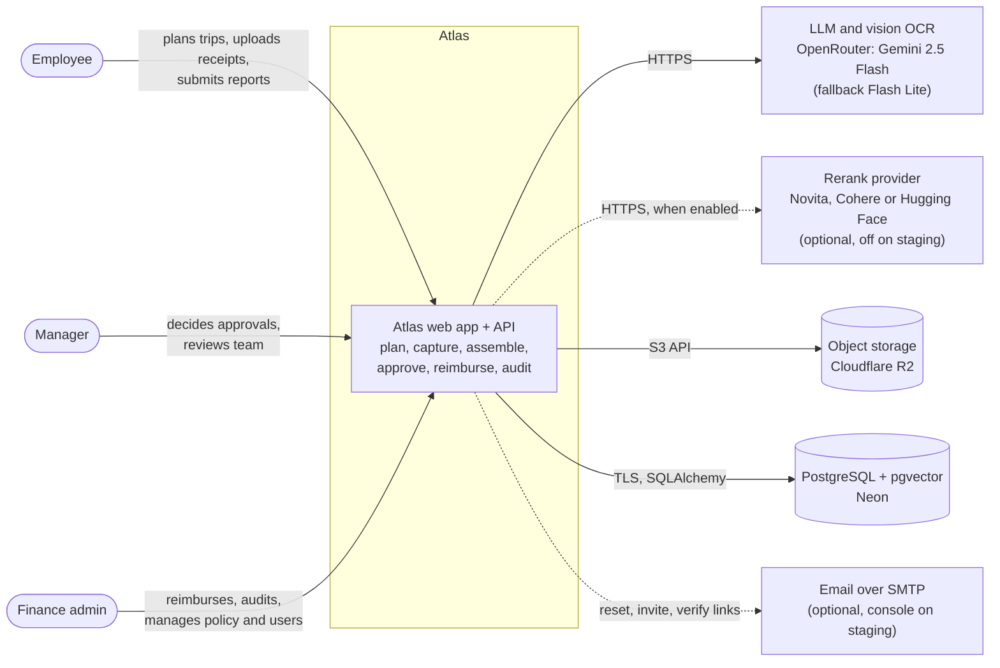
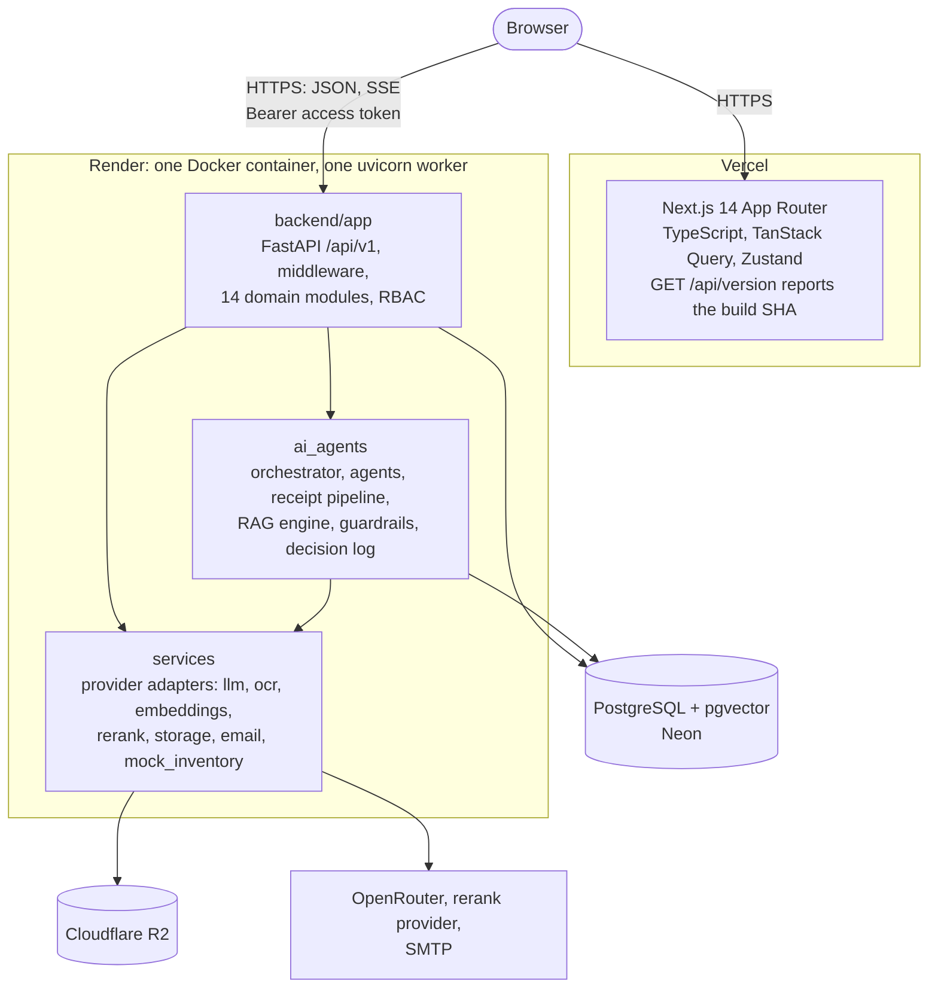
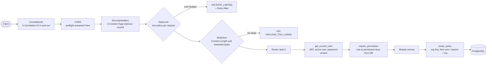
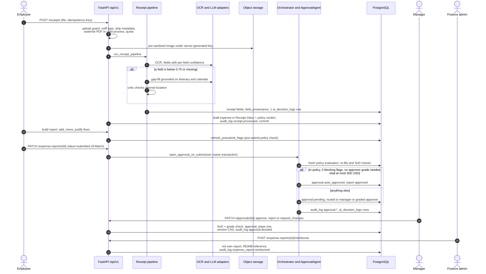

# Atlas architecture

This is the map of the whole Atlas application: what runs where, how a request travels through it, which directory owns what, and which rules hold everywhere. It is written for engineers who want to find their way around the code, and for reviewers who want to see how the pieces fit before reading any of them. The retrieval engine has its own document, [RAG_ARCHITECTURE.md](RAG/RAG_ARCHITECTURE.md); this page links to it rather than repeating it.

> Atlas is an independent engineering study inspired by SAP Concur. It is not affiliated with, authorized by, sponsored by, or endorsed by SAP SE or its affiliates. SAP and SAP Concur are trademarks or registered trademarks of SAP SE in Germany and other countries. All data in this project is synthetic.

**Contents:** [Bird's-eye view](#birds-eye-view) · [System context](#system-context) · [Containers](#containers) · [Request lifecycle](#request-lifecycle) · [Expense lifecycle](#expense-lifecycle-end-to-end) · [Code map](#code-map) · [Invariants](#invariants) · [Boundaries](#boundaries) · [Cross-cutting concerns](#cross-cutting-concerns) · [Related documents](#related-documents)

---

## Bird's-eye view

Atlas is a travel-and-expense copilot. An employee plans a trip and photographs receipts; Atlas reads the receipts, fills gaps from the itinerary, checks every line against a written policy, and assembles a report. A deterministic approval agent either auto-approves a low-risk, in-policy report or routes it to a human with the clause that applies. A finance admin marks it reimbursed (simulated) and can read every step in an append-only audit trail.

Four ideas shape the code:

1. **Modular monolith.** One FastAPI process, one database, fourteen domain modules with explicit boundaries ([ADR-0001](adr/0001-modular-monolith.md)).
2. **Deterministic core, routed agents.** Rules, the policy engine, matching and approval routing are plain code. An LLM is called only when a task needs reasoning, and its output is checked by a critic before it can change state ([ADR-0003](adr/0003-deterministic-core-routed-agents.md)).
3. **Every external dependency is an adapter with a local fallback.** LLM, OCR, embeddings, rerank, storage and email are chosen by environment variables, and each has a no-key `local` (or `console`) implementation, so CI and local development need no network ([ADR-0002](adr/0002-provider-adapters-with-local-fallbacks.md)).
4. **Everything leaves a record.** Business state changes write `audit_log` in the same transaction; each AI task writes one `ai_decision_logs` row.

| Fact | Value | Source |
|---|---|---|
| API surface | 80 `/api/v1` endpoints plus `GET /health` | `backend/tests/api/test_contract_matrix.py` |
| Domain modules | 14 | `backend/app/modules/` |
| Database tables | 24 (Alembic migrations 0001–0025, one linear head) | `database/models/`, `database/migrations/versions/` |
| Agents | travel, expense, policy (Q&A, evaluation, rule authoring), approval, plus the receipt pipeline | `ai_agents/agents/`, `ai_agents/receipt_pipeline/` |
| Test tiers | hermetic pytest 4225 passed / 4 skipped; DB-backed 2069 passed / 8 skipped; Vitest 968 tests in 133 files; eval-db 48 | [README](../README.md#quality--evaluation) |

---

## System context

Who uses Atlas and what it talks to. Drawn C4-style (level 1) as a flowchart.

| External system | Used for | Chosen by | Staging value |
|---|---|---|---|
| OpenRouter (Gemini 2.5 Flash) | Planner narrative, receipt gap-fill, policy answers, rule-authoring drafts, vision OCR | `LLM_PROVIDER`, `OCR_PROVIDER` | `openrouter` for both |
| Rerank provider | Cross-encoder rerank in the RAG engine | `RERANK_PROVIDER` (`local`, `novita`, `cohere`, `huggingface`) | not set, so `local` |
| Cloudflare R2 | Receipt images (object keys only in the database) | `STORAGE_PROVIDER=minio` (S3-compatible client) | R2 bucket |
| Neon PostgreSQL + pgvector | System of record and vector index | `DATABASE_URL` | Neon PostgreSQL 18 |
| SMTP | Password reset, invitation and verification emails | `EMAIL_PROVIDER` (`console`, `smtp`, `off`) | not set, so `console` (delivers nothing) |

Staging values come from [`render.yaml`](../render.yaml) and the [deployment guide](guides/deployment.md). `LLM_PROVIDER=anthropic` also exists as a configurable option in `services/llm_provider/factory.py`; it is not used on staging.

---

## Containers

What is deployed, and where (C4 level 2, drawn as a flowchart). `ai_agents` and `services` are Python packages loaded **inside** the backend process; they are not separate services.

| Container | Technology | Notes |
|---|---|---|
| Frontend | Next.js 14.2 on Vercel, Git-connected | Calls the API directly from the browser (`NEXT_PUBLIC_API_BASE_URL`), so the API enforces CORS. Access token in memory, refresh token in `localStorage` (`frontend/lib/auth/token-store.ts`). |
| Backend | FastAPI 0.115, SQLAlchemy 2.0, Python 3.12, Docker on Render | `docker/Dockerfile.backend` runs `uvicorn ... --workers 1`. The entrypoint (`docker/entrypoints/backend-entrypoint.sh`) runs `alembic upgrade head` before the server starts, then optional seed and repair steps. |
| Database | PostgreSQL 16 locally, Neon PostgreSQL 18 on staging | `pgcrypto` and `vector` extensions are created by migration 0001. |
| Object storage | MinIO locally, Cloudflare R2 on staging, filesystem for tests | Media is served only through short-lived signed URLs (at most 300 s). |
| Rate-limit store | In process by default; optional Redis (`RATE_LIMIT_STORE=redis`) | Staging uses the in-process store ([runbook](runbooks/rate-limit-redis.md)). |

There is no background job queue: AI work runs synchronously inside the request (blocking provider calls are moved to the threadpool, for example in `backend/app/modules/receipt/router.py`). This is listed as a known limitation in the README.

---

## Request lifecycle

Every HTTP request passes the same middleware stack, registered in `backend/app/main_entry/app.py::create_app`. Starlette wraps middleware in reverse order of registration, so the outermost layer below is added last.

| Step | Code | What it guarantees |
|---|---|---|
| Correlation ID | `backend/app/core/correlation.py` | Reads `X-Correlation-ID` (or `X-Request-ID`), else generates a UUID; echoes it on every response, including errors. Persisted on `ai_decision_logs.correlation_id` (capped at 128 characters in `backend/app/modules/ai/runtime.py`). |
| CORS | Starlette `CORSMiddleware` | Origins from `CORS_ALLOWED_ORIGINS`; exposes the rate-limit headers to the browser. |
| nosniff | `SecurityHeadersMiddleware` in `backend/app/core/body_limit.py` | No API response can be content-sniffed into something executable. |
| Rate limit | `backend/app/core/rate_limit.py` | Classifies each `/api/v1` request into one policy (login, refresh, account recovery, user admin, AI spend, receipt upload, default). `/health` is exempt. Runs **before** the body guard, so a throttled flood is refused before its body is read. |
| Body size | `BodySizeLimitMiddleware` in `backend/app/core/body_limit.py` | `MAX_REQUEST_BODY_BYTES` (1 MiB) for most routes, `MAX_UPLOAD_BYTES` (10 MiB) plus multipart overhead for `/api/v1/receipts`. |
| Authentication | `backend/app/core/security.py::get_current_user` | HS256 JWT; refuses refresh tokens used as access tokens, unknown or inactive users, and tokens minted before the last password change (`pwv` claim). |
| Authorization | `backend/app/core/rbac.py::require_permission` | Permission keys are resolved from `role_permissions` in the database, never from a token claim. |
| Record scope | `backend/app/core/rbac.py::scope_query`, `require_owner` | Tenant filter first, always; then employee → own rows, manager → own plus direct reports, finance admin → whole organisation. Writes are owner-only for every role. |
| Errors | `backend/app/core/errors.py` | One envelope, `{"error": {"code", "message", "correlation_id"}}`; details are logged, never returned. |

The order is pinned by `backend/tests/test_ps_rate_limit.py::test_real_app_runs_the_rate_limiter_before_the_body_size_guard`, which inspects the real app's middleware list and checks that a throttled oversized upload gets 429, not 413.

---

## Expense lifecycle, end to end

The main business flow, from a receipt photo to a reimbursed report. Each arrow is a real endpoint or function; names are given in the table below the diagram.

| Step | Where it happens | Notes |
|---|---|---|
| Upload and hardening | `backend/app/modules/receipt/router.py::upload_receipt`, `upload_guard.py`, `pdf_raster.py`, `quota.py` | Everything is checked before a byte is stored or sent to OCR. See the [security model](design/security-model.md#upload-hardening). |
| OCR, gap-fill, provenance | `ai_agents/receipt_pipeline/pipeline.py` | Fields at or above 0.70 confidence stay deterministic. Lower ones go to LLM gap-fill grounded by `ai_agents/tools/itinerary_calendar.py`; a reflection step checks an inferred location against the trip. Each field gets `deterministic`, `ai_inferred` or `user_edited` provenance. |
| Auto-draft | `_auto_draft_expense_from_receipt` in the receipt router | Runs in a savepoint: if drafting fails, the receipt still saves and the upload still returns 201. |
| Matching and assembly | `ai_agents/agents/expense_agent/` (`matching.py::smart_match`, `assemble.py`) and `backend/app/modules/expense/service.py` | Receipt ↔ card transaction ↔ trip segment matching through the assistant's expense context, or manual line editing in the UI. |
| Pre-submit check | `refresh_presubmit_flags` in the expense service, using `ai_agents/agents/expense_agent/presubmit.py::run_presubmit` and `ai_agents/tools/policy_eval.py::PolicyEvalTool` | A blocking violation disables Submit unless the line carries a written justification (for justifiable rule types). |
| Submit opens the approval | `backend/app/modules/approval/lifecycle.py::open_approval_on_submission` | Same transaction as the status change. If the agent fails, a pending, not-evaluated approval is opened instead (fail safe). |
| Approval agent | `ai_agents/agents/approval_agent/` (`evaluate.py::assess_risk`, `routing.py::decide_route`) | No LLM. `LOW_RISK_AUTO_APPROVE_MAX_USD = 500.00`. Never auto-rejects ([ADR-0004](adr/0004-llm-free-approval-agent.md)). |
| Grade routing | `backend/app/modules/approval/grade_routing.py` | A flag that names an approver grade (SVP, VP) routes to a user of that grade; a lower grade gets `403 INSUFFICIENT_APPROVER_GRADE`. |
| Human decision | `backend/app/modules/approval/service.py::decide_approval` | Nobody decides their own submission (403). Reject and request-changes need a reason; the returned content is frozen in `approval_steps.subject_snapshot`. |
| Reimbursement | `backend/app/modules/lifecycle/service.py::reimburse_report` | Finance admin only (`expense.reimburse.org`), never on their own report; reference `REIMB-<yyyymmdd>-<12 hex>`. No real payment happens. |

---

## Code map

One entry per top-level directory and the subpackages that matter. Paths are relative to the repository root.

### `frontend/` — Next.js app

| Path | What lives there |
|---|---|
| `frontend/app/(app)/` | Authenticated pages: `dashboard`, `planner`, `trips`, `receipts`, `expenses`, `approvals`, `team`, `analytics`, `policy`, `audit`, `users` |
| `frontend/app/(auth)/` | `login`, `forgot-password`, `reset-password`, `verify-email`, `accept-invite` |
| `frontend/app/api/version/route.ts` | Reports the build's commit SHA for deploy verification |
| `frontend/components/atlas/` | App shell, sidebar, top bar, assistant drawer, citation chips, provenance badges, data table, status badges |
| `frontend/components/{planner,receipts,expenses,approvals,policy,...}/` | One folder per screen |
| `frontend/lib/` | API client and SSE stream reader (`lib/api/`), token store (`lib/auth/`), role-aware navigation (`lib/nav-config.ts`) |
| `frontend/stores/` | Zustand stores for auth, planner and assistant state |
| `frontend/__tests__/`, `frontend/e2e/` | Vitest unit tests; Playwright end-to-end specs (`e2e/p7t4/`) |

### `backend/` — FastAPI application

| Path | What lives there |
|---|---|
| `backend/app/main_entry/app.py` | `create_app()`: settings, logging, middleware order, exception handlers, routers, lifespan (DB check, optional demo-reset scheduler) |
| `backend/app/api/` | `v1.py` (mounts every module router under `/api/v1`), `health.py` (`GET /health` with `commit`), `ops.py`, `public_config.py` |
| `backend/app/core/` | Cross-cutting code: `rbac.py`, `security.py`, `errors.py`, `correlation.py`, `audit.py`, `idempotency.py`, `concurrency.py`, `rate_limit.py` (+ `rate_limit_redis.py`), `body_limit.py`, `demo.py`, `demo_reset_scheduler.py`, `pagination.py`, `money.py`, `csv_export.py` |
| `backend/app/modules/` | Fourteen domain modules, each a `router.py` + `service.py` + `schemas.py`: `identity`, `travel`, `receipt`, `expense`, `policy`, `approval`, `lifecycle`, `team`, `card`, `search`, `notifications`, `analytics`, `audit`, `ai` |
| `backend/app/modules/ai/runtime.py` | Composition root for the orchestrator: registers the policy, travel, expense and approval agents |
| `backend/tests/` | Unit (`unit/`), API contract (`api/`), AI-eval DB tier (`eval/`) and feature tests |

### `ai_agents/` — intelligence plane

| Path | What lives there |
|---|---|
| `ai_agents/orchestrator/` | `classifier.py` (rule-based, no LLM), `orchestrator.py` (route, dispatch, one decision-log row), `registry.py`, `envelopes.py` |
| `ai_agents/agents/` | `travel_agent/`, `expense_agent/`, `approval_agent/`, and the policy capabilities (`policy_agent.py`, `policy_qa.py`, `policy_eval_handler.py`, `policy_authoring.py`) |
| `ai_agents/receipt_pipeline/` | OCR core, gap-fill, location reflection, correction, evidence and retention (receipt locking) |
| `ai_agents/rag/` | Retrieval engine: chunker, indexer, lexical, fusion (RRF), rerank, calibration, threshold, grounding, support gate. See [RAG_ARCHITECTURE.md](RAG/RAG_ARCHITECTURE.md) |
| `ai_agents/tools/` | Grounding tools: `policy_eval.py` (deterministic rule engine), `entry_rules.py`, `process_rules.py`, `spend_policy.py`, `fx_policy.py`, `grade_entitlements.py`, `inventory.py`, `itinerary_calendar.py`, `policy_retrieval.py`, `profile.py` |
| `ai_agents/guardrails/` | `actions.py` (role-bound action allow-list), `reflection.py` (generator → critic loop), `citations.py` (citation contract) |
| `ai_agents/decision_log/` | `writer.py` (one row per AI task), `minimizer.py` (redacts secrets and PII before persistence) |
| `ai_agents/tests/` | Hermetic and DB-backed tests for every agent, tool and guardrail |

### `services/` — provider adapters

| Path | Implementations |
|---|---|
| `services/llm_provider/` | `local`, `openrouter`, `anthropic` |
| `services/ocr_provider/` | `local`, `openrouter` (vision) |
| `services/embeddings_provider/` | `local`, `openai`, `openrouter` |
| `services/rerank_provider/` | `local`, `novita`, `cohere`, `huggingface` |
| `services/storage_provider/` | `local` (filesystem), `minio` (any S3-compatible store, including R2) |
| `services/email_provider/` | `console`, `smtp`, `off` |
| `services/mock_inventory/` | Seeded flight and hotel inventory for the planner |

Each package has an `interface.py` and a `factory.py` that reads the matching `*_PROVIDER` setting.

### `database/` — schema, migrations, seeds

| Path | What lives there |
|---|---|
| `database/models/` | SQLAlchemy models for all 24 tables, plus shared mixins (`mixins.py`: UUID key, timestamps, tenant, authorship, version) |
| `database/migrations/versions/` | Alembic revisions 0001–0025, one linear chain |
| `database/seeds/` | Demo seed (`seed_all.py`), RAG corpus (`corpus/`), and operational tools: `reset_demo_data.py`, `cleanup_test_data.py`, `complete_elapsed_trips.py`, `reindex_policy_corpus.py` |

The data model is documented in [design/database-schema.md](design/database-schema.md).

### Everything else

| Path | What lives there |
|---|---|
| `config/settings/base.py` | Pydantic settings for every environment variable, plus the production startup guard |
| `config/constants/` | `permissions.py` (permission-key catalogue), `grades.py` (traveller grade ladder), `fx_rates.py` (simulated rates), `city_names.py`, `embeddings.py` |
| `evals/` | AI-eval harness, datasets, thresholds and manual live evals ([evals/README.md](../evals/README.md)) |
| `docker/` | Dockerfiles, compose files, backend entrypoint, Postgres init |
| `scripts/ci/wait_for_commit.sh` | Deploy verification: polls a service until it reports the expected SHA |
| `scripts/ops/` | `secret_scan.py` (tree and full history), `env_audit.py` |
| `.github/workflows/ci.yml` | Seven jobs: backend, secret-scan, frontend, eval-db, e2e, docker-build, deploy-staging |
| `render.yaml` | Render blueprint for the backend (`autoDeploy: false`) |

---

## Invariants

Rules that hold across the codebase. Each one names how it is enforced; every test file named here exists in the repository.

| # | Invariant | Enforced by |
|---|---|---|
| 1 | **Dependencies point one way:** `services` ← `ai_agents` ← `backend`. `services` depends only on `config`; `database.models` depends only on `config`; `ai_agents` uses `services`, `database.models` and `config`, and never imports `backend` at import time. | `ai_agents/tests/test_no_backend_import.py` imports the package's core modules (orchestrator, tools, RAG engine, guardrails, decision log and the policy and expense agents) in a subprocess and fails if any `backend.*` module is loaded. A search of the package finds no other `backend` import; the one exception is a deferred import inside the `ai_agents/rag/reindex.py` CLI `main()`. That `services` imports nothing above `config` is a convention (checked by search, not by a test). Operational scripts in `database/seeds/` do import `backend`; they are tools, not library code. |
| 2 | **Every read of user-owned records goes through `scope_query`**, which applies the tenant filter first, even for finance admins. | `backend/app/core/rbac.py`; `backend/tests/test_record_scoping.py`, `backend/tests/unit/test_unit_rbac_scoping.py`, `backend/tests/api/test_rbac_scoping.py` |
| 3 | **Writes are owner-only for every role.** Read scope is never reused to authorize a mutation; an unreadable record is 404, a readable but not-owned one is 403. | `require_owner` / `owner_scope_query` in `rbac.py`; `backend/tests/test_c7_g1_rbac_write_scope.py`, `backend/tests/unit/test_c7_g1_owner_scope.py` |
| 4 | **Every `/api/v1` route is registered in the contract matrix** and, unless public, refuses a missing token (401) and a forbidden role (403) with the standard envelope. | `backend/tests/api/test_contract_matrix.py` (`test_registry_covers_every_live_route` and the per-endpoint auth tests) |
| 5 | **One error shape** with a correlation ID; no stack traces in responses. | `backend/app/core/errors.py`; `backend/tests/test_error_contract.py`, `backend/tests/test_c7_24_error_envelope.py` |
| 6 | **Every business state change writes one `audit_log` row in the same transaction**, through the single writer `record_audit`. The table is append-only by convention (no database trigger). | `backend/app/core/audit.py`; `backend/tests/test_audit.py` |
| 7 | **Every AI task writes exactly one `ai_decision_logs` row**, minimised for secrets and PII before persistence. | `ai_agents/decision_log/writer.py`; `ai_agents/tests/test_decision_log_writer.py`, `ai_agents/tests/test_r6_audit_completeness.py` |
| 8 | **The approval path never calls an LLM and never auto-rejects.** | `ai_agents/agents/approval_agent/routing.py`; `backend/tests/unit/test_unit_approval_determinism.py` (`test_approval_service_has_no_llm_provider`, `test_approval_risk_has_no_llm_provider`), `ai_agents/tests/test_approval_agent.py` |
| 9 | **No one approves, decides or reimburses their own claim.** | `approval/service.py::decide_approval`, `lifecycle/service.py::reimburse_report`; `backend/tests/test_c7_g1_rbac_write_scope.py`, `backend/tests/test_pg_integ_lifecycle_sod_db.py`, `backend/tests/test_c7r_sod_returned_report_db.py` |
| 10 | **Agents can only take actions from a fixed enum, each bound to a permission key.** A prompt-injected instruction cannot add one. | `ai_agents/guardrails/actions.py`; `ai_agents/tests/test_role_bound_check.py` |
| 11 | **A policy answer cites only clauses that were actually retrieved**, and each sentence must be supported by the clause it cites. | `ai_agents/guardrails/citations.py`, `ai_agents/rag/support.py`; `ai_agents/tests/test_citation_contract.py`, `ai_agents/tests/test_c7r_sentence_support.py` |
| 12 | **Versioned records (trips, expense reports, approvals) change only through a compare-and-swap on `version`**, with the client's `If-Match` where it sends one; create and upload endpoints replay on a repeated `Idempotency-Key`. | `backend/app/core/concurrency.py`, `idempotency.py`; `backend/tests/unit/test_unit_concurrency_idempotency.py`, `backend/tests/api/test_idempotency.py` ([ADR-0007](adr/0007-optimistic-concurrency-and-idempotency-keys.md)) |
| 13 | **One Alembic head, and the models match the migrated schema.** Money is `NUMERIC(14,2)` with an explicit currency, never a float. | CI `backend` job counts `alembic heads`; `backend/tests/test_migration_chain.py` (autogenerate produces an empty diff) |
| 14 | **Middleware order:** CorrelationID → CORS → nosniff → RateLimit → BodySize → routes. | `backend/tests/test_ps_rate_limit.py::test_real_app_runs_the_rate_limiter_before_the_body_size_guard` |
| 15 | **Production refuses to start with unsafe secrets** (short or placeholder `JWT_SECRET`, the published seed password, `APP_DEBUG=true`, a `*` CORS origin). | `config/settings/base.py::deployment_secret_problems`; `backend/tests/test_ps_ops_settings_guard.py` |
| 16 | **Staging serves exactly the commit CI tested.** | `scripts/ci/wait_for_commit.sh`, `deploy-staging` in `.github/workflows/ci.yml`; `backend/tests/unit/test_unit_health_commit.py` ([ADR-0005](adr/0005-commit-pinned-deploy-verification.md)) |
| 17 | **CI never leaks credentials** (no Playwright HTML report or trace, short artifact retention, login bodies never printed). | `backend/tests/test_ci_workflow_hygiene.py` |

---

## Boundaries

| Boundary | Rule | Why |
|---|---|---|
| Module ↔ module | Each module owns its router, service and schemas. Cross-module calls go through service functions (for example the expense service calls `approval/lifecycle.py::open_approval_on_submission`); there is no shared "god" service. Modules do share one SQLAlchemy model package, so the "no cross-module table access" rule from the original design is a convention, not a hard wall. | Keeps the option to split a module out later without paying for distribution now ([ADR-0001](adr/0001-modular-monolith.md)). |
| `backend` → `ai_agents` | One-way. The orchestrator is built once in `backend/app/modules/ai/runtime.py`; conversation, policy and approval endpoints call `handle_task`. The receipt router and expense service also call deterministic pieces of `ai_agents` directly (receipt pipeline, `run_presubmit`, `PolicyEvalTool`). | `ai_agents` stays testable without FastAPI. |
| `ai_agents` → `services` | Agents receive provider objects (LLM, OCR, embeddings, rerank, storage) through the factories; they never construct HTTP clients themselves. | Swap a provider by configuration; run everything offline in CI. |
| Session ownership | `ai_agents` code only flushes. The backend endpoint owns `session.commit()`, so a business change, its audit row and its decision-log row commit together or not at all. | No partial state on failure. |
| Browser ↔ API | The browser talks to the API directly over HTTPS with a bearer token. The frontend has no server-side session and no Next.js middleware; route guards in the UI are hints, and every check that matters runs on the server. | One enforcement point. |

---

## Cross-cutting concerns

| Concern | How it is handled | Code |
|---|---|---|
| Authentication | Access token 15 minutes, refresh token 7 days (HS256). Tokens carry a keyed fingerprint of `password_changed_at`, so a password reset or change revokes older sessions. | `backend/app/core/security.py` |
| Authorization | Permission keys in `resource.action.scope` form, stored per role in the database. | `config/constants/permissions.py`, `backend/app/core/rbac.py` |
| Tenancy | `organization_id` on every root business table; child tables inherit it through their parent. Application-level only, no row-level security ([ADR-0006](adr/0006-application-level-tenancy.md)). | `database/models/mixins.py::TenantMixin`, `scope_query` |
| Audit | `record_audit` writes `audit_log` in the caller's transaction; state payloads are never logged. | `backend/app/core/audit.py` |
| AI decision logging | One `ai_decision_logs` row per AI task: agent, route (`deterministic` / `llm`), provider, minimised tool and output summaries, confidence, reflection outcome, latency, correlation ID. | `ai_agents/decision_log/` |
| Errors | Typed `AppError` subclasses map to status codes and stable error codes; database integrity errors map to 409 / 422. | `backend/app/core/errors.py` |
| Concurrency and retries | Version compare-and-swap on trips, expense reports and approvals (clients send `If-Match` on report, approval, receipt-attach and lifecycle calls); `Idempotency-Key` table for creates and uploads. | `backend/app/core/concurrency.py`, `idempotency.py` |
| Logging | Structured JSON logs (`LOG_FORMAT=json`) with the correlation ID; database host logged, never the DSN. | `backend/app/core/logging.py`, `backend/app/main_entry/app.py` |
| Configuration | Every variable is a typed Pydantic setting; invalid rate specs, a non-https `APP_BASE_URL` on staging or production, or incomplete SMTP settings stop startup. | `config/settings/base.py` |
| Graceful degradation | A provider failure produces templated or deterministic output marked `degraded` / `needs_review`; rerank failure falls back to RRF order. | `ai_agents/agents/*`, `ai_agents/rag/rerank.py` |
| Rate limiting and abuse | Per-IP, per-user and per-organisation budgets; failed-login backoff; overflow fails closed. | `backend/app/core/rate_limit.py` |
| Public demo | `DEMO_MODE` protects the seeded accounts and rules; an optional scheduled reset restores the demo organisation. | `backend/app/core/demo.py`, `demo_reset_scheduler.py` |

The full security picture, with threats, controls and residual risks, is in [design/security-model.md](design/security-model.md).

---

## Related documents

| Document | What it covers |
|---|---|
| [design/technical-design.md](design/technical-design.md) | The original technical design, annotated with how it was actually built |
| [design/database-schema.md](design/database-schema.md) | Every table, ER diagrams, migrations 0001–0025 |
| [design/ui-ux.md](design/ui-ux.md) | UX principles, screens and screenshots |
| [design/security-model.md](design/security-model.md) | Threat model, controls, residual risks |
| [adr/README.md](adr/README.md) | Architecture decision records for the application and the RAG engine |
| [RAG/RAG_ARCHITECTURE.md](RAG/RAG_ARCHITECTURE.md) | The retrieval engine: hybrid retrieval, RRF, rerank, calibrated abstention |
| [runbooks/](runbooks/) | Rollback, demo reset, rate-limit store, key rotation, and other operations |
| [README](../README.md) | Project overview, demo accounts, setup and test results |
