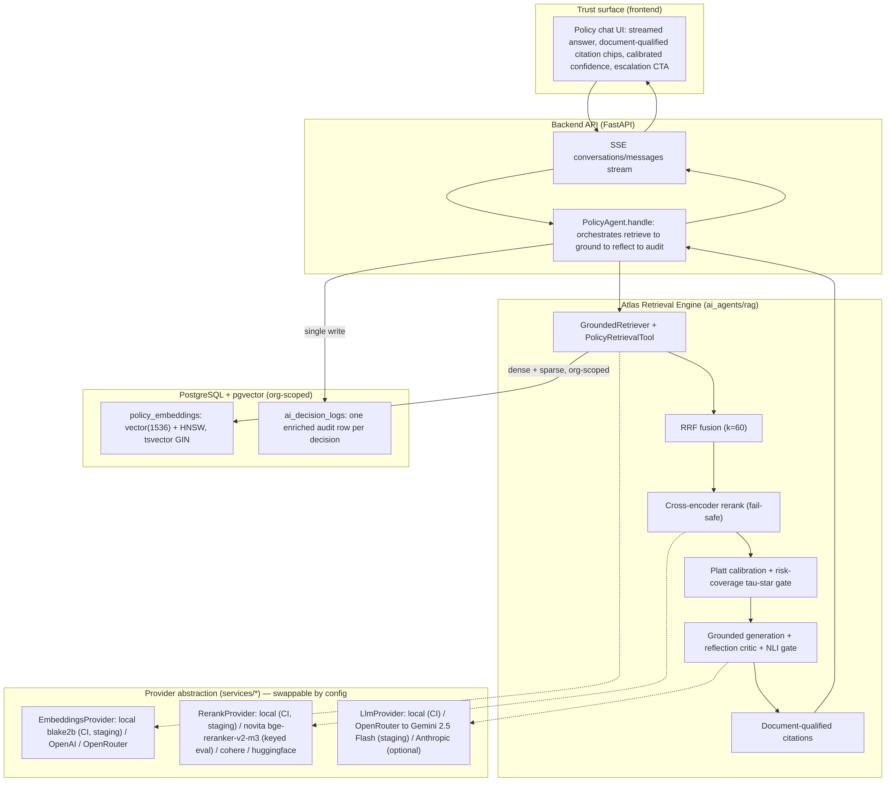

# Atlas Retrieval Engine (ARE) — Project Showcase

The two-minute version of the Atlas Retrieval Engine, the RAG subsystem behind Atlas's
policy assistant: the problem, the design, and the measured results. A reviewer can stop
after the results table; an engineer can follow the links into the architecture, the
decision records and the canonical metrics. The engine runs in the
[live demo](https://atlas-concur-ai.vercel.app) on the local embedder and reranker; the
keyed metrics below come from offline evaluation.

---

## The problem

Enterprise travel-&-expense policy is exactly the domain where a language model must
**not** improvise. Ask *"can I book business class on a 12-hour flight?"* and the answer
has to come from the actual policy clause, be **traceable** to it, and — when the policy
genuinely doesn't cover the question — the system must **say so** rather than invent a
rule. The project began with the opposite failure: a copilot that abstained on *"I want
to make a trip to New York."* Ground it, or abstain — never hallucinate.

---

## The solution

A two-stage retrieval pipeline with a calibrated trust boundary:

**hybrid retrieval** (semantic + lexical) → **RRF fusion** → **cross-encoder reranking**
→ **calibrated abstention gate** (answer only above a data-derived threshold) →
**grounded generation with document-qualified citations** → **one enriched audit write**
— all over PostgreSQL + pgvector, per-tenant scoped, behind swappable provider interfaces
so CI runs deterministically with no network.

*Diagram source: [system_architecture.mmd](diagrams/system_architecture.mmd)*

---

## Headline results

*All figures traceable to repository artifacts — see
[FINAL_METRICS_SUMMARY](metrics/FINAL_METRICS_SUMMARY.md).*

| | Result | Meaning |
|---|---|---|
| **Retrieval recall@10** | 0.727 → **0.819** (CI) → **0.959** (keyed) | hybrid, then cross-encoder, find the right clauses |
| **Abstention AURC** | 0.101 → **0.047** | *lower is better* — the calibrated signal roughly halves risk-at-coverage |
| **Faithfulness** | **0.981 @ 74% grounded** (108/145) | of answers it chooses to give, ~98% are fully supported — **no confirmed hallucinations** (history: 0.991 @ 78% at R6, before the stricter per-sentence gate) |
| **Retrieval latency** | fused **p50 ~4–7 ms** (local runs) | retrieval is not the bottleneck |

> Faithfulness is *always* reported with its coverage (74% grounded). A naked
> faithfulness number is the classic RAG sleight-of-hand — a system that answers almost
> nothing can score 1.0. See [why that matters](metrics/FINAL_METRICS_SUMMARY.md#4-faithfulness--always-paired-with-coverage-keyed-only).

---

## The honest arc: debugging the measurement

The strongest signal here isn't a metric — it's that the two hardest bugs were in **how
the system measured itself**, and both were found and fixed rather than hidden:

- **CI green, live grounding zero.** A citation floor on the *cosine* scale (0.70) was
  applied to a *calibrated* signal (operating point ~0.039), false-blocking every live
  answer — while CI stayed green because it runs the cosine path. Fixed with scale-aware
  thresholding: live grounding **0 → 113/145**.
- **0.775 faithfulness was the judge, not the model.** The LLM judge was penalizing
  verbatim-grounded answers by string-matching citation labels. A statement-level judge
  with the same pass rule measured **0.991** in a fresh keyed run — a measurement fix,
  not a generation fix.
  (A later, stricter per-sentence support gate trades some coverage for support: the
  current keyed figure is 0.981 @ 74% grounded.)

Full story: [ENGINEERING_DECISIONS](ENGINEERING_DECISIONS.md).

---

## Tech stack

- **Retrieval:** PostgreSQL + **pgvector** (dense, HNSW schema), PostgreSQL full-text
  (sparse, `ts_rank_cd`), **Reciprocal Rank Fusion** (k=60).
- **Reranking:** cross-encoder **`bge-reranker-v2-m3`** via Novita in the keyed
  configuration (swappable: Cohere / HuggingFace / deterministic local; CI and the public
  staging deployment use the local reranker).
- **Calibration:** **Platt scaling** + **risk-coverage / AURC** threshold selection
  (pure-stdlib, no numpy/sklearn) — *not* conformal.
- **Generation:** Gemini 2.5 Flash via OpenRouter (swappable; a deterministic local
  provider in CI), reflection critic + deterministic NLI grounding gate.
- **Language / infra:** Python, FastAPI, SQLAlchemy + Alembic, provider-abstraction
  layer, deterministic CI eval harness (197-query gold set).

---

## Engineering areas covered

- **Applied IR / RAG systems** — hybrid retrieval, rank fusion, two-stage reranking,
  grounded generation, citation enforcement.
- **Calibration & selective prediction** — Platt scaling, risk-coverage curves, AURC,
  data-derived abstention thresholds.
- **Evaluation rigor** — a labeled gold set, local-vs-keyed fidelity separation, CI
  regression floors, and the discipline to audit the judge before blaming the model.
- **Production engineering** — provider abstraction, strict layering, fail-safe
  degradation, multi-tenant scoping, single-write auditability.
- **Engineering honesty** — forward-looking vs. shipped clearly labeled; every number
  traceable; gaps flagged, not filled.

---

## Read deeper

| Start here | Then |
|---|---|
| [Architecture](RAG_ARCHITECTURE.md) — the system as it exists | [Engineering Decisions](ENGINEERING_DECISIONS.md) — how it got there |
| [Final Metrics](metrics/FINAL_METRICS_SUMMARY.md) — the canonical numbers | [ADRs](adr/) — the formal decision records |
| [Performance Profile](PERFORMANCE_PROFILE.md) — the latency lens | [Future Work](FUTURE_WORK.md) — what's deferred and why |
| [Glossary](GLOSSARY.md) — plain-language terms | [Companion Research](research/README.md) — the grounding survey |
