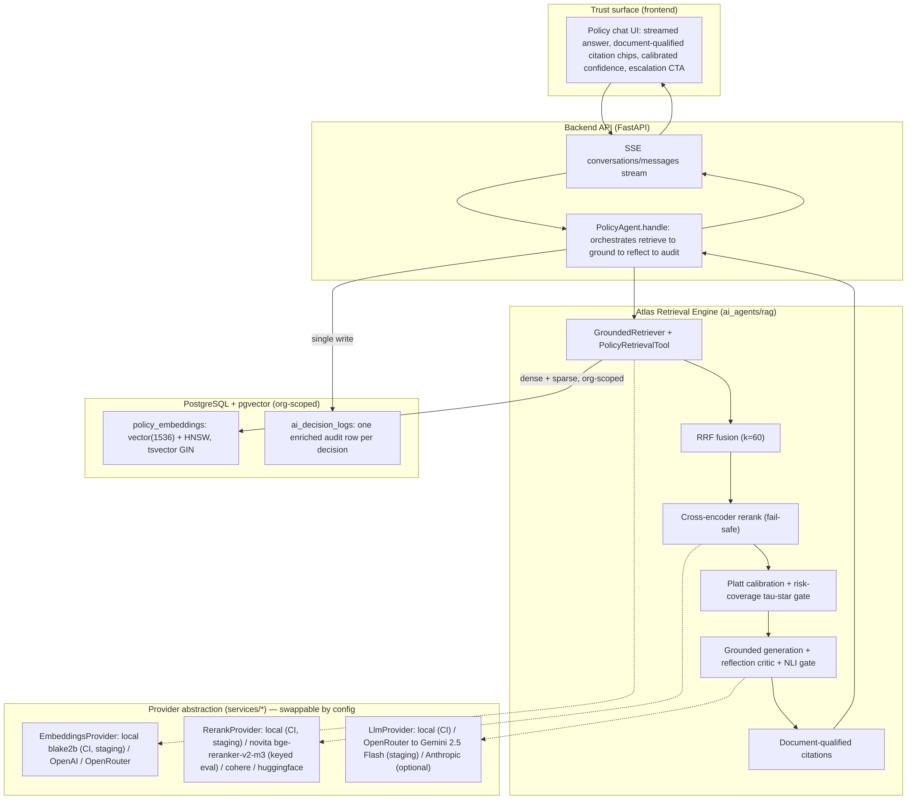
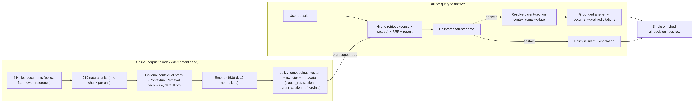
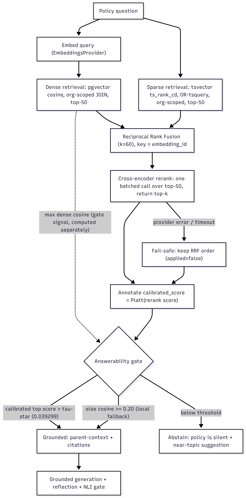
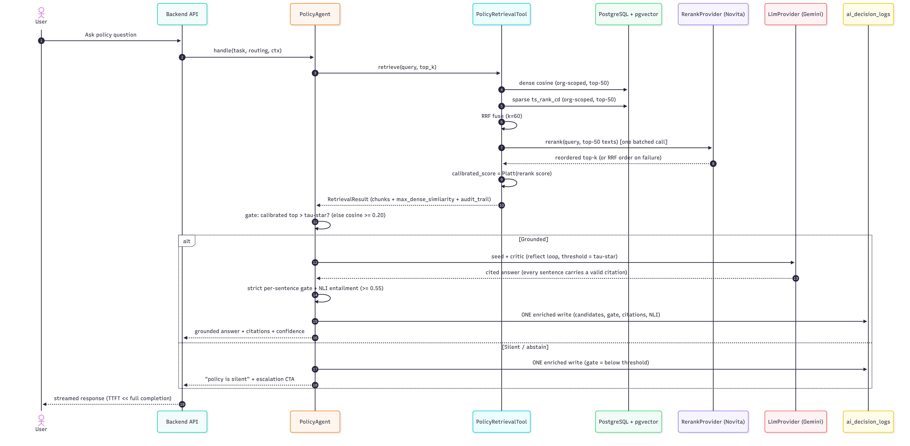
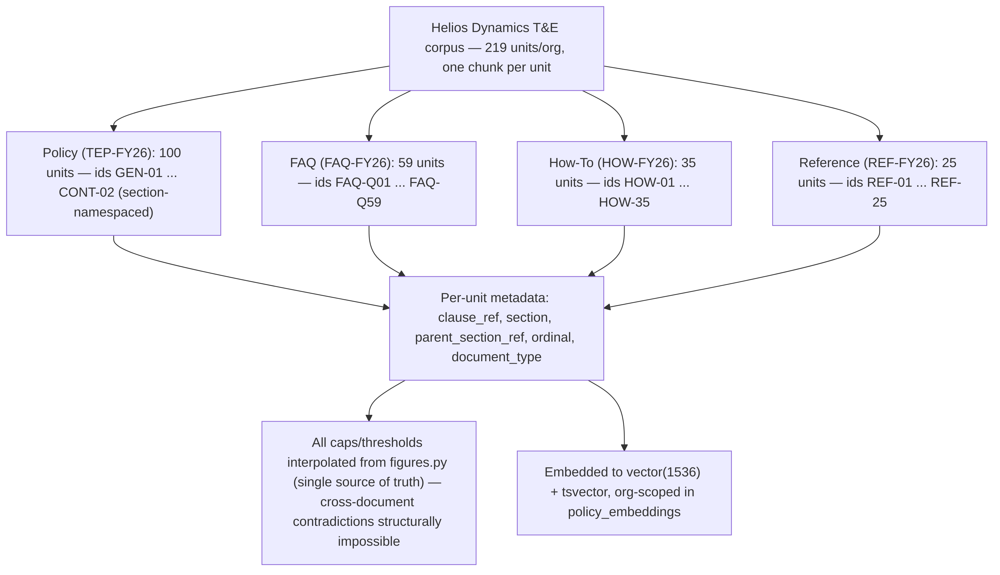
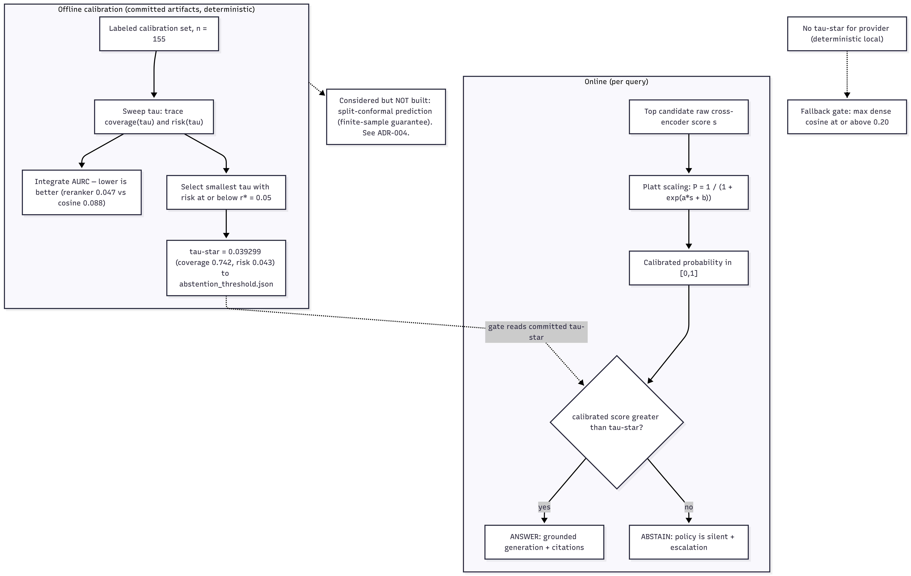
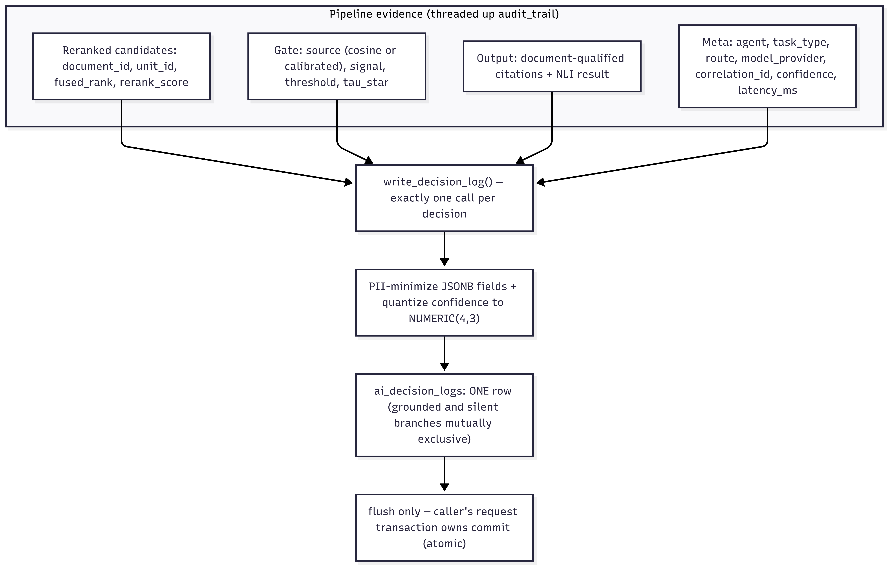

# Atlas Retrieval Engine (ARE) — Architecture

*The RAG subsystem as it exists today (present tense), for engineers who want the full
pipeline in about ten minutes. For the whole-application architecture see
[docs/ARCHITECTURE.md](../ARCHITECTURE.md). This document describes **what**;
the [ADRs](adr/) record **why each decision was made** and the
[ENGINEERING_DECISIONS](ENGINEERING_DECISIONS.md) narrative records **how the
thinking evolved**. Numbers are cited from
[FINAL_METRICS_SUMMARY](metrics/FINAL_METRICS_SUMMARY.md), the canonical figures.*

**Target read time:** ~10 minutes.

---

## Executive summary

ARE answers enterprise travel-&-expense **policy questions** by retrieving the exact
governing clauses and generating an answer grounded in them — or **abstaining** when
the corpus does not cover the question. It is a two-stage retrieval pipeline (hybrid
dense + sparse retrieval fused by RRF, then a cross-encoder reranker) feeding a
**calibrated abstention gate** (Platt-scaled reranker score against a
risk-coverage-selected threshold τ\*), grounded generation with **document-qualified
citations**, and a **single enriched audit write** per decision. The whole thing runs
over PostgreSQL + pgvector with strict per-tenant scoping, behind swappable provider
interfaces so CI runs deterministically with no network while keyed runs use real
reranking and LLM services (the public staging deployment uses Gemini via OpenRouter
for generation with the local embedder and reranker).

Measured outcomes (see [metrics](metrics/FINAL_METRICS_SUMMARY.md)):
retrieval recall@10 **0.727 → 0.819** (hybrid, CI path) → **0.959** (keyed
cross-encoder); abstention AURC **0.101 → 0.047** (lower is better); **0.981 faithful
@ 74% grounded** (108/145) on the latest keyed run, with **no confirmed model
hallucinations**. (History: the first measurement, at R6, was 0.991 @ 78%, 113/145,
before the stricter per-sentence support gate.)



*Diagram source: [system_architecture.mmd](diagrams/system_architecture.mmd)*

---

## Goals

1. **Ground or abstain — never hallucinate.** Enterprise policy answers must be
   traceable to a clause or explicitly declined. Abstention is a first-class outcome.
2. **Trustworthy abstention.** The answer/abstain boundary is derived from data with a
   target error rate, not a hand-tuned magic number.
3. **Auditability.** Every decision leaves one durable, tenant-scoped record with the
   full "why" (candidates, gate, citations).
4. **Determinism where it counts.** CI gates a byte-reproducible local path; the
   real-provider quality numbers are proven separately on a keyed run.
5. **Provider independence.** Embedding / reranking / LLM are swappable by config.

---

## System overview

```
Question ─► Hybrid retrieval (dense ∥ sparse) ─► RRF fuse ─► Cross-encoder rerank
         ─► Calibrated abstention gate (τ*) ─► [grounded generation + citations] or [abstain]
         ─► one enriched audit write ─► streamed answer + trust surface
```

Layering is strict: `services/*` (providers) import no application code; `ai_agents/*`
(the engine) imports no backend web layer; calibration/threshold math is pure-stdlib
so it ships in the backend image. This is enforced by an import-layering test.



*Diagram source: [data_flow.mmd](diagrams/data_flow.mmd)*

---

## End-to-end pipeline

A policy question enters at `PolicyAgent.handle` and is dispatched to the Q&A path.
The stages, in order:

1. **Query embedding** — the `EmbeddingsProvider` embeds the query to a 1536-d vector.
2. **Hybrid retrieval** — a dense pgvector search and a sparse full-text search run
   (logically parallel), each org-scoped and capped at 50 candidates.
3. **RRF fusion** — the two ranked lists fuse into one by Reciprocal Rank Fusion.
4. **Cross-encoder rerank** — one batched provider call rescores the fused top-50 into
   a high-precision top-k; fail-safe to RRF order on any error.
5. **Platt calibration annotation** — each reranked chunk gets a calibrated
   probability (observability + the gate signal).
6. **Calibrated abstention gate** — answer iff the top calibrated score exceeds τ\*
   (else the cosine fallback); otherwise abstain.
7. **Grounded generation + reflection** — a hypothesizer drafts a cited answer; a
   critic + bounded reflection loop + an independent NLI entailment check validate it.
8. **Single audit write** — exactly one enriched `ai_decision_logs` row.
9. **Stream** — the answer streams to the trust surface (citations, calibrated
   confidence, escalation on abstain).



*Diagram source: [retrieval_pipeline.mmd](diagrams/retrieval_pipeline.mmd)*



*Diagram source: [query_sequence.mmd](diagrams/query_sequence.mmd)*

---

## Multi-document corpus

The corpus is an original, synthetic enterprise T&E body for the fictitious "Helios
Dynamics" — **4 documents, 219 units/org today, one chunk per unit**. The published
metrics were measured on the earlier 208-unit version (policy 98, FAQ 50); the 11 units
added later (traveller grades) moved no gold unit in or out of any top-10
([corpus note](metrics/FINAL_METRICS_SUMMARY.md#headline-sheet)):

| Document | Type | Doc id | Units | Unit-id scheme |
|---|---|---|---|---|
| Global Travel & Expense Policy | `policy` | `TEP-FY26` | 100 | section-namespaced (`GEN-01` … `CONT-02`) |
| T&E FAQ | `faq` | `FAQ-FY26` | 59 | `FAQ-Q01` … `FAQ-Q59` |
| T&E How-To Guide | `howto` | `HOW-FY26` | 35 | `HOW-01` … `HOW-35` |
| T&E Quick Reference | `reference` | `REF-FY26` | 25 | `REF-01` … `REF-25` |

**Chunking.** The documents are pre-segmented into natural policy units (one clause,
FAQ, how-to step, or reference row per chunk), so chunk boundaries follow the
document's own structure rather than a blind character window. Each unit carries
`clause_ref`, `section`, `parent_section_ref`, `ordinal`, and `document_type`.

**Numeric consistency by construction.** Every dollar cap, day threshold, and
city-tier lives once in `figures.py` and is interpolated into the prose, so
cross-document numeric contradictions are structurally impossible — a corpus
consistency test re-derives the expected tokens from those constants and greps the
rendered text.



*Diagram source: [corpus_structure.mmd](diagrams/corpus_structure.mmd)*

---

## Hybrid retrieval

Two independent paths over the same org-scoped `policy_embeddings` table, each
returning up to 50 candidates. **Why hybrid rather than dense-only:**
[ADR-001](adr/ADR-001-hybrid-retrieval.md).

- **Dense (semantic).** Embed the query, then a pgvector nearest-neighbor search using
  the cosine-distance operator; `score = 1 − distance`. Org-scoping is a JOIN to
  `policies` (the embeddings table itself carries no tenant id, so the JOIN *is* the
  isolation boundary). `hnsw.ef_search` is set transaction-locally before the read.
- **Sparse (lexical, BM25-flavored).** PostgreSQL full-text search with
  `ts_rank_cd` (cover-density) over a `tsvector` GIN column — no embedder, no network.
  A key detail: `plainto_tsquery` produces an AND-of-terms query; ARE rewrites it to
  **OR** and re-parses, so an intent-mismatched utterance still matches on any term
  (recall-oriented; precision is recovered by the reranker).

---

## Reciprocal Rank Fusion

The two lists carry scores on **incomparable scales** (a cosine 0.4 and a
`ts_rank_cd` 0.08 are not addable), so ARE fuses by **rank**, not score. **Why RRF
over weighted or learned fusion:** [ADR-002](adr/ADR-002-reciprocal-rank-fusion.md).

$$\mathrm{RRF}(d) = \sum_{\ell \in \text{lists}} \frac{1}{k + \mathrm{rank}_\ell(d)}, \qquad k = 60$$

Rank is 1-based; an item absent from a list contributes nothing from that list. Fusion
keys on a stable chunk id (a dense hit and a sparse hit for the same chunk sum their
terms); ties break by a reproducible key (`clause_ref`), never a per-seed UUID — which
is what makes the fused output byte-identical run-to-run and therefore CI-gateable.

---

## Cross-encoder reranking

RRF gives recall but fuses blind to content. A **cross-encoder** reads query and
passage *together* and rescores the fused top-50 in **one batched call**, returning a
high-precision top-k (`RERANK_CANDIDATE_CAP = 50`, `RERANK_TOP_K = 6`). **Why a
cross-encoder, and the provider choices (Novita `bge-reranker-v2-m3` in the keyed
configuration; HuggingFace and Cohere kept as swap-in adapters):** [ADR-003](adr/ADR-003-cross-encoder-reranking.md).

Reranking is **fail-safe** (invariant I4): any provider error, timeout, or malformed
response returns the proven RRF order with `applied=false` — it never raises and never
abstains. On the calibrated path the abstention gate reads the top chunk's
Platt-calibrated reranker score; when the reranker fails (no calibrated score), the gate
falls back to the dense-cosine gate, so a reranker outage changes *which* gate decides
but never crashes the request or skips the gate. Measured lift (keyed path): nDCG@5 **0.658 →
0.873**, recall@10 **0.819 → 0.959**
([metrics](metrics/FINAL_METRICS_SUMMARY.md#2-retrieval-quality--the-three-honest-tiers)).

---

## Confidence calibration & abstention

This is the heart of "ground or abstain." The gate answers a query only when the
evidence clears a **data-derived** threshold with a target error rate — replacing the
original hand-tuned cosine gate. It is **Platt scaling + risk-coverage / AURC — not
conformal prediction** (conformal was researched and considered, not built). Full
rationale and the conformal-as-alternative record: [ADR-004](adr/ADR-004-confidence-calibration.md).

**Step 1 — Platt scaling.** Map the reranker's raw score $s$ to a probability:

$$P(\text{rel}\mid s) = \frac{1}{1 + \exp(a\,s + b)}, \qquad a \le 0$$

fit by deterministic fixed-step gradient descent with Lin-Lin-Weng target padding
(pure-stdlib; params committed per provider). Calibration makes a "0.7" mean the same
thing across queries and document types.

**Step 2 — risk-coverage curve.** Over a labeled set (label 1 = answerable), sweep a
threshold τ and trace:

$$\mathrm{coverage}(\tau) = \frac{\#\{s > \tau\}}{n}, \qquad \mathrm{risk}(\tau) = \frac{\#\{s > \tau \wedge \text{label}=0\}}{\max(\#\{s > \tau\},\,1)}$$

so $1 - \mathrm{risk}$ is the precision on answered queries.

**Step 3 — AURC (threshold-independent quality).** Integrate the area under the
risk-coverage curve (trapezoidal, anchored at coverage 0); **lower is better**. AURC
is how ARE compares two *signals* (cosine vs reranker) without committing to a
threshold — the honest, more trustworthy comparison.

**Step 4 — select τ\*.** Pick the smallest threshold meeting the target risk:

$$\tau^{*} = \min\{\tau : \mathrm{risk}(\tau) \le r^{*}\}, \qquad r^{*} = 0.05$$

Shipped operating point: **τ\* = 0.039299**, coverage@τ\* = 0.742, risk@τ\* = 0.043,
reranker AURC **0.047** vs cosine 0.088
([metrics §3](metrics/FINAL_METRICS_SUMMARY.md#3-calibration--abstention-keyed-reranker-signal)).

**The gate (scale-aware).** Answer iff the top chunk's *calibrated* score `> τ*` on the
calibrated path; fall back to `max_dense_cosine ≥ 0.20` when no τ\* exists for the
provider (the deterministic local provider is intentionally *not promoted*, so the CI
path stays byte-identical to the pre-calibration cosine gate). The gate keys off the
**τ\* predicate**, not the mere presence of a calibrated score — a subtlety that
matters (see [Measurement](#measurement--honest-evaluation)).



*Diagram source: [calibration_abstention.mmd](diagrams/calibration_abstention.mmd)*

---

## Grounded generation

On a grounded gate, generation is deliberately constrained:

- A **hypothesizer** is shown *only* the retrieved clauses (grounded on the enclosing
  parent section — "small-to-big") and must answer in 1–3 sentences, **every sentence
  ending in a copied document-qualified citation marker**.
- A **critic** independently judges whether the draft is fully supported by those
  clauses (SUPPORTED / CONTRADICTED / UNSUPPORTED).
- A bounded **reflection loop** (≤3 rounds) regenerates on a contradiction and, on
  support, validates the citation contract before asserting.
- Two more gates fire in the agent: a **strict per-sentence** check (every sentence
  must carry a verified citation) and an independent **NLI entailment** check
  (threshold 0.55, MIN across sentences). Only a fully-grounded result is returned as
  `grounded`; anything else degrades to `needs_review`.

Provider failure never crashes the path — an LLM error degrades to `needs_review`
(fail-safe).

---

## Document-qualified citations

Two artifacts work together:

- The **structured `Citation`** (`kind`, `ref` = clause id, `detail` = leaf chunk
  text, `source` = document name, `document_type`). `detail` stays the **leaf** unit
  even when generation grounds on the parent section.
- The **inline marker** the model must copy per sentence, e.g. `[T&E Policy §AIR-01]`,
  built from a short per-document prefix + `§clause_ref`.

Verification is **strict**: the answer is parsed, each `[PREFIX §ref]` marker is kept
only if its `ref` matches a retrieved citation, and any unknown ref is **dropped** — so
the model *cannot fabricate a source*. A sentence with no valid marker flags the answer
`needs_review`.

---

## Audit logging

Exactly **one** enriched `ai_decision_logs` row is written per Q&A invocation (the
grounded and silent branches are mutually exclusive). **Why one enriched write rather
than incremental writes:** [ADR-005](adr/ADR-005-single-audit-write.md). The row
carries the meta (`agent`, `route`, `model_provider`, `correlation_id`, quantized
`confidence`, `latency_ms`), the reranked candidates
(`document_id`, `unit_id`, `fused_rank`, `rerank_score`), the **gate**
(`source`, `signal`, `threshold`, `tau_star`), and the citations + NLI result — after
PII-minimization, `flush`-only so the request transaction owns the commit.



*Diagram source: [audit_pipeline.mmd](diagrams/audit_pipeline.mmd)*

---

## Frontend trust surface

The policy answer streams over SSE and renders: **document-qualified citation chips**
(e.g. "T&E Policy §AIR-01") with hover snippets; a **calibrated confidence** indicator
(a τ-anchored log-odds normalization of the calibrated score, floored so a grounded
answer never reads as red); and, on abstention, a calm "policy is silent on this"
state with a **non-alarming escalation CTA**. The confidence a user sees is the
*calibrated* grounding score, distinct from the router's routing confidence.

---

## Latency (summary)

Retrieval is measured and fast (fused **p50 ~4–7 ms** over 208 rows on local runs; the dense read
exact-scans in **~0.7 ms**). The reranker network hop is the dominant *retrieval*
cost and generation dominates *end-to-end*; the endpoint **streams**, so
time-to-first-token is far below full completion. Per-stage keyed medians for the
current Novita reranker and for generation were **deferred, not captured** — full
lens, with the honest gaps, in [PERFORMANCE_PROFILE](PERFORMANCE_PROFILE.md).

---

## Evaluation methodology

The gold set is **197 queries = 145 answerable + 52 unanswerable**, hand-authored over
the corpus (each answerable item lists its gold `(doc_id, unit_id)` pairs; unanswerable
items are outside the corpus and must abstain). The evaluation runs at two fidelities:

- **Local / CI path** — deterministic providers (blake2b embedder, RRF-anchored local
  reranker, cosine gate), byte-reproducible, no network. CI gates committed floors
  (recall@10, nDCG@5, precision-on-answered, AURC, coverage, abstention, per-doc-type
  recall). **These are plumbing numbers.**
- **Keyed path** — real providers (Gemini via OpenRouter, a hosted `bge-reranker-v2-m3`
  cross-encoder, calibrated τ\*). Not byte-reproducible. **These are the quality numbers**,
  including the cross-encoder lift and faithfulness. CI **never** gates faithfulness
  (no LLM judge exists in CI).

Full numbers and per-slice tables: [FINAL_METRICS_SUMMARY](metrics/FINAL_METRICS_SUMMARY.md).

---

## Before / after metrics

Headlines (full tables + sources in [metrics](metrics/FINAL_METRICS_SUMMARY.md)):

| | R0 dense-only | Hybrid RRF (CI) | + Cross-encoder (keyed) |
|---|---|---|---|
| recall@10 | 0.727 | 0.819 | 0.959 |
| nDCG@10 | 0.596 | 0.690 | 0.889 |
| AURC (lower better) | 0.101 | 0.084 (cosine sig.) | **0.047** (reranker sig.) |

Faithfulness: **0.981 @ 74% grounded** (108/145; latest keyed run, C7R, 2026-11-11).
History: first measured at R6 as 0.991 @ 78% grounded (113/145), before the
per-sentence support gate was added.

---

## Comparison table (R0 → R6)

Real deltas as measured. **Faithfulness is marked first-measured-at-R6** — there is no
faithfulness-per-phase curve.

| Phase | Shipped | Measured effect | Source |
|---|---|---|---|
| **R0** | multi-doc corpus (208 units; 219 since phase 10) + eval harness; dense-only baseline | recall@10 0.727, nDCG@10 0.596, AURC 0.101 | `R0-T3_T6_asbuilt.md:49,57` |
| **R1** | hybrid dense+sparse + RRF | recall@10 0.727 → **0.819** (+0.092); coverage/abstention byte-identical | `R1-T3_T5_asbuilt.md:56,61` |
| **R2** | cross-encoder rerank + Platt calibration | nDCG@5 0.658 → **0.873**; recall@10 0.819 → **0.959** (keyed) | `R2-T1_T2_asbuilt.md:211,214` |
| **R3** | risk-coverage τ\* abstention gate (replaces 0.20 magic number) | τ\* 0.039299; AURC reranker **0.047** vs cosine 0.088 | `R3-T1_T2_asbuilt.md:78,81` |
| **R4** | contextual prefixes (default-off) + live provider matrix (Novita) | local prefix delta regressed (AURC +0.034) → **not adopted** | `R4-T1_T2_asbuilt.md:84` |
| **R5** | latency-gated HyDE + per-sentence citations + NLI grounding + first faithfulness harness | faithfulness harness stood up (no prior baseline to delta) | `R5-T3_T4_asbuilt.md:118` |
| **R6** | latency hardening + trust surface + audit completeness + CI floors; **gate + judge fix** | live grounding 0 → **113/145 (78%)**; **faithfulness first measured: 0.991** (historical; the later C7R per-sentence support gate moved it to 0.981 @ 74%) | `R6_gate_and_judge_fix_asbuilt.md:12,71` |

---

## Engineering tradeoffs

Each major decision accepted a specific cost: RRF discards score magnitude (recovered
by reranking); OR-sparse trades precision for recall (recovered by reranking);
in-sample τ\* selection is mitigated by the threshold-independent AURC claim; the
single audit write forgoes a per-stage streaming trace. These are recorded per-decision
in the [ADRs](adr/) and told as a connected story in
[ENGINEERING_DECISIONS](ENGINEERING_DECISIONS.md).

---

## Measurement & honest evaluation

*This is the spine of the package.* A system is only as trustworthy as its evaluation,
and ARE's evaluation had to earn that trust the hard way. Four things are true and
documented rather than hidden:

**(a) The HNSW index is currently inert / forward-looking.** At 208 rows a live
`EXPLAIN (ANALYZE, BUFFERS)` shows the planner **exact-scans + top-N heapsorts** the
org-filtered rows — *not* an HNSW index scan — with an identical plan whether
`hnsw.ef_search` is unset (0.844 ms) or 100 (0.686 ms). So `ef_search` is inert here
and recall@10 = 0.819 is *exact-search* recall. The index earns its keep only once the
corpus is large enough that the planner prefers the graph. Claiming an "ANN speedup"
today would be false; we don't. (`R6-T1_T2_asbuilt.md:9–14`)

**(b) The prompt cache is inert below the model's token floor.** The static
instruction block is ~150 tokens, below Gemini's ~1024-token cache floor, so the wired
`cache_control` breakpoint does nothing yet. It is wired, not "implemented and saving
cost." (`R6-T1_T2_asbuilt.md:13,107`)

**(c) The confidence-scale bug — CI green, live grounding zero.** The abstention gate
operates on the **calibrated** scale (τ\* ≈ 0.039, max observed ~0.25). A separate
citation-contract floor was, at one point, a fixed **0.70** — a value on the *cosine*
scale. Applied to the calibrated signal it was structurally unsatisfiable, so on the
keyed path **live grounding collapsed to 0/145 (a 100% false-block)** — while **CI
stayed green**, because CI runs the cosine local path where 0.70 is reachable. This is
exactly the class of defect a deterministic CI *cannot* catch: the local and keyed
paths disagree, and only the keyed path is broken. The fix is scale-aware
`resolve_citation_threshold` — floor at τ\* on the calibrated path, keep 0.70 on the
cosine path (leaving CI byte-identical). Live grounding recovered **0 → 113/145**.
(`R6_gate_and_judge_fix_asbuilt.md:17–42`)

*C7R update (local cosine path).* The same fixed 0.70 then proved too strict on the
**local** cosine path (local embedder + local reranker: local Docker and staging), whose
in-corpus confidences sit at ~0.56–0.69, so most verified answers were only shown as
"needs review". On that path only, the floor is now `LOCAL_COSINE_CITATION_THRESHOLD`
= **0.55** (top similarity 0.28 at the 0.20 gate), and below 0.70 an answer is grounded
only if the answer **and** its cited clauses cover every subject concept of the question
(`support.question_relevance`; vague one-concept questions never qualify), the answer
repeats every figure the question names, and no sentence opens with a yes/no verdict.
Concepts cannot see a question's premise: "Can I book business class for a 2-hour
flight?" → "Yes, business class is permitted for flights over 10 hours [§AIR-03]" is
cited, entailed and critic-supported — and wrong — so below 0.70 a "Yes,"/"No," verdict
is never grounded. Otherwise the verified text is shown provisionally
(`question_not_covered`). The C7-06 data decision still holds without that gate (only
≥ 0.69 grounds zero out-of-corpus questions); with it, an agent-level run on real Gemini
drafts (27 answerable + all 52 unanswerable + 2 off-topic) grounds **0/54** unanswerable
and raises answerable grounding **5 → 12/27** (two correct "Yes," answers stay
provisional — the price of never grounding an unverified verdict). Every other cosine
path — including a calibrated reranker that fell back to cosine — keeps the fail-closed
0.70; the calibrated τ\* path is unchanged.

**(d) The faithfulness measurement defect — 0.775 was the judge, not the model.** The
first faithfulness number was **0.775**, which looked like a generation problem. It was
not. The original holistic LLM judge string-matched **citation-attribution phrasing**
("also supported by §FAQ-Q05") against chunk text where those labels never appear, and
penalized verbatim-grounded answers. Replacing it with a **statement-level, attribution-
excluded** judge (identical binary-per-answer aggregation, so it is apples-to-apples)
measured **0.991** on the *same answers* — a judge-quality delta only, no generation
change. The lone remaining flag (`ans-052`) is itself a verified judge error, leaving
**zero genuine model hallucinations**. (`R6_gate_and_judge_fix_asbuilt.md:53–79`) That R6
figure is now history: with the C7R per-sentence support gate the latest keyed run
measures **0.981 @ 74% grounded** (108/145).

The through-line: **the deterministic CI gates the plumbing, not the production quality
signal.** That is a structural property, stated honestly, not a gap papered over — and
the two R6 defects are the evidence that ARE's evaluation is itself checked, not trusted. The
narrative version of this arc is in
[ENGINEERING_DECISIONS](ENGINEERING_DECISIONS.md#the-honest-arc-debugging-the-evaluation-itself).

---

## Production readiness

- **Scalability.** pgvector + HNSW schema in place; retrieval is org-scoped and
  index-ready (the index binds at larger corpus — [PERFORMANCE_PROFILE](PERFORMANCE_PROFILE.md)).
- **Reliability.** Reranker and LLM failures are fail-safe (RRF order / `needs_review`);
  embeddings fail loud on a zero-norm vector rather than insert an unretrievable row.
- **Observability.** One enriched audit row per decision with the full gate + candidate
  trace; a live per-stage latency profiler.
- **Security & multi-tenancy.** Every retrieval is org-scoped by JOIN; zero-cross-tenant
  is a hard, tested invariant. No secrets or model weights in the image (see the
  [security model](../design/security-model.md)).
- **Auditability.** [ADR-005](adr/ADR-005-single-audit-write.md); PII-minimized JSONB.
- **CI & regression gates.** Committed floors fail CI on a drop of the local-path
  plumbing metrics; faithfulness is a keyed-only guard.
- **Provider abstraction & layering.** Config-only provider swaps; strict import
  layering enforced by test.

---

## Repository map

| Path | Role |
|---|---|
| `ai_agents/rag/` | fusion (RRF), rerank, Platt calibration, risk-coverage threshold, grounding, retrieval, parent-context, query-rewrite (HyDE) |
| `ai_agents/tools/policy_retrieval.py` | hybrid dense+sparse retrieval + fusion + rerank orchestration |
| `ai_agents/guardrails/citations.py` | structured citations + scale-aware citation threshold |
| `ai_agents/agents/policy_agent.py` | orchestration: retrieve → ground → reflect → single audit write |
| `services/{embeddings,rerank,llm}_provider/` | swappable provider interfaces + adapters |
| `database/seeds/corpus/` | the 4-document Helios corpus + `figures.py` single-source-of-truth |
| `evals/` | gold datasets, harness, thresholds, reports (metrics.json, CSVs) |
| `config/settings/`, `config/constants/` | tunables (RRF_K, top-k, thresholds, dims) |

---

## Limitations

- Corpus-scale caveat: metrics are corpus-appropriate (measured on 208 units; 219 today),
  not production-scale claims; the HNSW index and `ef_search` are forward-looking here.
- τ\* is selected in-sample; the trustworthy claim is the AURC comparison.
- Faithfulness and the cross-encoder lift are keyed-path results, not CI-gated.
- Per-stage keyed latency (Novita rerank, generation) is not yet captured.

---

## Future direction

Parent-child retrieval, learned sparse (SPLADE), ColBERT late-interaction, adaptive
top-K, query decomposition, knowledge-graph augmentation, production-scale HNSW /
halfvec, and conformal guarantees — each with an explicit *why-not-yet*:
[FUTURE_WORK](FUTURE_WORK.md).

---

## Companion research

The design is grounded in a prior survey, [`docs/RAG_RESEARCH_REPORT.md`](../RAG_RESEARCH_REPORT.md)
(Anthropic's published Contextual Retrieval technique; RRF/Cormack 2009; risk-coverage/Geifman 2017;
cross-encoders) — summarized, not duplicated, in [research/README](research/README.md).

---

## Conclusion

ARE is a small, honest, production-shaped RAG system: hybrid retrieval and RRF for
recall, a cross-encoder for precision, a calibrated risk-coverage gate for trustworthy
abstention, document-qualified citations and a single audit write for enterprise
traceability — and an evaluation discipline candid enough to find, document, and fix
its own two hardest bugs. The numbers are real, traceable, and paired with the
coverage they were measured at.
