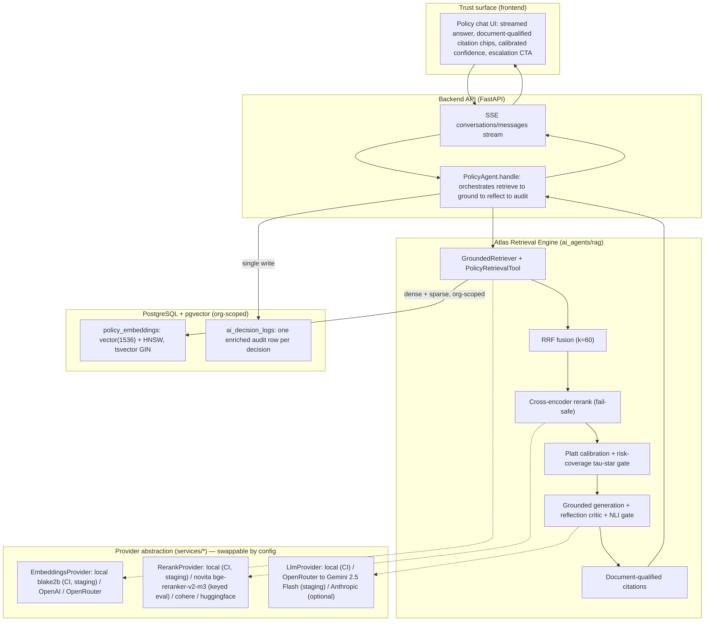
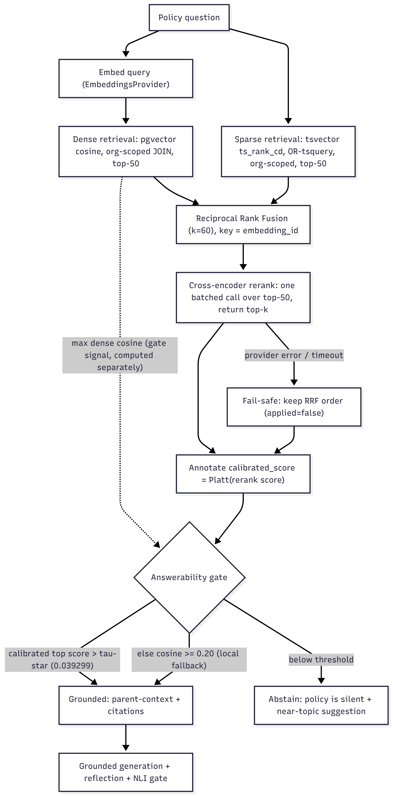
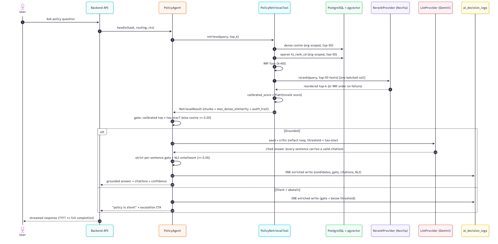
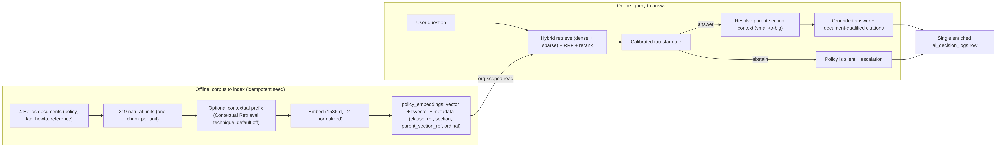
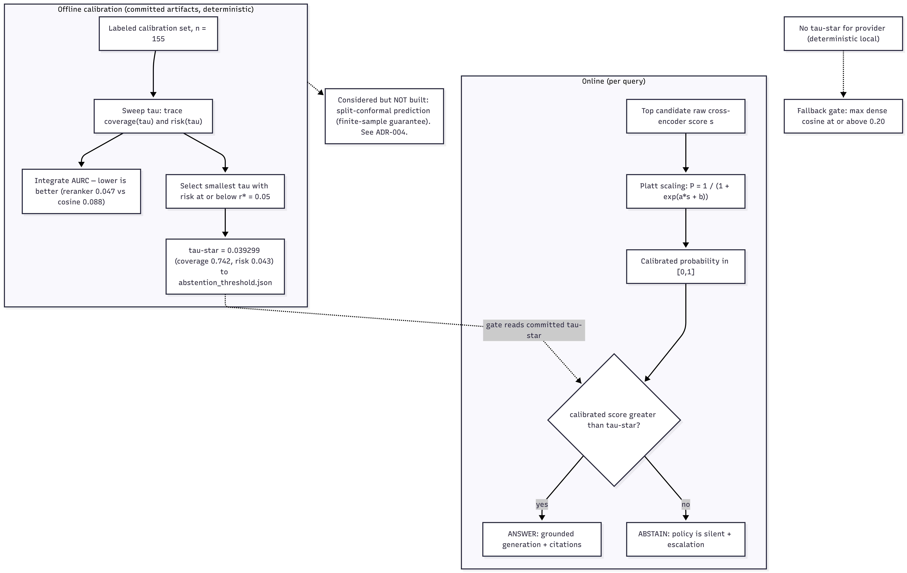
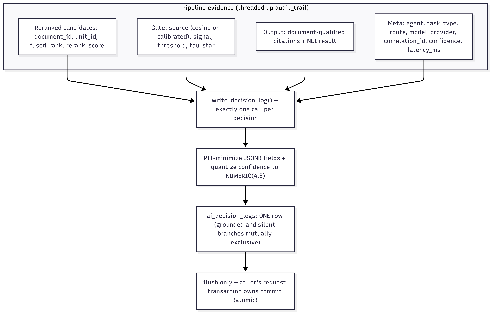
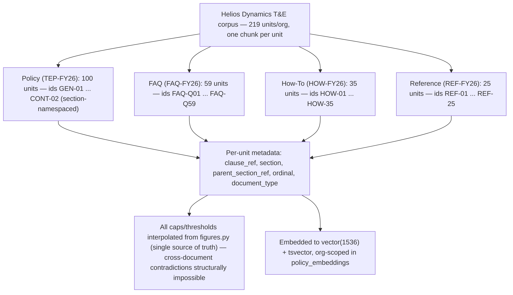

# Atlas Retrieval Engine (ARE)

This folder documents the **Atlas Retrieval Engine (ARE)**, the retrieval-augmented
generation subsystem that answers travel-&-expense policy questions in Atlas. It is for
reviewers who want the results in two minutes and for engineers who want the
architecture, decisions and evaluation behind them. The engine runs in the
[live demo](https://atlas-concur-ai.vercel.app) on the local embedder and reranker; the
keyed metrics below come from offline evaluation with a live cross-encoder and LLM.

> Part of the wider Atlas documentation: start at the [docs hub](../README.md); for the
> whole-application architecture (backend, frontend, agents, data) see
> [ARCHITECTURE](../ARCHITECTURE.md). This folder covers only the RAG subsystem.

**ARE answers enterprise travel-&-expense policy questions.** It finds the exact governing
policy clauses, generates an answer grounded in them with document-qualified citations, and
— when the corpus genuinely does not cover the question — abstains instead of
hallucinating, using a calibrated, data-derived trust boundary.

---

## Reading path

**Showcase → Architecture → Decisions → Metrics → deep.**

1. **[PROJECT_SHOWCASE](PROJECT_SHOWCASE.md)** — the 2-minute hook: problem, solution,
   headline results.
2. **[RAG_ARCHITECTURE](RAG_ARCHITECTURE.md)** — the system as it exists (~10 min).
3. **[ENGINEERING_DECISIONS](ENGINEERING_DECISIONS.md)** — the connected story of how the
   design evolved, including the honest debugging arc.
4. **[FINAL_METRICS_SUMMARY](metrics/FINAL_METRICS_SUMMARY.md)** — the canonical, sourced
   numbers.
5. Deep: the [ADRs](adr/), the [diagrams](diagrams/), the [Performance Profile](PERFORMANCE_PROFILE.md).

New to the terms? Start with the **[Glossary](GLOSSARY.md)**.

---

## Quick links

| Document | What it is |
|---|---|
| [PROJECT_SHOWCASE](PROJECT_SHOWCASE.md) | Two-minute overview + headline metrics |
| [RAG_ARCHITECTURE](RAG_ARCHITECTURE.md) | The anchor: full system, present tense |
| [ENGINEERING_DECISIONS](ENGINEERING_DECISIONS.md) | The decision narrative (flagship) |
| [PERFORMANCE_PROFILE](PERFORMANCE_PROFILE.md) | Latency lens (measured + deferred, honest) |
| [FUTURE_WORK](FUTURE_WORK.md) | Techniques deferred, with the "why not yet" |
| [GLOSSARY](GLOSSARY.md) | Plain-language definitions |
| [metrics/FINAL_METRICS_SUMMARY](metrics/FINAL_METRICS_SUMMARY.md) | **Canonical numbers** (all figures cite here) |
| [adr/](adr/) | 5 Architecture Decision Records |
| [diagrams/](diagrams/) | 7 Mermaid diagrams |
| [research/README](research/README.md) | Pointer to the companion research survey |

### Architecture Decision Records

These five cover the RAG engine; application-wide decisions (modular monolith, provider
adapters, routed agents and so on) are in the [app-level ADRs](../adr/README.md).

- [ADR-001 — Hybrid retrieval over dense-only](adr/ADR-001-hybrid-retrieval.md)
- [ADR-002 — Reciprocal Rank Fusion over weighted fusion](adr/ADR-002-reciprocal-rank-fusion.md)
- [ADR-003 — Cross-encoder reranking as a second stage](adr/ADR-003-cross-encoder-reranking.md)
- [ADR-004 — Calibrated abstention: Platt + risk-coverage (not conformal)](adr/ADR-004-confidence-calibration.md)
- [ADR-005 — One enriched audit write per decision](adr/ADR-005-single-audit-write.md)

### Diagrams

*Diagram source: [system_architecture.mmd](diagrams/system_architecture.mmd)*

*Diagram source: [retrieval_pipeline.mmd](diagrams/retrieval_pipeline.mmd)*

*Diagram source: [query_sequence.mmd](diagrams/query_sequence.mmd)*

*Diagram source: [data_flow.mmd](diagrams/data_flow.mmd)*

*Diagram source: [calibration_abstention.mmd](diagrams/calibration_abstention.mmd)*

*Diagram source: [audit_pipeline.mmd](diagrams/audit_pipeline.mmd)*

*Diagram source: [corpus_structure.mmd](diagrams/corpus_structure.mmd)*

---

## At a glance

- **Corpus:** 4-document synthetic enterprise T&E body, org-scoped; 219 units today
  (metrics were measured on the earlier 208-unit version — see the
  [corpus note](metrics/FINAL_METRICS_SUMMARY.md#headline-sheet)).
- **Pipeline:** hybrid (dense pgvector + sparse full-text) → RRF (k=60) →
  cross-encoder rerank (`bge-reranker-v2-m3`) → calibrated τ\* abstention gate →
  grounded generation + document-qualified citations → single audit write.
- **Calibration:** Platt scaling + risk-coverage / AURC (τ\* = 0.039299) — not conformal.
- **Results:** recall@10 0.727 → 0.819 → 0.959; AURC 0.101 → 0.047;
  **0.981 faithful @ 74% grounded** (108/145, latest keyed run; R6 history: 0.991 @ 78%),
  zero confirmed hallucinations
  ([sources](metrics/FINAL_METRICS_SUMMARY.md)).
- **Evaluation:** 197-query gold set (145 answerable + 52 unanswerable); deterministic
  CI gates the local-path plumbing, keyed runs measure the calibrated quality numbers.
  How to run each tier: [evals/README](../../evals/README.md).

---

## Repository map (one line)

The engine lives in `ai_agents/rag/` (fusion, rerank, calibration, threshold, grounding,
retrieval) with `ai_agents/tools/policy_retrieval.py` orchestrating hybrid retrieval,
`ai_agents/agents/policy_agent.py` orchestrating the decision, swappable providers under
`services/{embeddings,rerank,llm}_provider/`, the corpus + figures under
`database/seeds/corpus/`, and the gold datasets, harness, thresholds, and reports under
`evals/`.

---

*This folder reads on its own: it explains the design without reproducing application
source, prompts, secrets or deployment detail (those live in the code and in the
[deployment guide](../guides/deployment.md)). Every quantitative claim is traceable to a
named repository artifact, collected in
[FINAL_METRICS_SUMMARY](metrics/FINAL_METRICS_SUMMARY.md). Where any prose and the
repository disagree, the repository is authoritative.*
