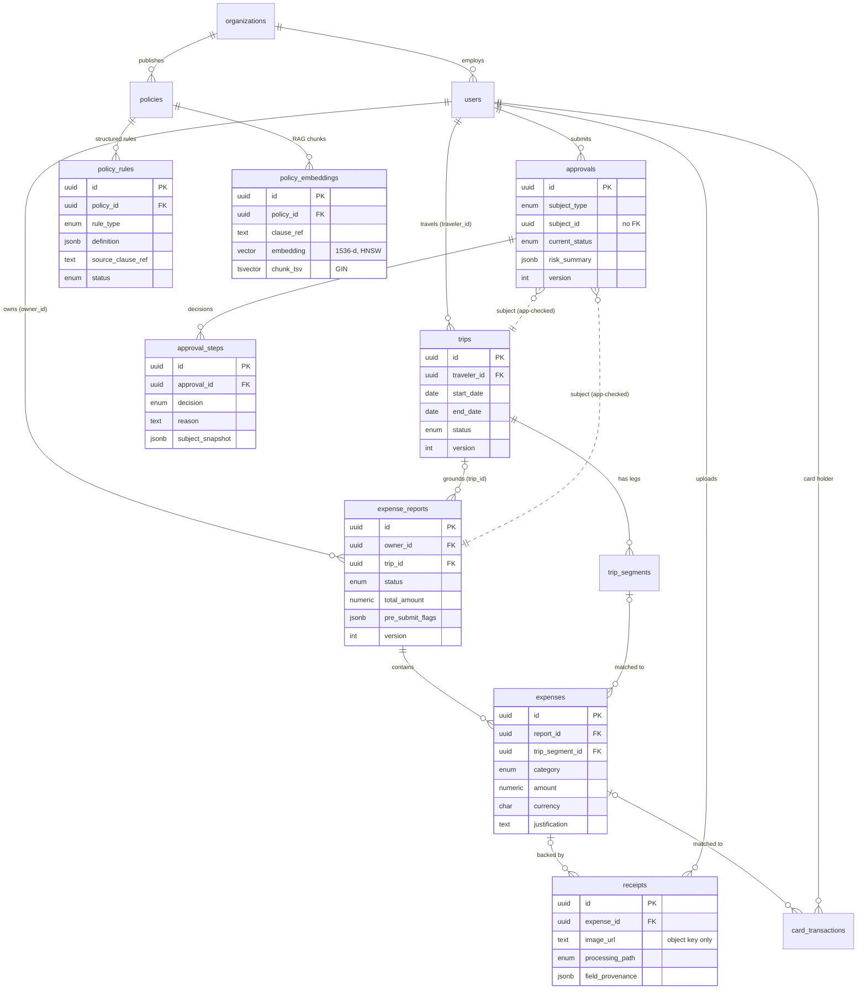
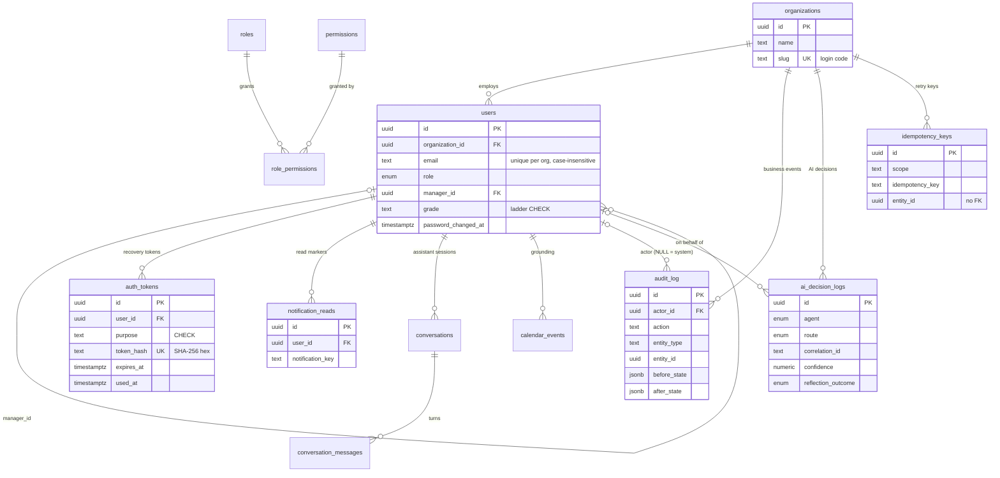

# Database schema

The Atlas data model: 24 PostgreSQL tables that connect trips, receipts, expenses, approvals and policy, with an audit record for every business change and a decision record for every AI task. It is for engineers reading the models or migrations, and for reviewers who want to see how lineage, workflow state and tenancy are stored. The original design (May 2026) is kept as the body; **As built:** notes and the migration history describe the schema that `alembic upgrade head` produces today.

**Contents:** [Why PostgreSQL](#why-postgresql) · [Conventions](#conventions) · [Entity-relationship diagrams](#entity-relationship-diagrams) · [Tables](#tables) · [Relationships](#relationships) · [Migration history 0001–0025](#migration-history-00010025) · [Migrations 0024 and 0025 in detail](#migrations-0024-and-0025-in-detail) · [Indexing](#indexing) · [Audit and decision logging](#audit-and-decision-logging) · [Integrity rules](#integrity-rules)

| Fact | Value | Where |
|---|---|---|
| Tables | 24 (plus `alembic_version`) | `database/models/` |
| Migrations | 0001–0025, one linear chain, head `0025_grade_entitlement_rules` | `database/migrations/versions/` |
| Extensions | `pgcrypto` (UUID generation), `vector` (pgvector) | created in `0001_initial_identity.py` |
| Engines | PostgreSQL 16 locally and in CI, Neon PostgreSQL 18 on staging | `docker/docker-compose.yml`, [README](../../README.md) |

---

## Why PostgreSQL

- **Relational integrity for a connected domain.** The point of the product is that trip, receipt, expense and approval data are *connected*. Foreign keys, transactions and constraints enforce that lineage.
- **Transactional workflow state.** Approval and report transitions must be atomic and never half-applied (NFR-R2).
- **Semi-structured AI artifacts in JSONB.** Extracted receipt fields, AI decision metadata, conversation context and rule definitions are semi-structured; `JSONB` with GIN indexes stores them next to strict relational columns.
- **Retrieval in the same database.** pgvector holds the policy embeddings next to the relational data, and PostgreSQL full-text search provides the lexical leg of hybrid retrieval. One datastore to run.
- **A strong constraint and indexing toolkit.** Enums, CHECKs, partial and composite indexes and unique constraints map onto the RBAC and integrity requirements.

Object storage (receipt images) sits beside PostgreSQL; the database remains the system of record and stores only object keys.

---

## Conventions

The design set these conventions for every table:

- **Primary keys:** `id UUID`, generated, so identifiers are non-sequential and merge-safe.
- **Tenant key:** every business table carries `organization_id` (FK → organizations).
- **Timestamps:** `created_at` and `updated_at` (`TIMESTAMPTZ NOT NULL`).
- **Authorship:** `created_by` / `updated_by` (FK → users) on mutable business tables.
- **Soft delete:** `deleted_at` where records must be retained for audit.
- **Optimistic concurrency:** `version INTEGER` on records subject to concurrent edits.
- **Status as ENUM:** lifecycle states are constrained enums, not free text.
- **Money:** `NUMERIC(14,2)` plus an ISO `currency CHAR(3)`; never floats.

> **As built:** the conventions are implemented as SQLAlchemy mixins in `database/models/mixins.py` and applied per table:
>
> | Mixin | Columns | Tables |
> |---|---|---|
> | `UUIDPrimaryKeyMixin` | `id UUID DEFAULT gen_random_uuid()` | every table except `role_permissions` (composite key) |
> | `TimestampMixin` | `created_at`, `updated_at` | mutable tables |
> | `CreatedAtMixin` | `created_at` only | append-only tables: `audit_log`, `ai_decision_logs`, `approval_steps`, `conversation_messages`, `policy_embeddings`, `idempotency_keys` |
> | `TenantMixin` | `organization_id` FK `ON DELETE RESTRICT` | root business tables: `trips`, `expense_reports`, `expenses`, `receipts`, `card_transactions`, `calendar_events`, `policies`, `approvals`, `conversations`, `ai_decision_logs`, `audit_log`, `idempotency_keys` (`users` and `auth_tokens` declare the column directly) |
> | `AuthorshipMixin` | `created_by`, `updated_by` FK `ON DELETE SET NULL` | `trips`, `expense_reports`, `expenses`, `policies`, `policy_rules` |
> | `VersionMixin` | `version INTEGER` | `trips`, `expense_reports`, `approvals` |
>
> Two differences from the design:
> - **Child tables do not repeat `organization_id`.** `trip_segments`, `approval_steps`, `policy_rules`, `policy_embeddings`, `conversation_messages` and `notification_reads` inherit their tenant through the parent foreign key.
> - **No soft delete.** `SoftDeleteMixin` exists but no model uses it, and no table has `deleted_at`. Records with review history are kept by refusing deletion (for example `409 REPORT_HAS_APPROVAL`), and only never-submitted drafts and unused receipts can be hard-deleted.
>
> `organizations.base_currency` is `TEXT`, not `CHAR(3)`. All other currency columns are `CHAR(3)`.

---

## Entity-relationship diagrams

Two diagrams keep each one readable. Both use the real table names from `database/models/`. A dotted line is a reference without a database foreign key (integrity is checked in the application).

### Core workflow: trips, receipts, expenses, approvals, policy

### Identity, audit, AI records and support tables

There is no `notifications` table: notifications are derived on read from workflow state, and `notification_reads` only stores which derived keys a user has marked read.

---

## Tables

Field tables follow the original design. Columns added later are marked with the migration that added them. Types use PostgreSQL vocabulary.

### organizations

The tenant root.

| Field | Type | Constraints | Notes |
|---|---|---|---|
| id | UUID | PK | |
| name | TEXT | NOT NULL | Company name |
| base_currency | TEXT | NOT NULL | Default reporting currency |
| slug | TEXT | NOT NULL, UNIQUE, CHECK format, 2–63 chars | **0022.** Organisation login code (lower-case letters, digits, single hyphens) |
| created_at / updated_at | TIMESTAMPTZ | NOT NULL | |

### users

People in the system; the role drives RBAC and the self-referential manager link drives approval routing.

| Field | Type | Constraints | Notes |
|---|---|---|---|
| id | UUID | PK | |
| organization_id | UUID | FK → organizations, NOT NULL, RESTRICT | Tenant |
| name | TEXT | NOT NULL | |
| email | TEXT | NOT NULL | Unique per organisation, case-insensitive (`uq_users_org_email_lower`, **0022**) |
| role | ENUM `user_role` (`employee`, `manager`, `finance_admin`) | NOT NULL | Fine-grained permissions come from `role_permissions` |
| department | TEXT | NULL | Scoping and analytics |
| manager_id | UUID | FK → users, NULL, SET NULL | Approver for this user |
| status | ENUM (`active`, `inactive`) | NOT NULL, default `active` | Inactive users cannot authenticate |
| preferences | JSONB | NULL | Traveller preferences used by the travel agent |
| password_hash | TEXT | NOT NULL | bcrypt; never returned or logged |
| grade | TEXT | NULL, CHECK on the ladder | **0021.** `CSUITE`, `SVP`, `VP`, `DIRECTOR`, `MANAGER`, `SENIOR_IC`, `IC`, `INTERN`; NULL = unknown, never guessed |
| email_verified_at | TIMESTAMPTZ | NULL | **0024.** NULL = not verified (a banner, nothing blocked) |
| password_changed_at | TIMESTAMPTZ | NULL | **0024.** Its keyed fingerprint in every JWT revokes older sessions |
| created_at / updated_at | TIMESTAMPTZ | NOT NULL | |

### roles, permissions, role_permissions

Role → permission as data, so authorisation can change without code changes to the checks.

| Table | Fields | Notes |
|---|---|---|
| roles | `id` PK, `key` ENUM `role_key` UNIQUE, `description` | Mirrors `users.role` |
| permissions | `id` PK, `key` TEXT UNIQUE, `description` | Keys like `expense.read.own`, `approval.decide.reports`, `policy.manage`, `expense.reimburse.org` (catalogue in `config/constants/permissions.py`) |
| role_permissions | `role_id` FK CASCADE, `permission_id` FK CASCADE, composite PK | Prevents duplicate grants |

### trips

A planned or booked trip, created when an employee selects a recommendation.

| Field | Type | Constraints | Notes |
|---|---|---|---|
| id | UUID | PK | |
| organization_id | UUID | FK, NOT NULL | |
| traveler_id | UUID | FK → users, NOT NULL, RESTRICT | Ownership column for record scoping |
| origin / primary_destination | TEXT | NOT NULL | |
| start_date / end_date | DATE | NOT NULL, CHECK `end_date >= start_date` | |
| purpose | TEXT | NULL | |
| estimated_cost / budget_amount | NUMERIC(14,2) | NULL | |
| currency | CHAR(3) | NOT NULL | |
| status | ENUM `trip_status` (`draft`, `pending_approval`, `approved`, `rejected`, `completed`, `cancelled`) | NOT NULL | |
| recommendation_context | JSONB | NULL | Chosen option and rationale snapshot |
| withdrawn_at / withdrawn_by_id / withdrawal_reason | TIMESTAMPTZ / UUID FK RESTRICT / TEXT | NULL | **0016.** Owner withdrawal of a returned trip |
| created_by / updated_by | UUID | FK → users, SET NULL | |
| created_at / updated_at | TIMESTAMPTZ | NOT NULL | |
| version | INTEGER | NOT NULL | Optimistic lock |

### trip_segments

Legs of a trip. One trip → many segments.

| Field | Type | Constraints | Notes |
|---|---|---|---|
| id | UUID | PK | |
| trip_id | UUID | FK → trips, NOT NULL, CASCADE | |
| segment_type | ENUM (`flight`, `hotel`, `rail`, `car`) | NOT NULL | |
| supplier | TEXT | NULL | From the mock inventory |
| start_datetime / end_datetime | TIMESTAMPTZ | NULL, CHECK end ≥ start (**0006**) | |
| location | TEXT | NULL | Grounding context for receipts |
| amount / currency | NUMERIC(14,2) / CHAR(3) | NULL | |
| in_policy | BOOLEAN | NULL | Policy result at selection |
| policy_notes | TEXT | NULL | Reason if out of policy |
| details | JSONB | NULL | Cabin, room type, sustainability |
| created_at / updated_at | TIMESTAMPTZ | NOT NULL | |

### expense_reports

A container of expense entries; the workflow subject for expenses.

| Field | Type | Constraints | Notes |
|---|---|---|---|
| id | UUID | PK | |
| organization_id | UUID | FK, NOT NULL | |
| owner_id | UUID | FK → users, NOT NULL, RESTRICT | Ownership column for record scoping |
| trip_id | UUID | FK → trips, NULL, SET NULL | |
| title | TEXT | NOT NULL | |
| status | ENUM `expense_report_status` (`draft`, `submitted`, `approved`, `rejected`, `reimbursed`) | NOT NULL | A returned or withdrawn report is a `draft`; `withdrawn_at` closes a withdrawn one |
| total_amount | NUMERIC(14,2) | NOT NULL, default 0 | Derived from entries |
| currency | CHAR(3) | NOT NULL | |
| submitted_at | TIMESTAMPTZ | NULL | |
| pre_submit_flags | JSONB | NULL | Snapshot of policy flags read by the submit gate |
| reimbursed_at / reimbursed_by_id | TIMESTAMPTZ / UUID FK RESTRICT | NULL | **0016.** Simulated reimbursement by finance |
| reimbursement_reference | TEXT | NULL, unique when present | **0016.** `REIMB-<yyyymmdd>-<12 hex>` |
| reimbursement_amount | NUMERIC(14,2) | NULL | **0016** |
| withdrawn_at / withdrawn_by_id / withdrawal_reason | TIMESTAMPTZ / UUID FK RESTRICT / TEXT | NULL | **0016** |
| created_by / updated_by | UUID | FK → users, SET NULL | |
| created_at / updated_at | TIMESTAMPTZ | NOT NULL | |
| version | INTEGER | NOT NULL | Optimistic lock |

### expenses (expense entries)

One line item. Belongs to a report; optionally linked to a trip segment and to receipts.

| Field | Type | Constraints | Notes |
|---|---|---|---|
| id | UUID | PK | |
| organization_id | UUID | FK, NOT NULL | |
| report_id | UUID | FK → expense_reports, NOT NULL, CASCADE | |
| trip_segment_id | UUID | FK → trip_segments, NULL, SET NULL | Smart-match link |
| category | ENUM `expense_category` (`airfare`, `lodging`, `meals`, `ground_transport`, `other`, + `mileage`, `entertainment`, `gift` in **0019**) | NOT NULL | The 0019 values are manual-only |
| amount | NUMERIC(14,2) | NOT NULL, CHECK ≥ 0 | |
| currency | CHAR(3) | NOT NULL | |
| expense_date | DATE | NOT NULL | |
| vendor / description | TEXT | NULL | |
| status | ENUM (`draft`, `matched`, `flagged`, `approved`) | NOT NULL | |
| match_source | ENUM (`receipt`, `card_txn`, `manual`, `trip`) | NULL | Provenance of the entry |
| is_itemized | BOOLEAN | NOT NULL, default false | |
| justification | TEXT | NULL | **0013.** Makes a justifiable violation advisory; still shown to the approver |
| receipt_affidavit_at | TIMESTAMPTZ | NULL | **0018.** EXP-04 missing-receipt affidavit |
| attendee_count | INTEGER | NULL, CHECK > 0 | **0019.** MEAL-05 / ENT-02 per-head caps |
| disclosure / mileage | JSONB | NULL | **0019.** ENT-04 gift disclosure; MIL-01..03 mileage claim |
| released_from_report_id / released_from_approval_id / released_at | UUID / UUID / TIMESTAMPTZ | NULL, no FK on purpose | **0023.** Where a line moved out of a withdrawn report came from |
| created_by / updated_by | UUID | FK → users, SET NULL | |
| created_at / updated_at | TIMESTAMPTZ | NOT NULL | |

### receipts

Captured receipt images with extracted fields, confidence and provenance.

| Field | Type | Constraints | Notes |
|---|---|---|---|
| id | UUID | PK | |
| organization_id | UUID | FK, NOT NULL | |
| uploaded_by | UUID | FK → users, NOT NULL, RESTRICT | |
| expense_id | UUID | FK → expenses, NULL, SET NULL | Linked once matched or attached |
| image_url | TEXT | NOT NULL | Object-storage **key**, never a public URL. A rasterised PDF is stored as `<org>/<uuid>-from-pdf.png` |
| ocr_status | ENUM (`pending`, `processed`, `failed`) | NOT NULL | |
| processing_path | ENUM (`deterministic`, `agent_gap_fill`) | NULL | Which route resolved it |
| extracted_fields | JSONB | NULL | amount, currency, date, vendor, location, expense type, review flags |
| field_confidence | JSONB | NULL | Per-field confidence |
| field_provenance | JSONB | NULL | Per field: `deterministic`, `ai_inferred` or `user_edited` |
| grounding_context | JSONB | NULL | Trip and calendar context the gap-fill used |
| created_at / updated_at | TIMESTAMPTZ | NOT NULL | |

### card_transactions and calendar_events (simulated sources)

| Table | Fields | Notes |
|---|---|---|
| card_transactions | `id`, `organization_id`, `user_id` FK RESTRICT, `expense_id` FK SET NULL, `amount` NUMERIC(14,2), `currency` CHAR(3), `merchant`, `txn_date` DATE, `last_four` CHAR(4), `matched` BOOLEAN, timestamps | Seeded card feed; a second capture source for smart matching |
| calendar_events | `id`, `organization_id`, `user_id` FK RESTRICT, `title`, `location`, `start_datetime`, `end_datetime`, timestamps | Seeded calendar used to ground receipt gap-fill and the planner |

### policies, policy_rules, policy_embeddings

| Table | Fields | Notes |
|---|---|---|
| policies | `id`, `organization_id`, `name`, `version` INTEGER (document version), `effective_from` DATE, `document_text`, `is_active`, `document_type` ENUM (`policy`, `faq`, `howto`, `reference`, NULL for the rule-bearing stub; **0008**), authorship, timestamps | Unique `(organization_id, name, version)`; at most one active policy per `(organization_id, name)` (partial unique index, **0006**) |
| policy_rules | `id`, `policy_id` FK CASCADE, `rule_type` ENUM, `applies_to` ENUM (`flight`, `hotel`, `rail`, `car`, `meals`, `all`), `definition` JSONB, `source_clause_ref`, `status` ENUM (`draft`, `active`, `archived`), authorship, timestamps | `rule_type`: `amount_cap`, `category_allow`, `cabin_class`, `per_diem`, `preferred_supplier`, `receipt_required`, plus `per_head_cap`, `gift_disclosure`, `mileage` (**0019**). Newer rule families reuse a type with a `kind` key in `definition` |
| policy_embeddings | `id`, `policy_id` FK CASCADE, `chunk_text`, `clause_ref`, `embedding` VECTOR(1536), `created_at`; `section`, `parent_section_ref`, `ordinal` (**0009**); `chunk_tsv` TSVECTOR (**0010**); `context_prefix` (**0011**) | `chunk_text` stays pristine for reranking and citations; the context prefix feeds only the embedding and the lexical vector |

### approvals and approval_steps

| Table | Fields | Notes |
|---|---|---|
| approvals | `id`, `organization_id`, `subject_type` ENUM (`trip`, `expense_report`), `subject_id` (no FK), `submitter_id` FK RESTRICT, `current_status` ENUM (`pending`, `auto_approved`, `approved`, `rejected`, `changes_requested`), `is_auto_approved`, `risk_summary` JSONB, timestamps, `version` | No authorship columns; `submitter_id` is explicit |
| approval_steps | `id`, `approval_id` FK CASCADE, `approver_id` FK SET NULL (NULL = system), `step_order`, `decision` ENUM (`approve`, `reject`, `request_changes`, `auto_approve`), `reason`, `decided_at`, `created_at`, `subject_snapshot` JSONB (**0014**) | Append-only history; the snapshot freezes what a reviewer returned or rejected, for the re-file check |

### conversations and conversation_messages

| Table | Fields | Notes |
|---|---|---|
| conversations | `id`, `organization_id`, `user_id` FK RESTRICT, `context_type` ENUM (`travel_planning`, `expense`, `policy_qa`, `general`), `context_ref_id` (no FK), `parsed_intent` JSONB, timestamps | Assistant sessions; `parsed_intent` backs the editable intent chips |
| conversation_messages | `id`, `conversation_id` FK CASCADE, `role` ENUM (`user`, `assistant`, `system`, `tool`), `content`, `tool_calls` JSONB, `citations` JSONB, `sequence`, `created_at` | Append-only turns with their grounding trace |

### ai_decision_logs

One row per AI task, for explainability, audit and evaluation (FR-A5).

| Field | Type | Notes |
|---|---|---|
| id, organization_id, user_id (FK SET NULL) | UUID | |
| agent | ENUM (`orchestrator`, `travel`, `expense`, `policy`, `approval`, `receipt_analysis`) | |
| task_type | TEXT | e.g. `approval_decision`, `trip_planning`, `policy_grounded_lookup` |
| route | ENUM (`deterministic`, `llm`) | The routing metric (M-R4) |
| model_provider | TEXT | NULL on deterministic paths |
| correlation_id | TEXT | **0007.** Ties the row to the HTTP request |
| input_summary / tools_used / output_summary | JSONB | Minimised before persistence |
| confidence | NUMERIC(4,3) | Range-checked to 0–1 |
| reflection_outcome | ENUM (`passed`, `revised`, `rejected`) | NULL when no critic ran |
| latency_ms | INTEGER | |
| created_at | TIMESTAMPTZ | |

### audit_log

Record of every meaningful business event (NFR-R4). No `updated_at`.

| Field | Type | Notes |
|---|---|---|
| id, organization_id | UUID | |
| actor_id | UUID FK → users, SET NULL | NULL = system (agent, migration, scheduler) |
| action | TEXT | e.g. `receipt.processed`, `expense_report.status_changed`, `approval.auto_approved`, `approval.escalated`, `approval.decided`, `expense_report.reimbursed`, `policy_rule.seeded` |
| entity_type / entity_id | TEXT / UUID | |
| before_state / after_state | JSONB | |
| created_at | TIMESTAMPTZ | |

### Support tables added after the design

| Table | Added in | Fields | Purpose |
|---|---|---|---|
| idempotency_keys | 0006 | `id`, `organization_id`, `scope`, `idempotency_key`, `entity_id` (no FK), `created_at`; UNIQUE `(organization_id, scope, idempotency_key)` | Replays a retried create or upload instead of duplicating it |
| notification_reads | 0020 | `id`, `user_id` FK CASCADE, `notification_key` (1–200 chars), `read_at`; UNIQUE `(user_id, notification_key)`, index `(user_id, read_at)` | Per-user read state for derived notifications |
| auth_tokens | 0024 | see [below](#0024_auth_tokens) | One-time password-reset, invitation and email-verification tokens |

---

## Relationships

**One-to-many**

- organizations → users, trips, expense_reports, policies, approvals (tenant ownership).
- users → trips (traveller), expense_reports (owner), receipts (uploader), card_transactions, conversations, auth_tokens, notification_reads.
- users → users (self-referential `manager_id`; one level is used for scoping).
- trips → trip_segments; trips → expense_reports; expense_reports → expenses.
- expenses → receipts and card_transactions (typical case 1:1).
- policies → policy_rules, policy_embeddings; approvals → approval_steps; conversations → conversation_messages.

**Many-to-many**

- roles ↔ permissions through `role_permissions`.
- trip_segments ↔ expenses conceptually (a hotel stay can produce lodging, parking and meals). Resolved through `expenses.trip_segment_id` plus itemisation; a junction table remains a possible extension.

**Polymorphic references (no database FK, checked in the application)**

- `approvals (subject_type, subject_id)` → trip or expense report. This keeps one generic workflow engine for both subjects; the service loads the subject with record scoping before any decision.
- `conversations.context_ref_id`, `idempotency_keys.entity_id`, and the 0023 lineage columns on `expenses`. The lineage columns have no FK on purpose: they are audit references that must outlive what they point at.

**Lineage (the connected loop)**

receipt → expense → expense_report → trip → trip_segment, with `card_transactions` and `calendar_events` as grounding sources and `ai_decision_logs` recording how derived values were produced.

---

## Migration history 0001–0025

One linear Alembic history. CI's `backend` job fails if `alembic heads` returns more than one head, and `backend/tests/test_migration_chain.py` upgrades a clean database, checks that autogenerate finds no drift between models and schema, and downgrades to base.

| # | Revision | Kind | What it does |
|---|---|---|---|
| 0001 | `0001` | schema | `pgcrypto` and `vector` extensions; `organizations`, `users`, `roles`, `permissions`, `role_permissions`, `audit_log` |
| 0002 | `0002` | schema | `trips`, `trip_segments` (with `end_date >= start_date` CHECK) |
| 0003 | `0003` | schema | `expense_reports`, `expenses` (with `amount >= 0` CHECK) |
| 0004 | `0004` | schema | `policies`, `policy_rules`, `policy_embeddings`, `card_transactions`, `calendar_events`, `receipts`, `approvals`, `approval_steps`, `conversations`, `conversation_messages`, `ai_decision_logs` |
| 0005 | `0005` | indexes | 38 indexes: 28 FK indexes, 5 named composites, 2 JSONB GIN, 2 partial, 1 HNSW |
| 0006 | `0006` | schema | `idempotency_keys`; one active policy per `(organization_id, name)`; segment end ≥ start CHECK |
| 0007 | `0007` | schema | `ai_decision_logs.correlation_id` + index |
| 0008 | `0008` | schema | `policies.document_type` (multi-document corpus) |
| 0009 | `0009` | schema | `policy_embeddings.section`, `parent_section_ref`, `ordinal` |
| 0010 | `0010` | schema | `policy_embeddings.chunk_tsv` + GIN index (lexical retrieval) |
| 0011 | `0011` | schema | `policy_embeddings.context_prefix` |
| 0012 | `0012_hnsw_ef_construction_200` | index | Rebuilds the HNSW index with `ef_construction = 200` (`m = 16` unchanged) |
| 0013 | `0013_expense_justification` | schema | `expenses.justification` |
| 0014 | `0014_approval_step_snapshot` | schema | `approval_steps.subject_snapshot` |
| 0015 | `0015_canonical_policy_figures` | data | HOTEL-CAP and MEALS-PD rules moved to the TEP-FY26 figures (hotel $300 / $225 / $160 per night; meals $85 / $75 / $65 per day) |
| 0016 | `0016_report_trip_lifecycle` | schema + data | Reimbursement and withdrawal columns on `expense_reports`, withdrawal columns on `trips`; `expense.reimburse.org` permission |
| 0017 | `0017_entry_level_policy_rules` | data | LOD-02, MEAL-02, MEAL-04, GRND-01 / 03 / 05 |
| 0018 | `0018_process_timing_rules` | schema + data | `expenses.receipt_affidavit_at`; EXP-01, PTA-02, PTA-05, AIR-06, CARD-03; EXP-04 and AIR-04 keys on existing rules |
| 0019 | `0019_spend_caps_mileage` | schema + data | New enum values; `attendee_count`, `disclosure`, `mileage` on `expenses`; MEAL-05, ENT-02, ENT-04, MIL-01..03 rules |
| 0020 | `0020_notification_reads` | schema | `notification_reads`; global `uq_users_email_lower` (replaced in 0022) |
| 0021 | `0021_traveller_grades` | schema | `users.grade` + ladder CHECK |
| 0022 | `0022_org_scoped_email` | schema | `organizations.slug`; email unique per organisation (`uq_users_org_email_lower`); drops the global index |
| 0023 | `0023_entry_release_lineage` | schema | `expenses.released_from_report_id`, `released_from_approval_id`, `released_at` |
| 0024 | `0024_auth_tokens` | schema | `auth_tokens`; `users.email_verified_at`, `users.password_changed_at` |
| 0025 | `0025_grade_entitlement_rules` | data | AIR-07, LOD-05, NR-01 grade-entitlement rules (head) |

Revisions 0001–0011 use the short revision IDs shown; from 0012 on, the revision ID carries the descriptive suffix.

**How later migrations stay safe on a populated database.** Since 0013 every schema change is additive: new columns are nullable with no default (a catalog-only `ADD COLUMN` in PostgreSQL, no table rewrite), and new constraints are added `NOT VALID` and then validated where that matters. Data migrations touch only rows that still equal a frozen literal copied into the migration (never imported from seed code), write one `audit_log` row per change with `actor_id = NULL`, and never overwrite a rule a person has edited. Several migrations fail closed with a count-only message instead of guessing (0020 and 0022 on duplicate emails, 0019's downgrade while new categories are in use). Releases that include a migration roll forward, not back ([rollback runbook](../runbooks/rollback.md)).

---

## Migrations 0024 and 0025 in detail

### 0024_auth_tokens

Account recovery: password reset, invitations and email verification. Revises `0023_entry_release_lineage`.

| Column | Type | Constraint |
|---|---|---|
| id | UUID | PK, `gen_random_uuid()` |
| organization_id | UUID | NOT NULL, FK → organizations `ON DELETE RESTRICT` |
| user_id | UUID | NOT NULL, FK → users `ON DELETE CASCADE` |
| purpose | TEXT | NOT NULL, `ck_auth_tokens_purpose_known`: `password_reset`, `invite`, `email_verify` |
| token_hash | TEXT | NOT NULL, UNIQUE (`uq_auth_tokens_token_hash`), `ck_auth_tokens_token_hash_sha256_hex`: `^[0-9a-f]{64}$` |
| expires_at | TIMESTAMPTZ | NOT NULL |
| used_at | TIMESTAMPTZ | NULL (single use) |
| created_by_id | UUID | NULL, FK → users `ON DELETE SET NULL` (the inviting admin) |
| created_at | TIMESTAMPTZ | NOT NULL, default `now()` |
| requested_ip_hash | TEXT | NULL |

Index `ix_auth_tokens_user_id_purpose (user_id, purpose)`. On `users`: `email_verified_at` and `password_changed_at`, both nullable with no default.

Design points:

- **Only a SHA-256 digest is stored.** The raw token (32 random bytes, URL-safe) exists only in the emailed link, or once in the inviting admin's response when no email is delivered (`backend/app/modules/identity/accounts.py`).
- **`purpose` is `TEXT` + CHECK, not a PostgreSQL enum**, so no enum type is created or altered.
- **Safe on a populated database:** one new empty table and two nullable columns. Existing users keep NULL in both: "not verified" (a banner, nothing blocked) and "password never changed through the app" (their existing tokens stay valid until the first change).
- `downgrade()` drops the table and the two columns.
- Tests: `backend/tests/test_migration_0024_auth_tokens.py`, `backend/tests/test_fu_accounts_db.py`, `backend/tests/test_fu_accounts_unit.py`.

### 0025_grade_entitlement_rules

Data only: no schema or enum change. Revises `0024_auth_tokens`.

| Rule | `rule_type` / `applies_to` | `definition` (`kind = grade_entitlement`) |
|---|---|---|
| AIR-07 | `category_allow` / `all` | `entitlement: airport_extras`, `min_grade: SVP`, `delay_exception_hours: 4` |
| LOD-05 | `category_allow` / `all` | `entitlement: room_upgrade`, `min_grade: SVP` |
| NR-01 | `category_allow` / `all` | `entitlement: lounge_membership`, `min_grade: SVP` |

- **Upgrade:** inserts each rule, active, into every policy that carries a HOTEL-CAP rule (the rule-bearing policy), only when that policy has no rule citing the clause yet, in any status. An archived or admin-edited rule is never re-added or touched. Each insert writes an `audit_log` row (`policy_rule.seeded`, actor NULL). On a fresh database the seed has already written the rules, so the step is a no-op.
- **Downgrade:** deletes only rows that still equal the frozen literal and that no person ever touched (no audit row with an actor), each with a `policy_rule.unseeded` audit row.
- The rules are evaluated by `ai_agents/tools/grade_entitlements.py` against the expense owner's grade of record.
- Tests: `backend/tests/test_fu_grade_entitlements_consistency.py::test_migration_chain_and_frozen_literals` (literals equal the seed), `backend/tests/test_fu_grade_entitlements_db.py` (upgrade and both downgrade guards on a populated database).

---

## Indexing

The design targeted the access patterns behind each screen: foreign keys (PostgreSQL does not index them automatically), composite indexes for common filters, tenant-leading composites, JSONB GIN indexes, an ANN index for retrieval and partial indexes for hot queues.

> **As built** (migration 0005 unless noted):
>
> | Kind | Indexes |
> |---|---|
> | FK indexes | 28, one per join-driving FK not already covered by a leading unique or composite index (authorship FKs excluded) |
> | Composites | `ix_expense_reports_owner_id_status`, `ix_approvals_organization_id_current_status`, `ix_trips_traveler_id_status`, `ix_trips_start_date`, `ix_expenses_report_id_status`; `ix_audit_log_entity_type_entity_id_created_at` (0001) |
> | Unique | `uq_users_organization_id_email`, `uq_users_org_email_lower` (0022), `uq_organizations_slug` (0022), `uq_roles_key`, `uq_permissions_key`, `uq_policies_organization_id_name_version`, `uq_idempotency_keys_organization_id_scope_idempotency_key` (0006), `uq_notification_reads_user_id_notification_key` (0020), `uq_auth_tokens_token_hash` (0024), `uq_expense_reports_reimbursement_reference` (0016) |
> | Added later | `ix_ai_decision_logs_correlation_id` (0007), `ix_notification_reads_user_id_read_at` (0020), `ix_auth_tokens_user_id_purpose` (0024) |
> | JSONB GIN | `ix_receipts_extracted_fields`, `ix_policy_rules_definition` |
> | Partial | `ix_approvals_org_pending`, `ix_receipts_org_ocr_pending`; one active policy per `(organization_id, name)` (0006) |
> | Retrieval | `ix_policy_embeddings_embedding_hnsw` (HNSW, `vector_cosine_ops`, `m = 16`, `ef_construction = 200` since 0012); `ix_policy_embeddings_chunk_tsv` (GIN, 0010) |
>
> The tenant-prefix rule was applied with judgement: composites lead with `organization_id` only where no more selective tenant-bound column already leads. For `expense_reports`, `trips` and `expenses`, the ownership column leads because it already implies one organisation. Indexes are verified by `backend/tests/test_p3_indexes.py`.

---

## Audit and decision logging

- **`audit_log`** records who did what, when, with before/after state, for every business event; rows are never updated or deleted (NFR-R4). It is the compliance record finance reviews and exports as CSV (US-F2).
- **`ai_decision_logs`** is the parallel record for AI actions: route, tools, confidence and reflection outcome.
- **Row provenance** (`created_by`, `updated_by`, `version`) gives lightweight change tracking without reading the audit log.
- **Field provenance** in `receipts.field_provenance` says, per field, whether a value was read deterministically, inferred by AI, or edited by the user.
- **Policy versioning**: `policies.version` plus rule status changes in `audit_log` tie each enforcement decision to the policy state in effect; the UI shows a per-rule change history (`GET /api/v1/policy/rules/{id}/history`).
- **Separation**: operational logs are structured and transient, outside the database; the database holds only durable audit and decision records.

> **As built:** `audit_log` has a single writer, `backend/app/core/audit.py::record_audit`, which writes inside the caller's transaction so the change and its audit row commit together. Data migrations insert audit rows with SQL in the same pattern. Append-only is enforced by convention and review, not by a database trigger or privilege split; the README lists this as a known limitation.

---

## Integrity rules

| Rule | Design | As built |
|---|---|---|
| Referential integrity | FKs on all relationships; `CASCADE` only for true children | As designed. `CASCADE`: segments, entries, steps, messages, embeddings, rules, role grants, a user's tokens and read markers. Users with business records are protected by `RESTRICT`. Integrity errors map to 409 (unique, FK) or 422 (check) in the error envelope. |
| Enumerated lifecycles | Every `status` is an enum; legal transitions enforced in the application and audited | As designed. Transition tables live in the services (for example `backend/app/modules/travel/service.py`); tests in `backend/tests/unit/test_unit_state_transitions.py`. |
| Money | `NUMERIC` with explicit currency; `CHECK (amount >= 0)` where meaningful; totals derived | As designed. Foreign-currency lines are converted with simulated static rates (`config/constants/fx_rates.py`) before policy caps and totals. |
| Temporal | `end_date >= start_date` on trips; segment end ≥ start | As designed (0002, 0006). |
| Uniqueness | One email per organisation; one active policy per scope; no duplicate grants | As designed, with case-insensitive email uniqueness per organisation (0022). |
| Required reasons | Reject and request-changes need a reason | Enforced by `backend/app/core/validation.py::validate_required_reason` (whitespace-only is refused). |
| Idempotency | Keys on receipt upload and expense creation | `idempotency_keys` (0006); a key first used by another user never replays that user's record. |
| Optimistic concurrency | `version` on reports and approvals | On trips, expense reports and approvals, through a compare-and-swap `UPDATE` (`backend/app/core/concurrency.py`); stale version → 409. |
| Provenance | AI-inferred fields have a decision-log row and a provenance marker | The receipt pipeline writes both in the same flush. |
| Tenant isolation | All queries `organization_id`-scoped so row-level security could be added without schema change | Application-level through `scope_query`; no RLS today ([ADR-0006](../adr/0006-application-level-tenancy.md)). |
| Soft delete | `deleted_at` on records kept for audit | Not implemented; deletion of reviewed records is refused instead. |
