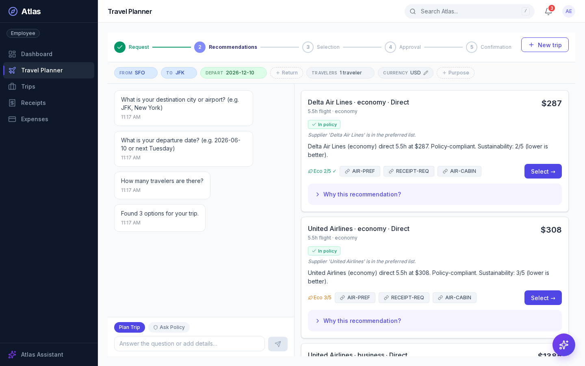
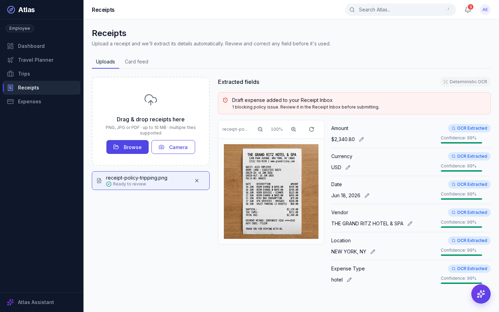
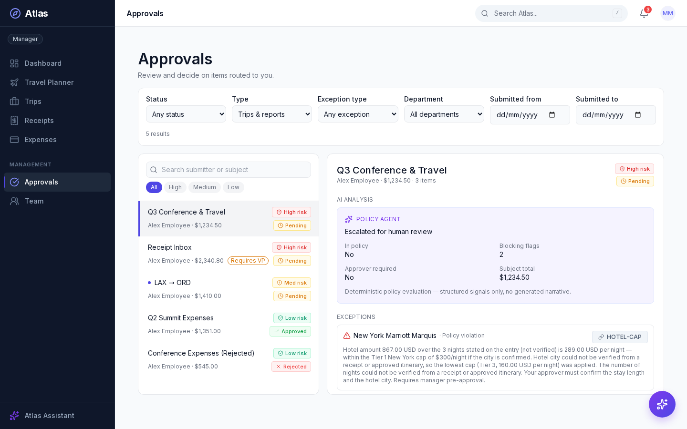
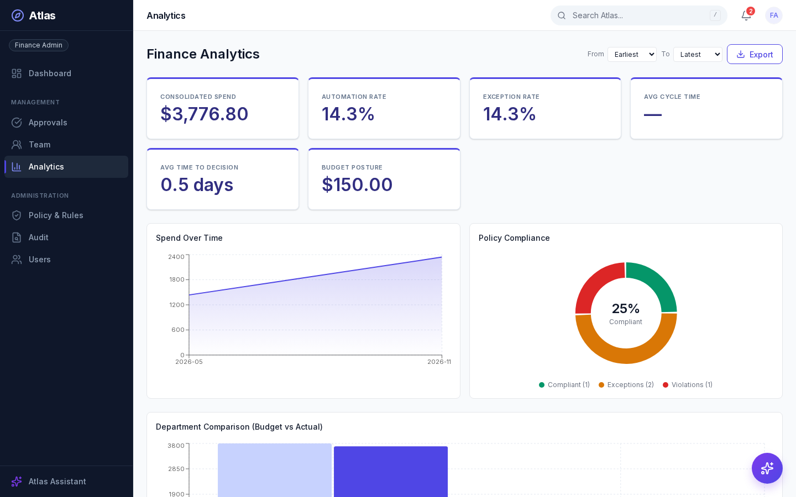
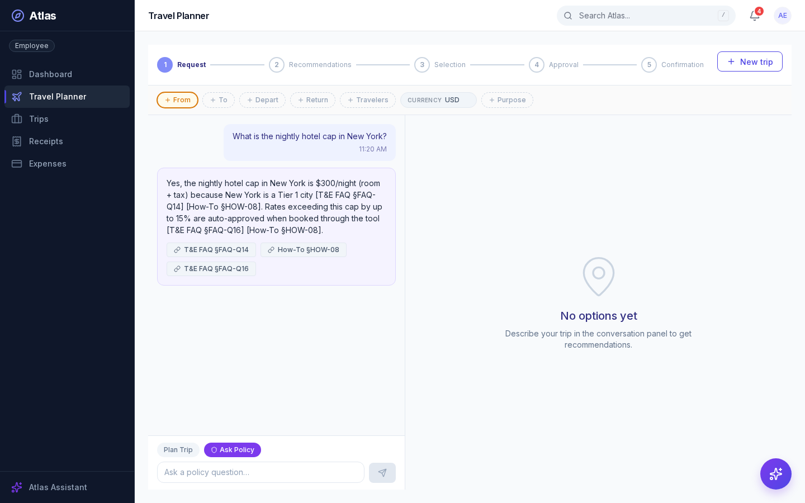
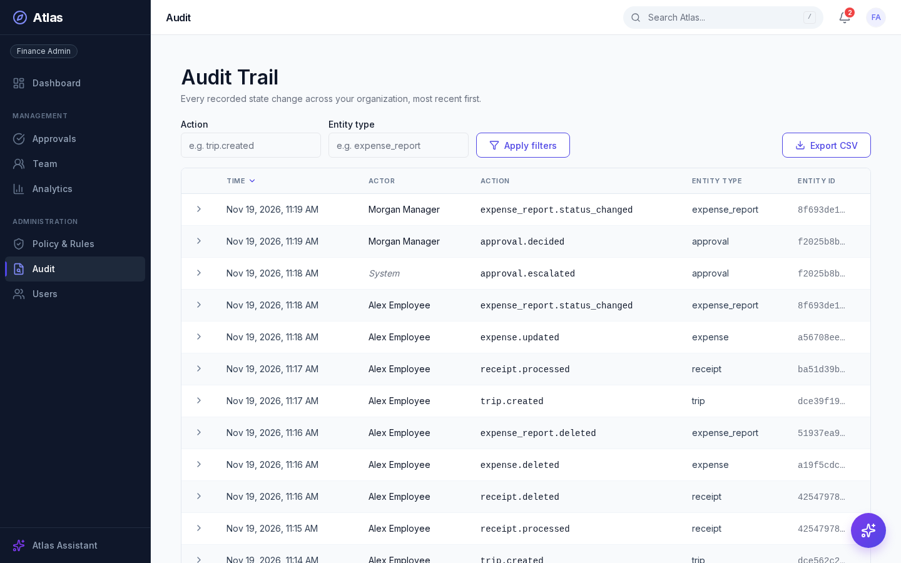

# UI/UX design

How Atlas should feel and work for its three users (employee, manager, finance admin): the design principles, the app shell, each key screen, the component system and the mobile strategy. It is for reviewers who want to see the product thinking behind the screens, and for engineers changing the frontend. The original design (May 2026) is the body of this page; **As built:** notes describe the Next.js app in `frontend/` today, with screenshots from a local run on synthetic data.

> Atlas is an independent engineering study inspired by SAP Concur. It is not affiliated with, authorized by, sponsored by, or endorsed by SAP SE or its affiliates. SAP and SAP Concur are trademarks or registered trademarks of SAP SE in Germany and other countries. All data in this project is synthetic.

**Contents:** [Design philosophy](#design-philosophy) · [App shell and dashboards](#app-shell-and-dashboards) · [Key screens](#key-screens) · [End-to-end flow](#end-to-end-user-flow) · [Component system](#component-system) · [Mobile and desktop](#mobile-and-desktop) · [Design references](#design-references)

> Design north star: what matters is not "does it have AI" but how quietly and trustworthily the AI is woven into the work people already do. The UX goal is **low friction and high trust**: the assistant does the work, and the user can always see why, see the source, and stay in control.

**Screenshots** (local run, seeded synthetic data, no-key local providers; see [docs/assets/README.md](../assets/README.md)):

| | |
|---|---|
|  **Planner**: options with in-policy badges and clause chips |  **Receipt OCR**: per-field confidence and provenance |
|  **Manager approval**: a HOTEL-CAP exception with its clause |  **Finance analytics**: KPIs, spend, compliance |
|  **Policy Q&A**: a grounded answer with clause citations (out-of-scope questions abstain; see the GIF) |  **Audit trail**: actor, action, entity |

---

## Design philosophy

### Principles

- **Clarity over cleverness.** Finance and approval decisions are high-stakes; every screen should make the current state, the next action and its consequences obvious.
- **Friction is the enemy.** Typing expense lines by hand is tedious and error-prone. Every field the user must touch is a cost; the default is *review, not enter*.
- **Trust through transparency.** Because AI makes inferences, the UI always shows provenance (deterministic or AI-inferred), confidence and the source (policy clause, trip context). Trust is earned by being inspectable.
- **Humans stay on the loop.** Automation proposes; the user decides. State-changing actions (submit, approve, reject) are always explicit, and reversible where that is safe.
- **Progressive disclosure.** Show the decision and the headline reason first; let the user expand into detail, the audit trail and the raw extraction only if they want it.
- **Balance density and calm.** Finance and approval users are power users who are comfortable with dense tables; the conversational surfaces should feel calm and spacious.
- **Accessibility as a baseline.** Sufficient contrast, keyboard navigation, visible focus states and screen-reader-friendly semantics are part of the baseline, not extras.

### Tone and visual character

Calm, credible and modern: a restrained palette with a single confident accent, clear typographic hierarchy, generous spacing on conversational surfaces and disciplined density on data surfaces. It should feel like a tool a CFO would trust and an employee would not mind using.

> **As built:** Tailwind CSS with shadcn/ui primitives and design tokens in `frontend/styles/globals.css`. AI-related surfaces (assistant, AI insight cards, the assistant button) use a separate violet accent so users can tell AI output from system data at a glance. Interactive elements carry `aria-label`s and visible focus rings; the app has not been through a formal accessibility audit.

---

## App shell and dashboards

A persistent application shell wraps every authenticated screen.

### Sidebar (primary navigation)

- Fixed left rail, collapsible to icons.
- **Role-aware items** (only what the role may access):
  - Employee: Planner, My Trips, Receipts, My Expenses, Status.
  - Manager: the above **plus** Approvals and Team.
  - Finance/Admin: Approvals, Analytics, Policy & Rules, Audit, Users.
- A persistent **assistant launcher** pinned at the bottom of the rail, so the copilot is always one click away.
- Clear active state and a visible role badge so users always know their context.

> **As built** (`frontend/lib/nav-config.ts`, `frontend/components/atlas/sidebar.tsx`): items are gated by permission keys and roles from the server, and the same function (`canAccessNavItem`) gates the routes, so typing the URL of a hidden page shows a no-access message instead of the page. The server still re-checks every request.
>
> | Section | Item | Who sees it |
> |---|---|---|
> | | Dashboard | everyone |
> | | Travel Planner, Trips | `trip.create.own` (employee, manager) |
> | | Receipts, Expenses | `expense.create.own` (employee, manager) |
> | Management | Approvals | `approval.decide.reports` or finance admin |
> | | Team | `expense.read.reports` (manager: direct reports) or `expense.read.org` (finance: everyone) |
> | | Analytics | finance admin |
> | Administration | Policy & Rules | `policy.manage` |
> | | Audit | finance admin |
> | | Users | `users.read` |
>
> The rail collapses to icons with tooltips, shows a role badge, and pins the assistant launcher at the bottom. A floating assistant button (shortcut Cmd/Ctrl + J) opens the same drawer from any page.

### Top bar

- Left: page title or breadcrumb.
- Centre (optional): global search across trips and expenses.
- Right: notifications (approvals pending, items needing review), help and the account menu.

> **As built** (`frontend/components/atlas/top-bar.tsx`): global search covers trips, reports, entries, receipts, approvals and policy rules, scoped exactly like the list endpoints (`GET /api/v1/search`). The notification bell shows an unread count with mark-read and mark-all-read; notifications are derived on the server from workflow state. A banner appears in demo mode and while an email is unverified.

### Role-specific landing dashboards

- **Employee:** active and upcoming trips, items needing review, reimbursement status, a quick "Plan a trip" entry.
- **Manager:** approval queue summary, team spend snapshot, recent activity.
- **Finance/Admin:** consolidated spend, automation rate, exception rate, average reimbursement cycle time, budget posture.

### Widgets (composable cards)

- **Stat widget** (one KPI with trend), **queue widget** (compact list with status badges and a primary action), **timeline widget** (recent state changes), **chart widget** (spend over time, by category or department), **status widget** (trip or report progress as a stepper).
- All widgets share loading, empty and error states so the dashboard never looks broken.

> **As built** (`frontend/components/dashboard/`): one dashboard component per role, built from `kpi-widget`, `queue-widget`, `timeline-widget`, `status-widget`, `area-chart-widget`, `compliance-donut-widget`, `department-budget-widget` and `reimbursement-queue-widget`. Each widget sits in its own error boundary (`widget-boundary.tsx`), so one failing query does not blank the page. Finance KPIs include Avg Cycle Time (submitted → reimbursed) and Avg Time to Decision.

---

## Key screens

### Travel Planner

The flagship screen: a conversational planner beside a structured results panel.

- **Left: conversation panel.** The user describes the trip in natural language; the assistant streams its response, asks one focused clarifying question at a time, and shows the parsed intent (origin, destination, dates) as editable chips, so intent can be corrected without retyping.
- **Right: recommendation panel.** Ranked option cards (flight and hotel). Each card shows price, key details, an **in-policy / out-of-policy badge with the reason**, a sustainability indicator and a one-line "why this option". Out-of-policy options are marked, never hidden.
- **Selection** turns a card into a trip and advances a visible stepper (Plan → Selected → Pending Approval).
- **Trust cues:** every recommendation links to the clause it was checked against; nothing is shown as "found" that is not in inventory.

> **As built** (`frontend/components/planner/`, screenshot 01): as designed. Intent chips understand relative and vague dates ("a fortnight"); compliance outranks price in the ranking. Planner notices cover advance booking (PTA-02), lowest logical fare (AIR-06) and grade-based business class (AIR-04). Input is typed text; voice input was not built. With the no-key local provider the narrative is templated, which is what the screenshot shows.

### Expenses

Where reports are reviewed and submitted.

- **Report list** with status badges (Draft, Submitted, Approved, Rejected, Reimbursed), filters and a clear "needs your review" emphasis.
- **Report detail:** entries in a dense, scannable table (vendor, date, category, amount, match status, pre-submit flag). Auto-matched items look different from manual ones.
- **Pre-submit panel:** policy flags with plain-language explanations and suggested fixes before submit. The user can still submit, but is informed.
- **Lineage:** each entry expands to show its source receipt or transaction and the trip that grounds it.

> **As built** (`frontend/components/expenses/`): the readiness panel and submit bar are stricter than the design. A **blocking** violation disables Submit (with the reason as a tooltip) until the line carries a written justification, for rule types where a justification is allowed (amount caps, per diems, preferred suppliers, per-head caps). If the policy engine could not evaluate every line, the user may still submit after a confirmation, and approval-time evaluation escalates whatever it could not check. Added since the design: create, rename and delete draft reports, move lines between reports, **Add mileage** with a live estimate, policy fields per entry (attendees, gift disclosure, missing-receipt affidavit), the card-feed tab, withdraw a returned report, and the Reimbursed state with date and reference. Submit carries the report `version` as `If-Match`.

### Receipt upload

The capture-and-review experience for the OCR → agent pattern.

- **Upload zone:** drag and drop, file picker, and camera capture on mobile; supports queueing several receipts.
- **Extraction review:** extracted fields (amount, date, vendor, location, expense type) beside the image. Each field has a **provenance badge** ("read from receipt" or "AI-inferred from your trip") and a confidence indicator.
- **Inline correction:** every field is editable; a correction is saved and visibly changes provenance to "user-edited".
- **Gap-fill transparency:** when the agent inferred a missing field (for example location from the itinerary), a short explainer shows *what context it used*.

> **As built** (`frontend/components/receipts/`, screenshot 02): as designed, including drag and drop, browse, camera and multi-file queueing, a confidence indicator per field, and `gap-fill-explainer.tsx`. Accepted formats are PNG, JPEG, WebP and PDF; a PDF is rendered to one image on the server and the review shows that image labelled "from PDF". A receipt a reviewer relied on is locked against correction (`409 RECEIPT_LOCKED`), and the UI says so. Each processed receipt also drafts an expense line into a "Receipt Inbox" report.

### Approvals

The manager and finance decision surface, built for fast, confident calls.

- **Queue:** a prioritised list scoped to the approver's authority (manager → direct reports; finance → organisation), with status badges and exception emphasis.
- **Decision panel:** the in/out-of-policy summary, each flagged exception with its reason and policy citation, and the context (trip, entries, receipts).
- **Actions:** Approve, Reject (reason required), Request changes. **Auto-approved low-risk items** appear in a separate, labelled lane with their rationale, so the approver can see what the system handled and inspect or reverse it within policy.
- **Bulk-friendly:** finance can filter and act at scale without losing the per-item audit trail.

> **As built** (`frontend/components/approvals/`, screenshot 03): queue, decision panel, exceptions list with clause citations, an auto-approved lane, and the decision history. When a flag needs an SVP or VP approver, `grade-requirement.tsx` shows the required grade and the routed approver, and the buttons are disabled with the reason for a viewer below that grade (the server refuses with `403 INSUFFICIENT_APPROVER_GRADE` anyway). Finance gets a filter bar (exception type, department, owner, submitted and decided date ranges) and **CSV export**. Bulk decisions were not built: each decision is made on one item, which keeps a reason and a version check per decision.

### Assistant

The reusable copilot, available from any screen.

- **Conversational thread** with streamed responses, clear turn separation and visible "working" states while the agent calls tools, so latency feels intentional.
- **Grounded answers:** policy answers render with citation chips linking to the clause; "policy is silent" is shown honestly when nothing relevant is retrieved.
- **Context awareness:** opened from a trip or report, the assistant is scoped to that context.
- **Guardrail visibility:** the assistant says clearly when it cannot take an action the user's role does not permit, rather than failing opaquely.
- **Persistence:** conversations are saved, so context survives reloads.

> **As built** (`frontend/components/atlas/assistant-drawer.tsx`, `frontend/components/atlas/assistant/`, screenshot 05): a drawer that streams answers over SSE (`frontend/lib/api/stream.ts`). Citations are document-qualified chips. An out-of-scope question returns an abstention with an escalation contact instead of a guess; the abstention is decided by a calibrated score before any LLM call ([RAG_ARCHITECTURE.md](../RAG/RAG_ARCHITECTURE.md)). Conversations are stored in `conversations` and `conversation_messages`.

### Screens added after the design

| Screen | Route | What it does |
|---|---|---|
| Trips | `/trips` | List with status filter (including Completed, Cancelled, Withdrawn), mark completed, withdraw a returned trip |
| Team | `/team`, `/team/[id]` | A manager's direct reports (finance: everyone) with open trips, reports by status, pending approvals and spend |
| Policy & Rules | `/policy` | Policy document by section with clause codes, rule list, rule authoring from plain language (draft → human activates), archive, per-rule history |
| Audit | `/audit` | Filterable append-only audit trail with CSV export (screenshot 06) |
| Users | `/users` | Add, invite, edit, deactivate and reactivate users; set traveller grade; show the organisation login code |
| Account pages | `/login`, `/forgot-password`, `/reset-password`, `/verify-email`, `/accept-invite` | Sign-in with optional organisation code, and account recovery |

---

## End-to-end user flow

One connected story across roles:

1. **Plan (employee).** Open the Planner, describe the trip, answer one clarifying question, review ranked options with explanations, select one. A trip is created and goes to Pending Approval.
2. **Approve the trip (manager).** The request appears in the queue with its policy summary. Low-risk in-policy trips may be auto-approved; otherwise the manager decides with context.
3. **Travel and capture (employee).** Photograph receipts. Each is extracted, gap-filled with provenance, and reviewed or corrected inline.
4. **Assemble (system and employee).** Receipts and simulated card charges are matched to the trip; entries are categorised; a draft report is assembled. The employee reviews the pre-submit flags and submits.
5. **Approve the report (manager or finance).** Exceptions are shown with citations; the decision is recorded. The report is approved and later marked reimbursed (simulated).
6. **See the whole picture (finance).** Finance views spend, automation rate and exceptions on analytics, and can drill into any item's audit trail.

At every step the user can see status, reasons and provenance.

> **As built:** this is the flow in the README's two-minute tour and in the Playwright end-to-end suite (`frontend/e2e/p7t4/`). Step 4's submit opens the approval in the same server transaction; the sequence is drawn in [ARCHITECTURE.md](../ARCHITECTURE.md#expense-lifecycle-end-to-end).

---

## Component system

A small, consistent set of primitives composes every screen.

| Primitive | Design intent | As built (`frontend/components/atlas/`) |
|---|---|---|
| Buttons | Primary (one per view), secondary, ghost, destructive with confirmation; states for hover, focus ring, loading, disabled with a reason | `button.tsx`; disabled buttons show the blocking reason as a tooltip (for example the submit bar) |
| Cards | Recommendation card, KPI card, entity card; consistent padding and header/body/footer rhythm | `recommendation-card.tsx`, `kpi-card.tsx`, `status-card.tsx`, `ai-insight-card.tsx` |
| Tables | Sortable, filterable, paginated, sticky header, row status, row expansion for lineage, bulk selection where relevant; empty and loading states | `data-table.tsx` (sortable, filterable, paginated, expandable, selectable) |
| Forms | Minimal (the system pre-fills, the user corrects); inline validation; provenance and confidence on AI-filled fields; obvious "edited" state | `form-field.tsx`, `provenance-badge.tsx`, `confidence-indicator.tsx` |
| Modals | Only for focused decisions (confirm submit or reject, capture a reason); always dismissible; no nested modals | `modal.tsx`; screen dialogs such as `expenses/lifecycle-dialogs.tsx` |
| Badges and chips | Status, policy (in/out), provenance, confidence, citations | `status-badge.tsx`, `citation-chip.tsx` |
| Steppers | Trip and report progress | `stepper.tsx`, `planner/planner-stepper.tsx` |
| Feedback | Non-blocking toasts; shared empty, loading and error states | `atlas-toast.tsx`, `empty-state.tsx`, `loading-state.tsx`, `error-state.tsx` |

---

## Mobile and desktop

Capture is mobile work (snap a receipt where it was issued); review, approval and analytics are desk work. The product is **responsive web** with a deliberate split of emphasis:

- **Mobile-first:** receipt capture (camera-forward, one-handed, queue-friendly), quick status checks and lightweight approvals. The assistant is usable on mobile for quick questions and simple planning.
- **Desktop-first:** dense expense tables, the full approval decision panel, policy and rule management, analytics and audit.
- **Adaptive layout:** the shell collapses on small screens (sidebar → bottom or hamburger navigation; the planner's two panes stack, conversation above results).
- **Parity of truth:** provenance, policy badges and citations appear at every breakpoint; trust cues are never dropped to save space.
- **Native apps are out of scope**; responsive web covers the journey.

> **As built:** on small screens the sidebar becomes a drawer, and below the `sm` breakpoint a bottom tab bar with an assistant button appears (`frontend/components/atlas/app-shell.tsx`, `mobile-tab-bar.tsx`). The upload zone offers camera capture. The dense finance screens are designed for desktop first.

---

## Design references

Three reference points, each contributing one quality:

- **SAP Concur (domain structure).** The connected travel-and-expense information architecture, policy as a first-class citizen, role-scoped dashboards, and the "capture at the source, then review rather than enter" approach. Atlas borrows these publicly visible product ideas only; it does not copy any SAP design, asset or code.
- **Stripe Dashboard (data clarity).** A calm, restrained palette with a single accent, strong tables and status semantics, clear KPIs, and careful empty, loading and error states.
- **Notion (simplicity).** Uncluttered, content-first calm and progressive disclosure: surfaces that look simple but reveal depth on demand, and a conversational surface that feels approachable rather than form-heavy.

The synthesis: a domain structure familiar to T&E users, the clarity of a good financial dashboard and the calm of a simple writing tool, in a product that earns trust through transparency and removes friction through automation.
