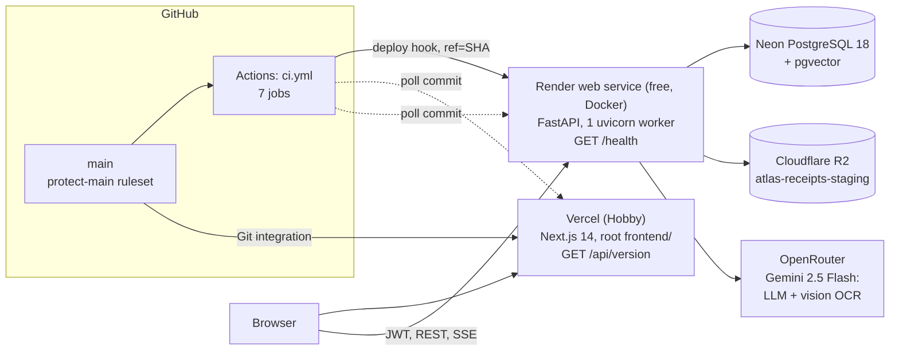
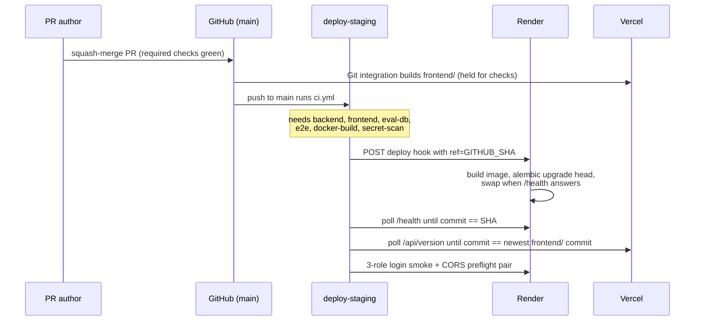

# Deployment

How the staging environment is built, how a merge reaches it, how CI proves the right release
is live, and where to look when something goes wrong. For engineers inspecting the release
path and for anyone operating the demo.

**In one screen:** the Next.js frontend runs on Vercel, the FastAPI backend runs as a Docker web
service on Render, data lives in Neon PostgreSQL 18 with pgvector, receipt images in Cloudflare
R2, and the LLM and vision OCR are Gemini 2.5 Flash through OpenRouter. Only CI deploys the
backend, pinned to the commit that passed every check; CI then waits until both services report
that commit before running a login and CORS smoke test. Migrations run at container boot.
Rollback is documented and was drilled (Render 77 s, Vercel 32 s).

| | |
|---|---|
| Frontend | https://atlas-concur-ai.vercel.app |
| Backend health | https://atlas-backend-tsf8.onrender.com/health |
| Variable map by platform | [`docs/staging_env_map.md`](../staging_env_map.md) |
| Variable reference | [configuration.md](configuration.md) |

---

## Contents

- [Staging topology](#staging-topology)
- [The CI/CD pipeline](#the-cicd-pipeline)
- [Commit verification](#commit-verification)
- [Branch protection](#branch-protection)
- [Where secrets live](#where-secrets-live)
- [Migrations and boot steps](#migrations-and-boot-steps)
- [Cold starts](#cold-starts)
- [Demo protections on staging](#demo-protections-on-staging)
- [Rollback and runbooks](#rollback-and-runbooks)

---

## Staging topology



| Component | Platform | How it is configured |
|---|---|---|
| Frontend | Vercel, Git-connected, production branch `main`, Root Directory `frontend` | `frontend/vercel.json` sets the framework and `ignoreCommand: git diff HEAD^ HEAD --quiet -- .`, so a merge that does not touch `frontend/` skips the build. `NEXT_PUBLIC_API_BASE_URL` is inlined at **build** time. Promotion to production waits for the CI Deployment Checks |
| Backend | Render web service from `render.yaml`: `runtime: docker`, `docker/Dockerfile.backend`, plan `free`, region `oregon`, `healthCheckPath: /health`, `autoDeploy: false` | The image runs as a non-root user; the entrypoint migrates and runs boot steps, then `uvicorn ... --workers 1` on port 8000 (`PORT=8000` tells Render's proxy) |
| Database | Neon PostgreSQL 18 with pgvector, branch `production` | Migration `0001` creates the `pgcrypto` and `vector` extensions, so there is no manual setup step. Point-in-time restore is the data safety net |
| Object storage | Cloudflare R2, bucket `atlas-receipts-staging` | `STORAGE_PROVIDER=minio` (the S3-compatible adapter; there is no `s3` value), `STORAGE_REGION=auto`, path-style on, a bucket-scoped Object Read & Write token |
| LLM and OCR | OpenRouter → `google/gemini-2.5-flash`, fallback `google/gemini-2.5-flash-lite`, `LLM_THINKING_BUDGET=0` | `OCR_PROVIDER=openrouter` reuses the LLM key and base URL, so vision OCR needs no extra secret |
| Embeddings and rerank | Local implementations | Staging runs `EMBEDDINGS_PROVIDER=local` and the default local reranker to keep cost at zero; the keyed RAG numbers come from offline evaluation, not from this deployment |

Preview deployments on Vercel are UI-only: `CORS_ALLOWED_ORIGINS` allows only the production
origin, so a preview's API calls are refused (a known, accepted limit).

---

## The CI/CD pipeline

The full job graph and what each job checks are in
[TESTING.md](../quality/TESTING.md#ci-job-graph). The release part:



What `deploy-staging` does, step by step (`.github/workflows/ci.yml`):

1. **Runs only on a push to `main`**, after all six other jobs pass. `concurrency: deploy-staging`
   with `cancel-in-progress: false` queues deploys so they never overlap; `permissions:
   contents: read`; job timeout 40 minutes.
2. **Works out which frontend commit should be live**: `git log -1 --format=%H HEAD -- frontend/`
   on a full-history checkout. If this merge did not change `frontend/`, Vercel skipped the build
   and the expected frontend commit is the older one.
3. **Triggers the Render deploy hook with `ref=<GITHUB_SHA>`** appended. Only the HTTP status is
   printed, never the URL. Pinning the ref means a newer, untested head of `main` can never be
   deployed by an older run.
4. **Waits for the backend** to report `GITHUB_SHA` on `/health`, then for the frontend to report
   the expected commit on `/api/version`, each with a 900 s budget.
5. **Checks the frontend domain** answers 200 or 307.
6. **Logs in as employee, manager and finance** through `/api/v1/auth/login` and requires an
   access token for each (password from the `STAGING_DEMO_PASSWORD` secret, masked; if the secret
   is unset it falls back to the published demo value with a warning). Each role gets up to four
   attempts: a 5xx, a timeout or a non-JSON body is retried, a 4xx fails immediately. The
   response body is never printed.
7. **CORS preflight pair:** the production origin must get 200 with a matching
   `Access-Control-Allow-Origin`, and `https://not-atlas.invalid` must get 400.

The design decision and the alternatives are in
[ADR 0005](../adr/0005-commit-pinned-deploy-verification.md); the build history is in
[`phase_8_p8_t4_cicd_pipeline.md`](../phase_logs/phase_8_p8_t4_cicd_pipeline.md).

---

## Commit verification

A liveness check during a deploy is a false green: the old release keeps answering while the
new one builds. Before this was fixed, run #112 passed its health poll in 54 s while Render's
build of that commit took 1 m 37 s. So each service reports the commit it was built from:

| Service | Endpoint | Source of `commit` |
|---|---|---|
| Backend | `GET /health` → `{"status","app","env","version","commit"}` | Setting `APP_COMMIT_SHA`, which also accepts Render's runtime `RENDER_GIT_COMMIT`; `local` elsewhere |
| Frontend | `GET /api/version` → `{"commit"}` (`frontend/app/api/version/route.ts`, `force-static`) | Vercel's build-time `VERCEL_GIT_COMMIT_SHA`; `local` elsewhere |

`scripts/ci/wait_for_commit.sh <url> <expected-sha> <budget-seconds>` polls the endpoint every
`WAIT_INTERVAL_SECONDS` (default 15) until `commit` equals the expected SHA. It exits 0 when
live; on timeout it exits 1 and names the SHA it actually saw (`none` = no commit field,
`unreachable` = no JSON answer). It prints only the URL, the SHAs and elapsed time. You can run
it by hand:

```bash
scripts/ci/wait_for_commit.sh https://atlas-backend-tsf8.onrender.com/health "$(git rev-parse origin/main)" 300
curl -s https://atlas-concur-ai.vercel.app/api/version
```

Because the container runs `alembic upgrade head` under `set -e` before starting the API, a
failed migration stops the new container, Render keeps serving the old release, and the wait
times out naming the old SHA. **The new SHA on `/health` is therefore also proof that the
migration succeeded.** The services report their own commit so that CI needs no Render API key
and no database credentials.

Measured on the P8-T4 merge (`d468dda`, run #114): the hook returned 200, `/health` reported the
new SHA after 61 s, and the job finished in 1 m 15 s.

---

## Branch protection

- A GitHub ruleset, `protect-main`, requires a pull request, blocks force pushes, and requires
  the checks `backend`, `frontend`, `eval-db`, `e2e` and `docker-build`. Merges are squash merges.
- Vercel's Deployment Checks hold the frontend's production promotion until the same five checks
  pass.
- `secret-scan` gates the deploy through `needs:`. Adding it to the merge checks is an optional
  item on the [public demo checklist](../runbooks/public-demo-checklist.md).
- The check names are the job IDs in `ci.yml`. Renaming a job means updating the ruleset and the
  Vercel checks in the same change.

---

## Where secrets live

Names only. No value is committed anywhere; `scripts/ops/secret_scan.py` scans the tree and the
full git history in CI, and `scripts/ops/env_audit.py` fails CI if `render.yaml` sets a
secret-like key with a literal `value:`.

| Store | Names | Notes |
|---|---|---|
| **GitHub Actions secrets** | `RENDER_DEPLOY_HOOK_URL`, `STAGING_BACKEND_URL`, `STAGING_FRONTEND_URL`, optionally `STAGING_DEMO_PASSWORD` | The hook URL can trigger a deploy, so it is secret-grade. The two URLs are public but kept as secrets so the workflow is environment-agnostic. No Render API key and no database URL in GitHub |
| **Render** (`sync: false` in `render.yaml`) | `JWT_SECRET`, `DATABASE_URL`, `LLM_API_KEY`, `STORAGE_ENDPOINT_URL`, `STORAGE_ACCESS_KEY_ID`, `STORAGE_SECRET_ACCESS_KEY`, `CORS_ALLOWED_ORIGINS` | Set in the dashboard. `CORS_ALLOWED_ORIGINS` is not sensitive, only environment-specific. `REDIS_URL` would join this list if the shared rate-limit store is switched on |
| **Render** (`value:` in `render.yaml`) | `APP_ENV=staging`, `APP_DEBUG=false`, provider choices, model names, bucket, `TRUSTED_PROXY_COUNT=1`, `APP_BASE_URL`, `SEED_ON_STARTUP=policy_corpus` | Non-secret literals, reviewed in PRs |
| **Vercel** | `NEXT_PUBLIC_API_BASE_URL` | A public URL (with the `/api/v1` suffix), stored as type Config so it can be audited |

The rotation order and verification for each secret are in the
[key rotation runbook](../runbooks/key-rotation.md). Saving a changed Render variable normally
restarts the service with the new value (no rebuild); changing `NEXT_PUBLIC_API_BASE_URL` needs a
Vercel rebuild because it is inlined at build time.

---

## Migrations and boot steps

`docker/entrypoints/backend-entrypoint.sh` runs before uvicorn on every container start:

1. `alembic upgrade head` (fatal on failure). The history is linear (25 revisions), CI's
   `backend` job fails if there is ever more than one head, and later migrations are additive.
2. On staging `SEED_ON_STARTUP=policy_corpus`, which does **not** run the demo seed. It runs:

| Step | Module | On failure |
|---|---|---|
| Reindex the policy RAG corpus | `database.seeds.reindex_policy_corpus` | Stops the boot (previous deploy keeps serving) |
| Top up the demo card feed | `database.seeds.topup_demo_card_feed` | Stops the boot |
| Open approvals for stranded submissions | `database.seeds.backfill_submitted_approvals` | Warns and continues; re-runs next boot |
| Route approvals that name an approver grade | `database.seeds.backfill_grade_routing` | Warns and continues |
| Refresh draft reports' pre-submit flags | `database.seeds.refresh_draft_presubmit_flags` | Warns and continues |
| Set demo accounts' grades where none is recorded | `database.seeds.seed_demo_grades` | Warns and continues |
| Complete approved trips that have ended (`ELAPSED_TRIP_SWEEP`) | `database.seeds.complete_elapsed_trips` | Warns and continues ([runbook](../runbooks/elapsed-trip-sweep.md)) |
| Optional test-data cleanup (`TEST_DATA_CLEANUP=off\|dry-run\|apply`) | `database.seeds.cleanup_test_data` | Warns and continues ([runbook](../runbooks/staging-test-data-cleanup.md)) |

The split is deliberate: steps that repair derived or pending state must never block a deploy
because of one bad legacy row, while a failed migration or reindex must.

**Rules for migrations** (from the [rollback runbook](../runbooks/rollback.md)): forward-only on
release, expand then contract (a release may add columns, tables or indexes, never drop or rename
something the previous release reads), and never `alembic downgrade` against staging. Render
migrates from the new container while the old release still serves traffic, so expand-only
changes keep the old release working during the swap. The Neon database was first seeded
out-of-band by running the image once with `SEED_ON_STARTUP=true` against it
([`docs/staging_env_map.md`](../staging_env_map.md#database-seeding-out-of-band--render-free-tier-has-no-shell)).

---

## Cold starts

Render's free plan sleeps the backend after about 15 minutes idle. The next request restarts the
container, which re-runs the migration check and the boot steps above, so the first request can
take two to three minutes (measured 100–152 s). The login page detects the slow
response and tells the user the server is waking up. A slow first answer is not a reason to roll
back. The CI wait budget (900 s per service) is sized well above this.

---

## Demo protections on staging

The live demo shares well-known accounts, so staging turns on protections that are off by
default in code and set in the Render dashboard rather than in `render.yaml`:

- `DEMO_MODE=true`: the five seeded `@atlas-demo.internal` accounts cannot be edited or
  deactivated, seeded policy rules cannot be archived, and the app shows a demo banner.
- A scheduled reset of the demo organisation, due daily at 04:00 UTC (a missed slot while the
  free instance sleeps runs once on the next wake)
  (`DEMO_RESET_SCHEDULE=interval`, `DEMO_RESET_AT_UTC_HOUR`, plus `DEMO_RESET_ENABLED=true` in the
  process environment). See the [demo reset runbook](../runbooks/demo-reset.md).
- Rate limiting is on by code default with `TRUSTED_PROXY_COUNT=1` for Render's single proxy hop
  (verified against live traffic on 2026-11-17). Counters are in memory, which is correct for one
  worker on one instance; the [Redis runbook](../runbooks/rate-limit-redis.md) covers scaling out.
- `APP_ENV=staging` logs a warning for each unsafe value (for example the published demo password,
  kept on purpose for the public demo), where `APP_ENV=production` would refuse to start. See the
  [configuration reference](configuration.md#startup-validation).

The go-live list, with what was verified on the live service, is the
[public demo checklist](../runbooks/public-demo-checklist.md).

---

## Rollback and runbooks

| Runbook | When |
|---|---|
| [Rollback](../runbooks/rollback.md) | A deploy broke staging. Vercel Instant Rollback (~1 minute), Render rollback (~1–2 minutes), Neon restore for data only. Drilled 2026-11-07: Render 77 s, Vercel 32 s. A Render rollback cannot cross a migration: roll forward instead |
| [Key rotation](../runbooks/key-rotation.md) | Rotating any secret above, in a safe order, verified without printing values |
| [Demo reset](../runbooks/demo-reset.md) | Restore "Atlas Demo Corp" to the seed baseline, by hand (dry run first) or on the schedule |
| [Elapsed-trip sweep](../runbooks/elapsed-trip-sweep.md) | Preview (`dry-run`), run or disable the boot-time completion of ended trips |
| [Shared rate-limit store (Redis)](../runbooks/rate-limit-redis.md) | Move limiter counters to Redis before adding a worker or instance |
| [Staging test-data cleanup](../runbooks/staging-test-data-cleanup.md) | Remove old acceptance-round records, Neon backup branch first |
| [Public demo checklist](../runbooks/public-demo-checklist.md) | Owner go-live list for the public demo |

After any rollback, finish by undoing a Vercel rollback (it disables automatic promotion until
undone) and reverting the bad change on `main` through a PR, so `main` and staging agree again.
