# How SAP Concur works: a domain study

Before building Atlas I studied how corporate travel and expense (T&E) software works, using SAP Concur as the reference product. This page is that study, limited to facts that can be checked in public sources (listed at the end). It is for readers who want the domain background behind Atlas's design. It describes products from the outside and makes no claims about how SAP builds them.

> [!IMPORTANT]
> Atlas is an independent engineering study inspired by SAP Concur. It is not affiliated with, authorized by, sponsored by, or endorsed by SAP SE or its affiliates. SAP and SAP Concur are trademarks or registered trademarks of SAP SE in Germany and other countries. All data in this project is synthetic.

**Related:** [concur-to-atlas-map.md](concur-to-atlas-map.md) (concept-by-concept mapping into Atlas code) · [PRD.md](PRD.md) (the product spec this study fed) · [requirements-traceability.md](requirements-traceability.md) (what shipped)

Product names, dates and availability below are as the companies announced them at the time cited. Announced roadmaps change, so treat dates as "as announced", not as current status.

---

## 1. What T&E management is

Travel and expense management covers the spend that employees start themselves: booking a trip, paying for a hotel or a meal with a corporate or personal card, and claiming it back. A T&E system has two jobs at once:

- **System of record:** it captures what was booked and spent, with the evidence (receipts, card charges, itineraries), so finance can account for it.
- **System of control:** it applies the company's travel and expense policy (which cabin class, what hotel cap, which meals are reimbursable), routes claims to approvers, and keeps an audit trail.

The interesting engineering lives where those two jobs meet: every spend event has to be captured with as little typing as possible *and* checked against policy before money moves.

## 2. The business problems

| Problem | Why it hurts | What a T&E system does about it |
|---|---|---|
| Late visibility of spend | Finance sees travel spend only when expense reports arrive, often weeks after the trip | Capture spend at the source: the booking, the card charge, the receipt |
| Manual expense reports | Re-keying receipts is slow and error-prone; it is one of the most disliked admin tasks | Receipt capture, card feeds and matching so the report is mostly pre-filled |
| Policy violations found late | A violation found after reimbursement is expensive to unwind | Check policy at booking time and before submission ("shift left") |
| Disconnected tools | Booking, card data, receipts and reports live in different places | One connected flow from trip to report to payment |
| OCR that gives up | When a receipt is missing a field, the work goes back to the user | Infer the missing field from context (trip, calendar), then let the user confirm |

## 3. The SAP Concur product family

SAP Concur (formerly Concur Technologies) was founded in 1993 and is headquartered in Bellevue, Washington. SAP announced its agreement to acquire Concur on September 18, 2014, at about US$8.3 billion in enterprise value; at the time the release described Concur as "the leader in the multi-billion market for travel and expense (T&E) management software", with more than 23,000 customers and 25 million active users. The acquisition was completed on December 4, 2014.

The public product catalogue groups the products roughly like this (descriptions quoted from concur.com):

| Product | What it is for (as described publicly) |
|---|---|
| **Concur Travel** | "Book within policy, provide better duty of care, and integrate with Concur Expense for even greater cost control." |
| **Concur Request** | Pre-trip requests and approvals: "Simplify and speed up requests and approvals, drive policy compliance, and take control of company spend." |
| **Concur Expense** | "See expense data in one place and manage spending anywhere, anytime." |
| **ExpenseIt** | Receipt capture: "Snap pics of receipts on-the-go, match receipts to card charges, and reimburse employees faster." |
| **Concur Invoice** | Accounts payable: "Eliminate manual tasks and increase spending visibility with automated AP." |
| **Concur TripLink / TripIt Pro** | Bringing bookings made outside the managed tool "back into your managed-travel program", and itinerary management for travelers |
| **Intelligent Audit** | Expense audits performed by an audit team: "Let our global team of auditors handle expense audits" |
| **Analytics / Intelligence / Budget** | Consolidated, near-real-time spend reporting, dashboards and budget views |

The recurring theme: each product is useful alone, but the value is in the connections. A booked trip makes the later expense report easier to fill in and easier to check.

## 4. The core loop: travel → expense → approval → reimbursement → audit

This is the generic lifecycle a T&E suite manages. Atlas implements a simplified version of it: a trip is approved after options are selected rather than through a separate pre-trip request, and inventory and payments are simulated.

```mermaid
flowchart LR
  REQ["Pre-trip request<br/>(estimate + approval)"] --> BOOK["Book travel<br/>policy checked at search time"]
  BOOK --> TRIP["Trip / itinerary<br/>becomes context"]
  TRIP --> CAP["Capture spend<br/>receipts, card feed, e-receipts"]
  CAP --> MATCH["Match + categorise<br/>charge ↔ receipt ↔ trip"]
  MATCH --> RPT["Expense report<br/>pre-submit policy check"]
  RPT --> APR["Approval<br/>manager, exceptions surfaced"]
  APR --> AUD["Audit<br/>rules, receipts, sampling"]
  AUD --> PAY["Reimbursement<br/>and posting to accounting"]
  PAY --> ANA["Analytics<br/>spend, compliance, budget"]
```

| Stage | What happens | Key idea |
|---|---|---|
| Request | The employee estimates a trip and gets it approved before booking | Control before commitment |
| Book | Options are labelled in or out of policy as the traveler shops | Prevent the violation instead of catching it later |
| Itinerary | The booked trip is stored | The trip is context for every later step |
| Capture | Receipts are photographed or forwarded; card charges arrive from the card feed | Capture at the source, not from memory |
| Match and categorise | A charge, its receipt and the trip segment are linked; lines get expense types; a hotel folio can be itemised | Reconciliation is a record-linkage problem |
| Report and pre-submit check | Entries are assembled into a report and checked against policy before submission | Fewer returned reports |
| Approve | The manager sees exceptions and the policy reason; routine items move quickly | Humans on the loop for exceptions |
| Audit | Reports are checked against rules and receipts | Audit risk and fraud control |
| Reimburse and post | Approved amounts are paid and posted to the accounting system | Cycle time is a key metric |
| Analyse | Spend, compliance and budget are reported | The data improves policy and supplier negotiations |

## 5. Policy and compliance concepts

These are general T&E concepts, not a description of any vendor's rule engine.

| Concept | Meaning |
|---|---|
| **Travel policy** | Company rules for booking: cabin class by flight length, preferred carriers and hotels, nightly hotel caps by city tier, advance-booking windows |
| **Expense policy** | Rules for claims: per-diem meal limits, receipt thresholds, non-reimbursable items, mileage rates, submission deadlines |
| **Point-of-sale enforcement** | Options are tagged in or out of policy while booking; an out-of-policy choice may need a justification or extra approval |
| **Audit rules** | Configurable checks that flag over-limit amounts, missing receipts, disallowed categories and duplicates |
| **Justification** | A written reason the employee attaches to an exception, which the approver then reviews |
| **Pre-trip approval** | Approval of an estimated trip before it is booked |
| **Segregation of duties** | Nobody approves or pays their own claim |
| **Audit trail** | A record of who changed what, when, and why |

The direction across the category is to **shift enforcement left**: check policy at booking and before submission, not after reimbursement.

## 6. Receipt capture: from OCR to agents

Receipt capture is the clearest public example of how AI in T&E has changed.

1. **Classic OCR and extraction.** Text is lifted from the receipt image and fields (amount, date, vendor, expense type) are predicted, with the user correcting mistakes inline.
2. **Agentic gap-filling.** In April 2026 Google Cloud published an account of SAP Concur's **Receipt Analysis Agent** in ExpenseIt. As described there:
   - a **deterministic OCR core** lifts the visible text with high precision;
   - a **routing layer** sends clean receipts down the standard path and sends ambiguous ones (for example "missing location") to the agent, so not every receipt goes through an LLM;
   - the agent, built on Gemini models, receives the partial receipt **with grounding data such as the user's travel itinerary and business calendar**, and uses tools to fetch that context rather than guess;
   - a **reflection** (generator–critic) step checks a hypothesis against known facts. The article's example: a café lunch receipt with no address, which a naive reading might place in Paris, France, is resolved to Paris, Texas because the itinerary puts the traveler in Texas.
3. **What SAP Concur's own blog says the agent does:** infers missing receipt details such as vendor or expense type, uses user history to improve expense-type predictions, and calculates totals from line items when needed.

The pattern worth learning from is **deterministic core + routed agent + grounding + reflection**: cheap and predictable for the common case, with reasoning used only where it adds value and checked before it is trusted.

## 7. SAP's announced AI direction (high level)

| When (announced) | What was announced |
|---|---|
| Sept 2023 | **Joule**, which SAP describes as "a natural-language, generative AI copilot" for its business applications |
| Oct 2025 | Joule agents for SAP Concur: a **Booking Agent** in Concur Travel (conversational, policy-compliant trip planning with pricing and spend estimates; described as available), a **Receipt Analysis Agent** in ExpenseIt (rolling out through end of 2025), and a planned **Meeting Planning Agent** and **Expense Report Validation Agent** (early 2026) |
| Oct 2025 | A strategic alliance with American Express Global Business Travel (Amex GBT) and a co-developed product, **Complete**, combining booking, servicing, payments and expensing, plus an integration of Concur Expense with Amex GBT's Egencia |
| Mar 2026 (Fusion 2026) | Two more Joule agents in early-adopter programmes: an **Expense Automation Agent** (creates the expense report as a "virtual delegate") and an **Expense Pre-Submit Audit Agent** (flags receipt discrepancies before submission); Concur tasks inside **Microsoft 365 Copilot** (described as available); **AI-based rule creation** for admins from natural language (from Q2 2026) and later from uploaded policy documents; real-time expense creation from **Visa** card swipes (planned for an early-adopter programme, Q3 2026) |

The common thread: from an assistant that answers questions to agents that act, with policy and grounding built in, and with the T&E workflow reachable from the tools people already use.

## 8. Competitive landscape

The category has converged: travel-first suites added expense, and card-first spend platforms added travel and AI. Descriptions below are each company's own public positioning, summarised neutrally.

| Company | Public positioning (summarised) | Dated, public event |
|---|---|---|
| **Navan** | "The AI-powered business travel and expense platform": booking, company cards, expenses and reimbursements in one app | Listed on Nasdaq (NAVN), October 2025 |
| **Expensify** | An all-in-one expense management platform: receipt scanning, expense tracking, its own card and travel, with an AI assistant (Concierge) | |
| **Ramp** | A finance platform with corporate cards, expense tracking, bill payments and banking, positioned around AI agents | |
| **Brex** | Corporate cards, expense management, travel, bill pay and banking | Capital One agreed to acquire Brex, announced January 22, 2026 |
| **Emburse** | One platform for travel, expense, accounts payable, payments and cards | |
| **Perk** (formerly TravelPerk) | Travel and spend management in one AI-native platform | Rebranded from TravelPerk, November 2025 |
| **Amex GBT / Egencia** | A travel management company with its own booking tool (Egencia) | Partner of SAP Concur through Complete (October 2025) |

Shared themes I took from the landscape:

- Intelligent receipt capture is table stakes; the difference is what happens when a field is missing.
- Conversational assistants are moving from answering to doing.
- Card-linked, real-time expense creation shortens the gap between spend and visibility.
- Policy checks are moving earlier in the flow.

## 9. Engineering lessons I took from the domain

These are my own conclusions from the public material, not statements about how any vendor is built.

- **Deterministic first.** Rules, matching and OCR handle the common case predictably and cheaply; an LLM is a routed exception.
- **Grounding beats guessing.** The trip and the calendar are the best evidence for a missing receipt field; the policy text is the best evidence for a policy answer.
- **Reflection before commit.** A critic step that checks a hypothesis against known facts catches the "Paris, France vs Paris, Texas" class of error.
- **Policy as data.** Structured rules with clause references can be enforced, cited, audited and authored with AI help.
- **Humans on the loop.** Auto-approve the clearly low-risk; route everything else to a person with the reason attached.
- **Auditability is a feature.** Every state change and every AI decision should be explainable after the fact.

## 10. What this study shaped in Atlas

Each point links to the matching row in [concur-to-atlas-map.md](concur-to-atlas-map.md).

- **One connected loop.** Atlas joins plan (simulated booking) → capture → assemble → approve → reimburse → audit around one trip record ([map: travel booking, expense report, reimbursement](concur-to-atlas-map.md#concept-map)).
- **Policy checked at booking and before submission.** The planner labels every option in or out of policy, and the pre-submit check blocks or flags lines with the clause that applies ([map: travel policy, expense audit](concur-to-atlas-map.md#concept-map)).
- **Receipt pipeline modelled on the public agent pattern.** Deterministic OCR, per-field confidence routing at 0.70, gap-fill grounded in the itinerary and calendar, a reflection check, and per-field provenance ([map: receipt capture](concur-to-atlas-map.md#concept-map)).
- **Card feed and smart matching.** Simulated card transactions are matched to receipts and trip segments, with duplicates collapsed ([map: card feed reconciliation](concur-to-atlas-map.md#concept-map)).
- **A deterministic, LLM-free approval agent.** Low-risk, in-policy trips and reports up to $500 are auto-approved; everything else goes to a human with the reason ([map: approval workflow](concur-to-atlas-map.md#concept-map)).
- **Grounded policy Q&A and AI-assisted rule authoring.** Answers cite the retrieved clause or abstain; rules drafted from plain language stay drafts until a human activates them ([map: conversational assistant, policy authoring](concur-to-atlas-map.md#concept-map)).
- **Audit trail and decision log.** Every business event is audited and every AI decision writes one log row ([map: audit trail](concur-to-atlas-map.md#concept-map)).
- **Deliberate simplifications.** Mock inventory, simulated card data and reimbursement, static FX rates, no ERP or invoice pillar ([map: what Atlas does not model](concur-to-atlas-map.md#what-atlas-does-not-model)).

---

## Sources

Company and product sources:

- SAP Concur products: <https://www.concur.com/products>
- SAP Concur blog, "Joule Agents: Bringing the Future of T&E to SAP Concur Users" (Oct 20, 2025): <https://www.concur.com/blog/article/joule-agents-bringing-future-te-to-sap-concur-users>
- SAP Concur company news, Fusion 2026 announcements (Mar 17, 2026): <https://www.concur.com/blog/article/sap-showcases-new-ai-integrated-travel-and-expense-enhancements-and-global>
- SAP Concur company news, SAP Concur and Amex GBT strategic alliance (Oct 3, 2025): <https://www.concur.com/blog/article/new-era-for-business-travel-and-expense-sap-concur-and-amex-gbt-establish-strategic>
- SAP News Center, "SAP Announces New Generative AI Assistant Joule" (Sept 26, 2023): <https://news.sap.com/greece/2023/09/sap-announces-new-generative-ai-assistant-joule/>
- Google Cloud Blog, "How SAP Concur automates expense reporting with agentic AI" (Apr 10, 2026): <https://cloud.google.com/blog/products/ai-machine-learning/how-sap-concur-automates-expense-reporting-with-agentic-ai>

Corporate history:

- SAP / Concur joint press release, Sept 18, 2014 (SEC Form 6-K, Exhibit 99.1): <https://www.sec.gov/Archives/edgar/data/1000184/000119312514345861/d791851dex991.htm>
- SAP Form 20-F for fiscal year 2014 (acquisition date): <https://www.sec.gov/Archives/edgar/data/0001000184/000119312515099258/d875102d20f.htm>
- Wikipedia, "SAP Concur" (founding year, founders, headquarters, completion date): <https://en.wikipedia.org/wiki/SAP_Concur>

Competitive landscape:

- Navan: <https://navan.com/>; IPO coverage, PhocusWire: <https://www.phocuswire.com/navan-travel-and-expense-management-ipo-nasdaq-listing>
- Expensify: <https://www.expensify.com/>
- Ramp: <https://ramp.com/>
- Brex: <https://www.brex.com/>; acquisition coverage, Bloomberg Law: <https://news.bloomberglaw.com/banking-law/capital-one-to-buy-fintech-brex-for-5-1-billion-in-cash-stock>
- Emburse: <https://www.emburse.com/>
- Perk rebrand press release: <https://www.perk.com/press-release/travelperk-rebrands-to-perk-the-intelligent-platform-powering-real-work/>

Sources were checked in November 2026. Product availability statements are as announced on the dates shown.
