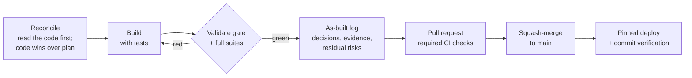

# Delivery process

How Atlas was planned, built, verified and released: the phased plan, the gate every task had
to pass, the logs that record each decision, and the release path from pull request to a
verified staging deploy. For reviewers who want to see how the work was run, not only what it
produced.

**In one screen:** the build followed a written plan of numbered tasks (for example `P2-T3`),
each with an explicit **Validate** gate. Every task or track ended with an as-built phase log
recording what was built, the decisions, the verification evidence and the residual risks.
Since PR #1 (November 2026), every change reaches `main` through a pull request with required CI checks, and
CI deploys staging pinned to the tested commit, then waits until both services report that
commit. Rollback was drilled on 2026-11-07: Render in 77 s, Vercel in 32 s.

---

## Contents

- [The plan and its structure](#the-plan-and-its-structure)
- [Timeline](#timeline)
- [The per-task loop](#the-per-task-loop)
- [The Validate gate](#the-validate-gate)
- [As-built phase logs: the decision record](#as-built-phase-logs-the-decision-record)
- [Architecture decision records](#architecture-decision-records)
- [Branches, pull requests and required checks](#branches-pull-requests-and-required-checks)
- [Release: commit-pinned deploy and verification](#release-commit-pinned-deploy-and-verification)
- [Rollback, drilled](#rollback-drilled)
- [Runbooks](#runbooks)
- [Known-limitations register](#known-limitations-register)

---

## The plan and its structure

Before writing code I wrote six design documents: a product requirements document, a
technical design, a database schema, a UI/UX specification, a domain research note, and a
master execution plan. The public
versions are in [`docs/product/PRD.md`](../product/PRD.md),
[`docs/design/technical-design.md`](../design/technical-design.md),
[`docs/design/database-schema.md`](../design/database-schema.md) and
[`docs/design/ui-ux.md`](../design/ui-ux.md); the
[requirements traceability](../product/requirements-traceability.md) document follows
requirement IDs into the build.

The execution plan broke the build into phases, and each phase into atomic tasks with IDs:

- **Task IDs:** `P<phase>-T<task>`, for example `P4-T6` (grounded retrieval flow). Requirement
  IDs (`FR-T1`, `NFR-SEC4`, `US-M3`) and table names reference the design docs, so the build
  stays traceable to them.
- **Every task:** Objective, then sub-steps, then a **Validate** gate.
- **Every phase:** done only when its **Definition of Done** and its **Checkpoint** pass. A
  phase does not start until the previous checkpoint is green.

Work after the original eight phases kept the same shape under new prefixes:

| Prefix | Meaning | Example |
|---|---|---|
| `P1`–`P8` | Original plan: bootstrap, core backend, database, AI system, frontend, integration, testing, deployment | `P7-T2` API contract tests |
| `R0`–`R6` | RAG engine plan (multi-document retrieval, rerank, calibration, grounded generation, evaluation) | `R3-T1` calibrated abstention threshold |
| `C1`–`C7` | Completion items after staging went live, ending with a staging acceptance run | `C7-10` policy Q&A retrieval defect |
| UAT rounds | Two user-acceptance retest rounds on staging | PR #10 |
| Phases 9–12 | Product gaps, known limits, public-demo security, follow-ups; built as parallel tracks on separate branches, then integrated | `pg/lifecycle`, `kl/grade`, `ps/ratelimit`, `fu/accounts` |

---

## Timeline

Dates come from the commit history and the phase logs.

| When (2026) | Work | Evidence |
|---|---|---|
| May 31 – Jun 7 | **Phase 1** bootstrap: monorepo, FastAPI and Next.js skeletons, Docker datastores, hermetic CI | `Phase1_P1-T*.md` |
| Jun 7 – Jun 12 | **Phase 2** core backend (sessions, error contract, auth, RBAC and record scoping, users, trips, expenses) and **Phase 3** database (models, migrations 0004–0006, indexes, integrity rules, seed) | `P2-T*.md`, `P3-T*.md` |
| Jun 13 – Jun 14 | **Phase 4** AI system: provider adapters, decision logging, reflection critic, tool layer, RAG, orchestrator, four agents, assistant endpoints | `P4-T*.md` |
| Jun 14 – Jun 17 | **Phase 5** frontend (design system through the assistant slide-out) and **Phase 6** integration (live APIs, agent delegation, scoping, degradation) | `Phase5_*`, `P5-T*`, `Phase6_*` |
| Jun 19 – Jun 20 | **Phase 7** testing: shared test infrastructure, unit, API contract, AI-eval harness, Playwright e2e | `P7-*.md` |
| Jun 23 – Jun 24 | **Phase 8** P8-T1 to P8-T4: production images, cloud topology, environment map, first CI deploy job | `phase_8_p8_t*.md` |
| Jun 26 – Jul 7 | **RAG R0–R6**: corpus and baseline, hybrid + RRF, cross-encoder, calibration, contextual retrieval, HyDE and citation enforcement, hardening, the R6 gate and judge fix, documentation | `R*-*.md` |
| Oct 29 – Nov 7 | P8-T3 environment audit and dashboard verification (PRs #1–#3); **P8-T4** commit-verified CI/CD and the rollback drill (PRs #4–#5) | `phase_8_p8_t3_*.md`, `phase_8_p8_t4_cicd_pipeline.md` |
| Nov 8 – Nov 14 | **Completion C1–C7** (PRs #6–#9) and **UAT rounds 1–2** (PR #10) | `phase_8_completion_*.md` |
| Nov 14 – Nov 15 | **Phases 9–11**: product gaps, known limits, public-demo security, merged together in PR #11; rate-limit and ops hardening (PRs #12, #13) | `phase_9_*`, `phase_10_*`, `phase_11_*` |
| Nov 15 – Nov 17 | **Phase 12** follow-ups (PR #14); README and visuals (PR #15) | `phase_12_*` |

The full index of logs is in [`docs/phase_logs/README.md`](../phase_logs/README.md).

---

## The per-task loop

1. **Reconcile.** Before building, read the current code against the task. Where the plan and
   the code disagree, the code wins and the deviation is written down. Several logs open with
   a "Reconcile findings" section for this reason, for example
   [`R3-T3_T5_asbuilt.md`](../phase_logs/R3-T3_T5_asbuilt.md) found that a planned bug fix had
   already landed.
2. **Build with tests.** Regression tests for a defect are shown to fail on the old code
   before the fix (by reverting the fix or mutating the guard), so a passing test means
   something. The phase 11 and 12 logs record these mutation checks per item.
3. **Validate gate**, below.
4. **Write the as-built log**, below.
5. **Review.** Larger changes had an adversarial review pass before the PR: each finding was
   checked, then fixed or rejected with the reason recorded (see the "Independent review"
   section of [`phase_8_p8_t4_cicd_pipeline.md`](../phase_logs/phase_8_p8_t4_cicd_pipeline.md)).
6. **Pull request, merge, deploy**, below.

Commit messages follow one structure: a subject line, then **What was built**, **Key
decisions**, **Verification passed** (a ✔ list of the checks that ran) and, where there are
any, **QA findings**. Squash merges keep that body on `main`.

---

## The Validate gate

Each task in the plan names a concrete, checkable condition. Examples from the plan and logs:

| Task | Validate gate |
|---|---|
| P1-T2 backend skeleton | Server boots; `/health` returns OK; a missing required variable gives a clear startup error |
| P1-T5 tooling and CI | CI passes green on the empty skeleton |
| P2-T2 cross-cutting core | A forced error returns the standard envelope with a correlation ID; an audited test action writes exactly one `audit_log` row |
| P2-T4 RBAC | A protected endpoint denies an unauthorised role; a manager sees only direct reports' records in a test |
| P7-T3 AI-eval harness | M-A3 violation recall == 1.0 (hard); other floors set just below measured values |
| P8-T4 CI/CD | Seven gates (G1–G7): gates hold on a PR, a merge auto-deploys, migrations run, health and logins pass, failure is loud, rollback works, no secret in logs |

On top of the task gate, each merge ran the full suites on an isolated database and recorded
the counts: for example the phase 11 integration gate (hermetic 3739 passed, DB 1884 passed,
eval-db 48, Vitest 869) and the phase 12 gate that the README quotes (hermetic 4225, DB 2069,
eval-db 48, Vitest 968). [`TESTING.md`](TESTING.md) describes the tiers.

---

## As-built phase logs: the decision record

[`docs/phase_logs/`](../phase_logs/README.md) holds 101 logs, one per task or track. They are
written after the work, from the code, not copied from the plan. A typical log records:

- **What was built**, by file or module, and what was deliberately left out.
- **Decisions**, with the option taken and why. Where the plan's assumption was wrong, the
  log says what the code actually does.
- **Verification evidence**: the commands run, the gate results and test counts, and for
  deploy work the live checks (for example `/health` reporting the merged SHA after 61 s).
- **Residual risks and known limits** that the change did not close, which feed the
  known-limitations register below.

When logs disagree, the later integration log wins and says so (the phase 11 integration log
lists exactly which track-log statements it supersedes).

---

## Architecture decision records

Cross-cutting decisions are in [`docs/adr/`](../adr/README.md):

| ADR | Decision |
|---|---|
| [0001](../adr/0001-modular-monolith.md) | One deployable FastAPI modular monolith, not services |
| [0002](../adr/0002-provider-adapters-with-local-fallbacks.md) | Every external system behind an adapter with a deterministic local implementation |
| [0003](../adr/0003-deterministic-core-routed-agents.md) | Deterministic handlers for routine work; agents only when reasoning is needed |
| [0004](../adr/0004-llm-free-approval-agent.md) | The approval agent makes no LLM call |
| [0005](../adr/0005-commit-pinned-deploy-verification.md) | Deploy the tested commit and wait for the services to report it |

The RAG engine has its own five ADRs in [`docs/RAG/adr/`](../RAG/adr/) (hybrid retrieval, RRF,
cross-encoder reranking, confidence calibration, single audit write).

---

## Branches, pull requests and required checks

- **`main` is protected** by a GitHub ruleset (`protect-main`): a pull request is required,
  force pushes are blocked, and the CI checks `backend`, `frontend`, `eval-db`, `e2e` and
  `docker-build` must pass before merge. PRs are squash-merged.
- **Vercel Deployment Checks** hold a frontend production promotion until the same five checks
  pass. `deploy-staging` is deliberately not a check, because it runs after the merge.
- **`secret-scan`** (phase 11) blocks the deploy through `needs:`; adding it to the merge checks
  is an optional item on the [public demo checklist](../runbooks/public-demo-checklist.md).
- **Larger rounds used integration branches.** Phases 9–12 were built as parallel tracks
  (`pg/*`, `kl/*`, `ps/*`, `fu/*`), each with its own log, merged with `--no-ff` into an
  integration branch where cross-track review findings were fixed and the full gate re-run,
  then merged to `main` as one PR (PR #11 for phases 9–11, PR #14 for phase 12).
- **Job IDs are contracts.** The check names match the job IDs in `ci.yml`; renaming a job means
  updating the ruleset and the Vercel checks in the same change.

---

## Release: commit-pinned deploy and verification

A merge to `main` triggers the `deploy-staging` job. Render's own auto-deploy is off
(`autoDeploy: false` in `render.yaml`), so CI is the only path to the backend.

1. CI calls the Render deploy hook with `ref=<GITHUB_SHA>`, so Render builds exactly the
   commit the jobs tested, never a newer head of `main`.
2. `scripts/ci/wait_for_commit.sh` polls the backend's `/health` until its `commit` field
   equals that SHA. A plain liveness poll was a false green: before this change, run #112
   passed in 54 s while Render's build of that commit took 1 m 37 s.
3. It then waits for the frontend's `/api/version` to report the newest commit that touched
   `frontend/`.
4. A 3-role login smoke and a CORS preflight pair (allowed origin 200, foreign origin 400)
   complete the check.

Because the container runs `alembic upgrade head` under `set -e` before starting the API, the
new SHA appearing on `/health` is also proof that the migrations succeeded. Details:
[deployment guide](../guides/deployment.md) and
[ADR 0005](../adr/0005-commit-pinned-deploy-verification.md).

---

## Rollback, drilled

The [rollback runbook](../runbooks/rollback.md) covers Vercel Instant Rollback, Render
rollback, and Neon point-in-time restore for data. It was drilled on 2026-11-07, rolling
`d468dda` back to `06b8ba6` and forward again:

| Service | Decision → previous release serving | Roll forward |
|---|---|---|
| Backend (Render rollback) | **77 s** | 51 s |
| Frontend (Vercel Instant Rollback) | **32 s** | about 6 s (promote via Manage Rollback) |

The drilled release had no migration, so Render rollback was valid. The same P8-T4 work found
the case where it is not, and changed the runbook: a Render rollback cannot cross a migration.
The older build still runs `alembic upgrade head`, which stops with "Can't locate revision"
when the database is ahead of it, so Render keeps the current release. Releases with a
migration therefore roll forward with a fix, and migrations are written expand-then-contract
so the previous release keeps working while the new one migrates.

---

## Runbooks

| Runbook | Use it to |
|---|---|
| [Rollback](../runbooks/rollback.md) | Put staging back on a known-good release; includes the drill log |
| [Key rotation](../runbooks/key-rotation.md) | Rotate each secret in a safe order and verify without printing values |
| [Demo reset](../runbooks/demo-reset.md) | Restore the demo organisation to its seed baseline, by hand or on a schedule |
| [Elapsed-trip sweep](../runbooks/elapsed-trip-sweep.md) | Preview, run or disable the boot-time completion of ended trips |
| [Shared rate-limit store (Redis)](../runbooks/rate-limit-redis.md) | Move limiter counters to Redis, verify, roll back |
| [Staging test-data cleanup](../runbooks/staging-test-data-cleanup.md) | Remove old acceptance-round records from staging, backup branch first |
| [Public demo checklist](../runbooks/public-demo-checklist.md) | Go-live list for exposing the demo publicly, with owner verifications recorded |

---

## Known-limitations register

Limitations are written down where they are found and carried until closed:

- The README's [Known limitations & roadmap](../../README.md#known-limitations--roadmap) table
  is the current register (for example: in-memory rate limiting on staging, SMTP needed for
  real email, one deciding approver, application-level tenant isolation, no real payments).
- Each phase log ends with its residual risks; phases 10 and 12 exist largely to close items
  from earlier registers (phase 10 is named "known limits").
- Carry-forward items are re-checked against the code before being worked: the R2 checksum log
  ([`P8_r2_checksum_hardening_asbuilt.md`](../phase_logs/P8_r2_checksum_hardening_asbuilt.md))
  found that a "boto3 missing from the image" item was stale and recorded that instead of
  making a change.
